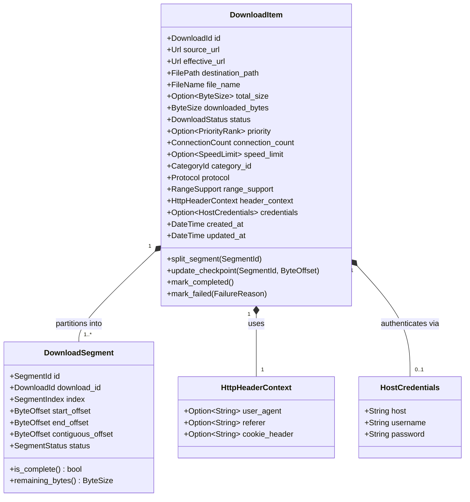
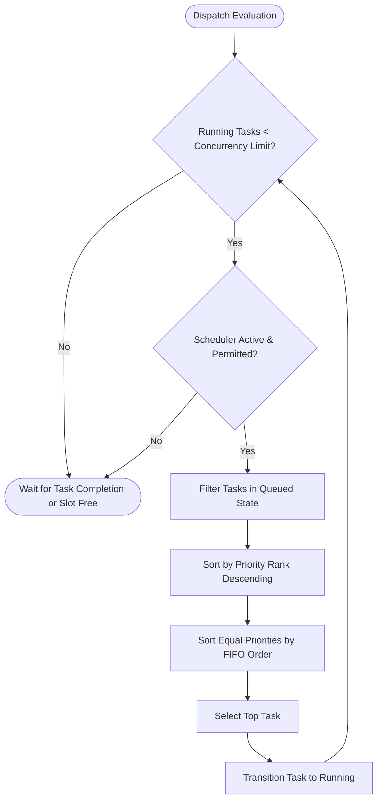
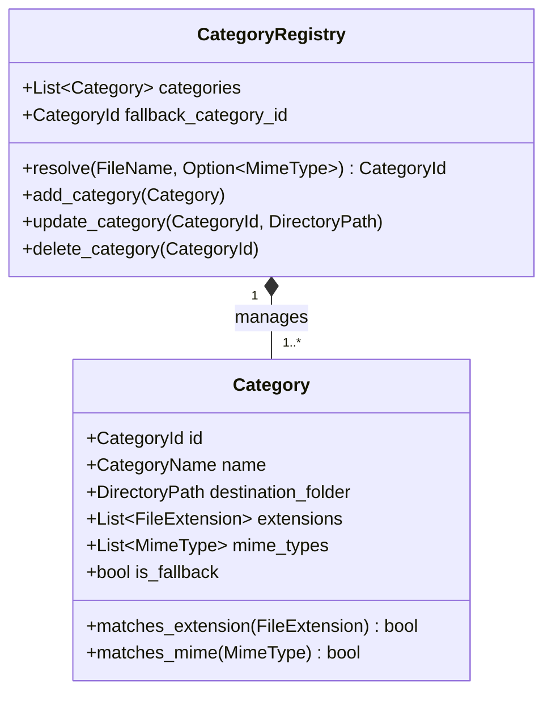
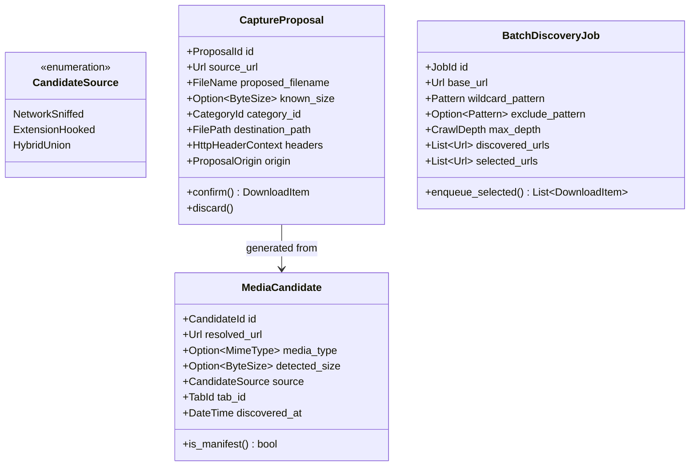
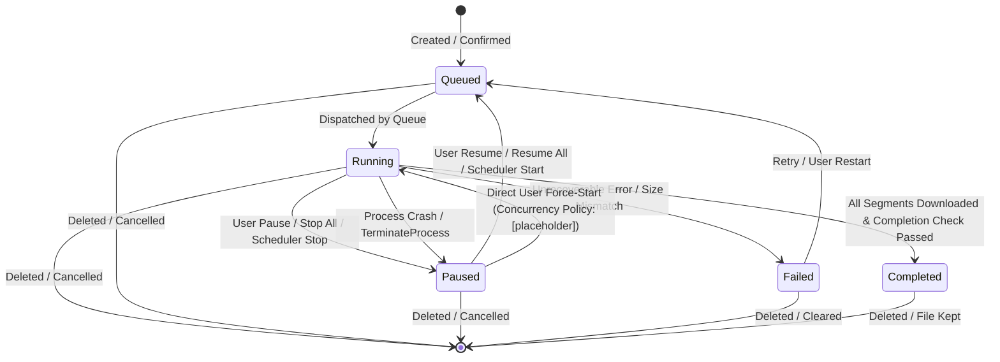
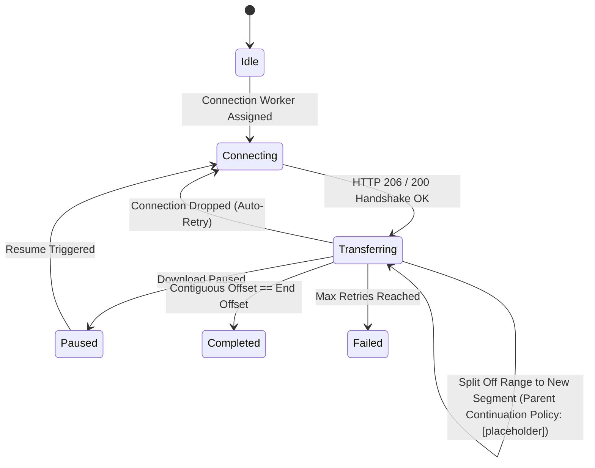

# Model Domain: UnduhKilat

## 1. Document Scope & Boundary

This document specifies the formal domain model for UnduhKilat, encompassing domain entities, aggregates, value objects, lifecycle state machines, domain invariants, and domain events. Its purpose is to provide a concrete, unambiguous, and testable domain specification for coding agents implementing the core business logic.

This document deliberately leaves the following concerns to other specifications:
- Physical table layouts, column data types, SQLite pragmas, and migration scripts are defined in `DATABASE.md`.
- Wire protocols, JSON payload schemas, Native Messaging IPC message formats, and numeric error codes are defined in `API.md`.
- GUI layout trees, rendering loops, thread topologies, and async task orchestration are defined in `ARCHITECTURE.md`.
- RFC 2119 test assertions and QA acceptance criteria are defined in `REQUIREMENTS.md`.

---

## 2. Ubiquitous Language & Domain Terminology

| Term | Domain Definition |
|---|---|
| **Download Item** | The primary domain entity representing a single file download task, uniquely identified across sessions, holding configuration, current status, network context, and target filesystem paths. |
| **Download Segment** | A distinct sub-range of bytes within a segmented download task, fetched concurrently over an independent connection and written to a target byte offset. |
| **Dynamic Segmentation** | The runtime process of re-splitting an under-performing or lagging segment into sub-segments across active connections to optimize overall completion time. |
| **Queue** | The prioritized list of all pending, active, and paused download tasks managed by the application. |
| **Priority-then-FIFO Dispatch** | The deterministic queue dispatch rule where items with explicit user-assigned priority rank highest, and items with equal or no priority are scheduled in First-In, First-Out order (DEC-002). |
| **Media Candidate** | A media stream or file resource surfaced from a web page via network request sniffing or DOM/API hooks, pending user confirmation for download (DEC-003). |
| **Capture Proposal** | A transient domain object representing an intercepted link, clipboard URL, or browser download request awaiting explicit user confirmation before creation (FR-039). |
| **Checkpoint** | A durable transaction committing the contiguous downloaded byte offsets of every active segment to disk, enabling crash-resilient resume (FR-058). |
| **Bandwidth Throttle** | A token-bucket or rate-limiting model that restricts the aggregate byte transfer rate across all items or caps an individual download item (FR-025, FR-026). |

---

## 3. Aggregate: Download Engine

The Download Engine aggregate governs file retrieval, dynamic segment slicing, server capability negotiation, and data integrity verification.

### 3.1 Entities and Value Objects

#### 3.1.1 `DownloadItem` (Aggregate Root)
- **`id`** (`DownloadId`): UUID identifying the task.
- **`source_url`** (`Url`): The canonical URI requested by the user or intercepted from the browser.
- **`effective_url`** (`Url`): The final destination URI following any HTTP 3xx redirects (FR-013).
- **`destination_path`** (`FilePath`): Fully qualified Windows file path where the target file is assembled.
- **`file_name`** (`FileName`): Target filename derived from header, URL, or explicit user override.
- **`total_size`** (`Option<ByteSize>`): Total resource size in bytes derived from `Content-Length` or range negotiation. `None` if chunked or unadvertised.
- **`downloaded_bytes`** (`ByteSize`): Sum of all contiguous bytes written to disk across all child segments.
- **`status`** (`DownloadStatus`): Current lifecycle state of the download task.
- **`priority`** (`Option<PriorityRank>`): User-assigned priority rank. `None` indicates baseline FIFO ordering (DEC-002).
- **`connection_count`** (`ConnectionCount`): Positive integer specifying target parallel connections (DEC-001).
- **`speed_limit`** (`Option<SpeedLimit>`): Item-specific maximum download rate in KB/s. `None` or `0` indicates unlimited (FR-026, FR-028).
- **`category_id`** (`CategoryId`): Identifier of the file category determining the default destination folder (FR-029).
- **`protocol`** (`Protocol`): Network protocol variant (`Http`, `Https`, `Ftp`) (FR-012).
- **`range_support`** (`RangeSupport`): Capabilities negotiated with the origin server (`Supported`, `Unsupported`, `Unknown`).
- **`header_context`** (`HttpHeaderContext`): Associated browser headers including Cookies, Referer, and User-Agent (FR-017).
- **`credentials`** (`Option<HostCredentials>`): Basic or challenge authentication credentials (FR-014).

#### 3.1.2 `DownloadSegment` (Entity)
- **`id`** (`SegmentId`): Unique identifier within the aggregate.
- **`download_id`** (`DownloadId`): Foreign reference to the owning aggregate root.
- **`index`** (`SegmentIndex`): Zero-based positional index of the segment.
- **`start_offset`** (`ByteOffset`): The absolute starting byte position in the target file.
- **`end_offset`** (`ByteOffset`): The absolute terminating byte position (inclusive).
- **`contiguous_offset`** (`ByteOffset`): The highest byte position up to which all preceding bytes have been successfully received and flushed to disk.
- **`status`** (`SegmentStatus`): Runtime state (`Idle`, `Connecting`, `Transferring`, `Paused`, `Completed`, `Failed`).

### 3.2 Invariants and Business Rules
1. **Unbounded Configuration (DEC-001):** The engine shall allow the user to set `connection_count` to any positive integer ($N \ge 1$) without enforcing an internal ceiling.
2. **Segment Boundary Invariant:** For any segmented download with $M$ segments, the ranges $[start\_offset_i, end\_offset_i]$ must be contiguous, mutually exclusive, and span exactly $0$ to $total\_size - 1$:
   $$\bigcup_{i=0}^{M-1} [start\_offset_i, end\_offset_i] = [0, total\_size - 1] \quad \text{where} \quad end\_offset_i + 1 = start\_offset_{i+1}$$
3. **Contiguous Checkpoint Guarantee (FR-006, FR-058):** $contiguous\_offset$ represents the durable watermark. Bytes beyond $contiguous\_offset$ that are not contiguously received prior to process termination are discarded upon restart.
4. **Zero-Byte Resume Guard (FR-007):** Upon resume, new range requests must originate from $Range: bytes=(contiguous\_offset + 1)-end\_offset$. Bytes below or equal to $contiguous\_offset$ are never requested again.
5. **Dynamic Segment Re-splitting (FR-004):** A re-split operation takes the segment with the largest remaining byte delta $(end\_offset - contiguous\_offset)$, divides its remaining unretrieved range into sub-ranges according to configured split thresholds `[placeholder]` and the sub-range allocation rule `[placeholder]`, and assigns the new segment to an available connection worker. Whether the parent segment remains `Transferring` with its reduced range or every sub-range becomes a new segment is `[placeholder]`.
6. **Fallback Invariant (FR-005):** If the server fails to advertise `Accept-Ranges: bytes` or rejects range requests with status 416 or 200, the aggregate collapses all segments into a single connection spanning the stream, setting `range_support = Unsupported`.
7. **File Size and Hash Integrity (FR-011):** At completion, when `total_size` is `Some(n)`, the target file length on disk must equal `n`; any discrepancy transitions the task to `Failed`. When `total_size` is `None`, the completion check is `[placeholder]`.
8. **File Conflict Protection (FR-016):** The engine must never overwrite an existing file silently. If `destination_path` exists, the conflict resolution policy `[placeholder]` (auto-rename vs. prompt) must establish a unique destination path or wait/abort before writing; the resulting unique-path or wait/abort behavior is `[placeholder]`.

---

## 4. Aggregate: Queue & Dispatch Management

The Queue aggregate orchestrates download concurrency, scheduling, and execution priority across all managed tasks.

### 4.1 Entities and Value Objects

#### 4.1.1 `DownloadQueue` (Aggregate Root)
- **`concurrency_limit`** (`PositiveInt`): Maximum number of simultaneously executing download tasks (DEC-001). Fully user-governed with no upper ceiling.
- **`global_speed_limit`** (`Option<SpeedLimit>`): Aggregate bandwidth throttle applied across all concurrent transfers in KB/s (FR-025). `None` or `0` indicates unlimited. The allocation of this aggregate cap across running tasks is `[placeholder]`.
- **`is_active`** (`bool`): Global pause/run state of the queue processor.

#### 4.1.2 `ScheduleEntry` (Entity)
- **`id`** (`ScheduleEntryId`): Unique identifier for the schedule rule.
- **`action`** (`ScheduleAction`): Action to execute (`StartQueue`, `StopQueue`). How a daily time-window maps this single action to the window's `start_time` and `end_time` boundaries is `[placeholder]`.
- **`trigger_time`** (`ScheduleTrigger`): Either a daily clock time or a daily time-window (`start_time`, `end_time`) (FR-023). The window-to-action boundary mapping is `[placeholder]`.
- **`enabled`** (`bool`): Toggle state of the schedule entry.

### 4.2 Queue Invariants and Business Rules
1. **Unbounded Concurrency (DEC-001):** The queue shall accept any positive integer for `concurrency_limit` without clamping or internal upper bounds.
2. **Deterministic Priority-then-FIFO Rule (DEC-002, FR-018):**
   - Given tasks $T_A$ and $T_B$ in `Queued` status:
     - If $Priority(T_A) > Priority(T_B)$, $T_A$ must be dispatched before $T_B$.
     - If $Priority(T_A) == Priority(T_B)$ (or both lack manual priority), the task earlier in the FIFO dispatch order must be dispatched first. The FIFO dispatch order is defined by the queue insertion index or a separate queue-order field; whether `QueueReordered` rewrites the insertion index or updates that separate field is `[placeholder]` (FR-021).
3. **Dynamic Priority Adjustment (FR-019):** Modifying a queued item's priority must immediately reposition it in the dispatch evaluation order without restarting active downloads.
4. **Slot Reclamation (FR-020):** When a running task transitions to `Completed`, `Paused`, `Failed`, or `Cancelled`, the queue manager must immediately evaluate the dispatch queue and start the next eligible task up to `concurrency_limit`.
5. **Effective Bandwidth Limit (FR-027):** For any running task $T$, $Limit_{eff}(T)$ is the minimum of the configured positive limits that apply to $T$. A per-download limit applies only when $Limit_{per\_download}(T) > 0$. The global cap $Limit_{global}$ is an aggregate ceiling shared across all running tasks; $T$'s allocated global share $Share_{global}(T)$ is `[placeholder]`, and the allocation must satisfy $\sum Share_{global}(T) \le Limit_{global}$. If no positive per-download limit and no positive global cap apply, bandwidth is unconstrained (FR-028).
6. **Headless & Tray Scheduler Execution (DEC-004, FR-024):** The scheduler must trigger actions on schedule regardless of whether the desktop UI is visible or hidden in the Windows notification area (tray).

---

## 5. Aggregate: Category & Destination Routing

The Category aggregate automates disk storage organization by associating file metadata with destination directory trees.

### 5.1 Invariants and Business Rules
1. **Automatic Extension Routing (FR-029):** New downloads are matched against category extension lists (case-insensitively). When a match occurs, the download's default `destination_path` is resolved inside that category's `destination_folder`. The precedence when an extension match and a MIME type or `Content-Type` match resolve to different categories is `[placeholder]` and must be applied consistently in `CategoryRegistry.resolve`.
2. **Fallback Category Guarantee (FR-030):** If no category matches under the precedence rule defined in Section 5.1.1, the item is routed to the configured Fallback category.
3. **Target Immutability on Folder Mutation (FR-031):** Modifying a category's `destination_folder` affects only future downloads. Existing or completed download records retain their existing `destination_path`.
4. **Explicit Per-Item Override (FR-032):** An explicit destination path specified in the Add URL dialog or Browser Confirmation dialog overrides category rules for that item.

---

## 6. Aggregate: Browser Integration & Media Sniffer

This aggregate processes link interceptions, media stream detections, and page-level hooks received via the Chromium Native Messaging host.

### 6.1 Entities and Value Objects

#### 6.1.1 `MediaCandidate` (Entity)
- **`id`** (`CandidateId`): Unique candidate identifier.
- **`resolved_url`** (`Url`): Fully resolved media resource URI.
- **`media_type`** (`Option<MimeType>`): Discovered MIME classification (e.g., `video/mp4`, `audio/aac`, `application/vnd.apple.mpegurl`).
- **`detected_size`** (`Option<ByteSize>`): Size discovered via sniffing or hook probing; `None` (`TBD`) if unknown.
- **`source`** (`CandidateSource`): Origin flag (`NetworkSniffed`, `ExtensionHooked`, or merged `HybridUnion`) (DEC-003).
- **`tab_id`** (`TabId`): Chromium tab context where the media was discovered.

#### 6.1.2 `CaptureProposal` (Transient Value Object)
- Represents an intercepted item awaiting confirmation (FR-039). Contains `source_url`, `proposed_filename`, `known_size`, `category_id`, `destination_path`, and `headers`.
- `origin` specifies the source: `BrowserExtension`, `ClipboardWatcher`, or `AddUrlDialog`.

### 6.2 Invariants and Business Rules
1. **Hybrid Detection Engine (DEC-003, FR-041):** Media discovery must merge candidates from both browser network sniffing and in-page extension hook signals. Dropping or disabling either channel is prohibited.
2. **Deduplication by Resolved URL (FR-042):** Candidates reported by both sniffing and extension hooks within the same browsing context must be merged into a single entry under their normalized resolved URL.
3. **Mandatory User Confirmation (FR-039, FR-040):** No download task may be inserted into the queue directly from link interception, clipboard monitoring, or media candidate panels without explicit user confirmation through the confirmation UI.
4. **Targeted Browser Confinement (DEC-006, FR-033):** Extension integration and native messaging hooks shall interface strictly with Chromium-based browsers (Google Chrome, Microsoft Edge, Brave).
5. **Manifest Stream Identification (FR-044):** Candidates resolving to HLS/DASH manifest streams (`.m3u8`, `.mpd`) are tagged as manifest streams. Segmented direct assembly is `TBD`.
6. **Batch Item Uniformity (FR-047):** Items confirmed from a Site Grabber batch job or page crawl become ordinary `DownloadItem` instances, bound to all queue concurrency, priority, and throttling rules.

---

## 7. Domain State Machines & Lifecycles

### 7.1 `DownloadItem` State Machine

#### State Transition Matrix

| Source State | Event / Trigger | Target State | Domain Invariants & Side Effects |
|---|---|---|---|
| `[*] ` | `ConfirmProposal` | `Queued` | Task created; initial segment records calculated if size known; persisted to SQLite. |
| `Queued` | `QueueDispatch` | `Running` | Concurrency check satisfied; worker tasks spawned; connections opened. |
| `Running` | `UserPause` | `Paused` | In-flight HTTP requests aborted; contiguous offsets flushed to SQLite checkpoint (FR-006). |
| `Running` | `SystemCrashOrKill` | `Paused` | On restart, ungracefully terminated `Running` tasks recover to `Paused` with checkpoint intact (FR-010). |
| `Running` | `AllSegmentsComplete` | `Completed` | Final file assembled; completion check defined in Section 3.2.7 passes (FR-011); toast notification emitted (DEC-004, FR-054). |
| `Running` | `FatalError` / `SizeMismatch` | `Failed` | Retries exhausted or size mismatch detected; error details recorded (FR-011, FR-056). |
| `Paused` | `UserResume` | `Queued` | Task repositioned for queue dispatch based on priority and FIFO index. |
| `Paused` | `UserForceStart` | `Running` | Direct user force-start resumes from the persisted checkpoint without wiping segment offsets. Whether it respects `concurrency_limit` by waiting for a free slot or routing through the queue, or uses an explicit override that suspends the maximum, is `[placeholder]`. |
| `Paused` | `RestartFromZero` | `Queued` or `Running` (`[placeholder]`) | Persisted segment offsets wiped; destination file truncated to 0; transfer restarted from byte 0 (FR-009). |
| `Failed` | `Retry` / `UserRestart` | `Queued` | Task re-enters queue for dispatch. Whether the retry preserves persisted segment offsets or wipes them and restarts from byte 0 is `[placeholder]` (FR-009). |
| Any non-terminal | `UserCancel` | `[*]` (`Cancelled` terminal state: `[placeholder]`) | Active connections aborted; temporary/partial files cleaned up or preserved per policy. Cancellation is the event outcome; whether a distinct `Cancelled` terminal state exists is `[placeholder]`. |

### 7.2 Segment Lifecycle

---

## 8. Domain Events

Domain events represent state changes within the core model that drive persistence checkpoints, desktop UI notifications, and browser extension synchronization.

| Event Name | Originating Aggregate | Payload Attributes | Domain Significance & Triggers |
|---|---|---|---|
| `DownloadEnqueued` | Queue | `download_id`, `url`, `priority`, `queue_position` | Item committed to queue; triggers UI list update. |
| `DownloadStarted` | Download Engine | `download_id`, `connection_count`, `total_size` | Worker tasks initialized; pushes status to browser extension if tab-linked (FR-038). |
| `SegmentCheckpointSaved` | Download Engine | `download_id`, `segment_id`, `contiguous_offset`, `bytes_downloaded` | Transactionally written to SQLite (FR-058); updates item details view (FR-055). |
| `SegmentResplit` | Download Engine | `download_id`, `parent_segment_id`, `new_segment_id`, `split_offset` | Dynamic segmentation triggered; spawned connection begins fetching upper sub-range (FR-004); whether the parent segment continues with its reduced range or every sub-range becomes a new segment is `[placeholder]`. |
| `DownloadProgressTicked` | Download Engine | `download_id`, `current_speed`, `downloaded_bytes`, `eta_seconds` | Throttle and sampling metrics recalculated; feeds live UI refresh (NFR-006). |
| `DownloadPaused` | Download Engine | `download_id`, `retained_bytes` | Transfers halted; persistent state clean; slots freed in queue. |
| `DownloadCompleted` | Download Engine | `download_id`, `final_path`, `total_bytes`, `duration` | File closed and verified; triggers Windows notification toast if enabled (DEC-004, FR-054). |
| `DownloadFailed` | Download Engine | `download_id`, `reason`, `last_error` | Size mismatch, authentication failure, or network give-up; recorded for diagnostics (FR-056). |
| `QueueReordered` | Queue | `new_order_list` | Manual user reordering changes FIFO evaluation sequence (FR-021); whether it rewrites the queue insertion index or updates a separate queue-order field is `[placeholder]`. |
| `PriorityChanged` | Queue | `download_id`, `old_priority`, `new_priority` | Item priority elevated or cleared; alters next dispatch candidate (FR-019). |
| `MediaCandidateDetected`| Browser Integration | `candidate_id`, `tab_id`, `url`, `media_type`, `source` | Discovered media item added to floating overlay panel (DEC-003, FR-041, FR-043). |
| `ScheduleActionTriggered`| Queue | `schedule_entry_id`, `action` | Daily timer or window boundary encountered according to the window-to-action mapping `[placeholder]`; starts or stops queue from tray (FR-023, FR-024). |

---

## 9. Consistency Notes

### 9.1 Mapping to User Decisions
- **DEC-001 (Concurrency & Connection Bounds):** Enforced in Section 3.2 and Section 4.2. `DownloadItem.connection_count` and `DownloadQueue.concurrency_limit` are strictly unbound positive integers with no application-imposed maximum.
- **DEC-002 (Dispatch Policy):** Enforced in Section 4.2. Priority-then-FIFO dispatch algorithm strictly orders manual priority items first, falling back to FIFO queue order for equal or unset priorities.
- **DEC-003 (Hybrid Media Capture):** Enforced in Section 6.1 and Section 6.2. `MediaCandidate` discovery mandates the union of both network sniffing and DOM/API hook signals, with normalized URL deduplication.
- **DEC-004 (Tray Lifecycle & Notification):** Enforced in Section 4.2, Section 7.1, and Section 8. Window minimization or close hides the interface to the system tray while transfers and scheduled tasks continue uninterrupted, dispatching Windows toast notifications on download completion.
- **DEC-005 (Target OS & Architecture):** Constrains execution context to 64-bit Windows 10 and Windows 11; domain paths, registry targets, and filesystem operations assume native Windows x64 semantics.
- **DEC-006 (Browser Scope):** Enforced in Section 6.2. Browser integration domain models interact exclusively with Chromium-class browsers (Google Chrome, Microsoft Edge, Brave) via native messaging.
- **DEC-007 (Distribution & Portability):** Enforced through self-contained local state models. The domain state store resides in a single transactional SQLite database file, enabling portable execution without registry dependencies outside user-scoped native messaging registration.

### 9.2 Inter-Document Dependencies
- **`DATABASE.md`**: Provides the exact schema tables, column definitions, index layouts, and transactional migration steps corresponding to the `DownloadItem`, `DownloadSegment`, `DownloadQueue`, and `Category` entities defined in Sections 3, 4, and 5.
- **`API.md`**: Defines wire protocols, Native Messaging manifest specifications, JSON message shapes, and standard error codes matching the domain events and failure reasons outlined in Sections 7 and 8.
- **`ARCHITECTURE.md`**: Defines the physical layering, Tokio task topologies, async actor channels, and egui/wgpu view implementations executing the aggregate invariants specified herein.
- **`REQUIREMENTS.md`**: Supplies the formal RFC 2119 verification rules and acceptance test matrices verifying the business rules and state machines established in this domain model.