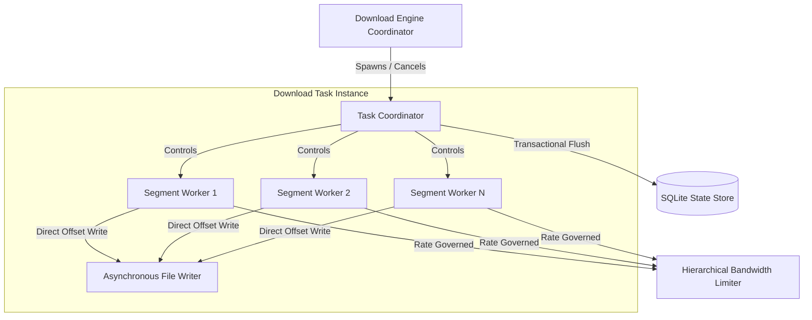
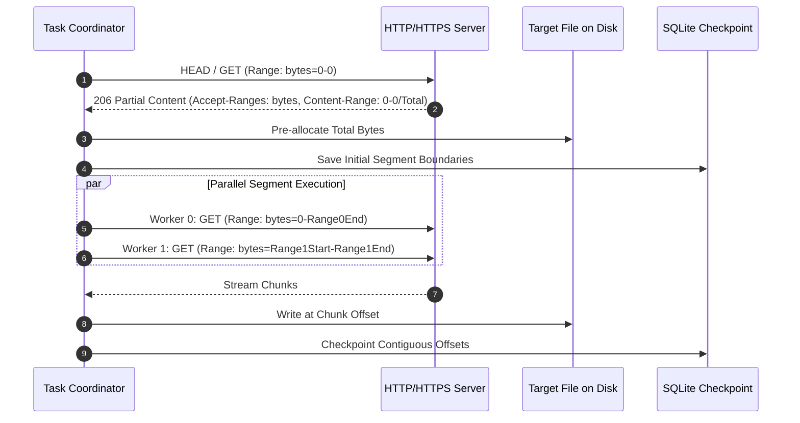
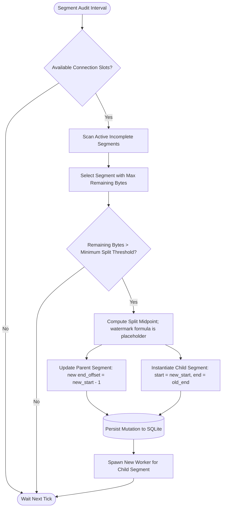
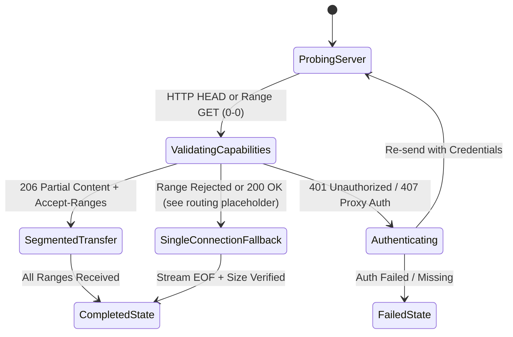
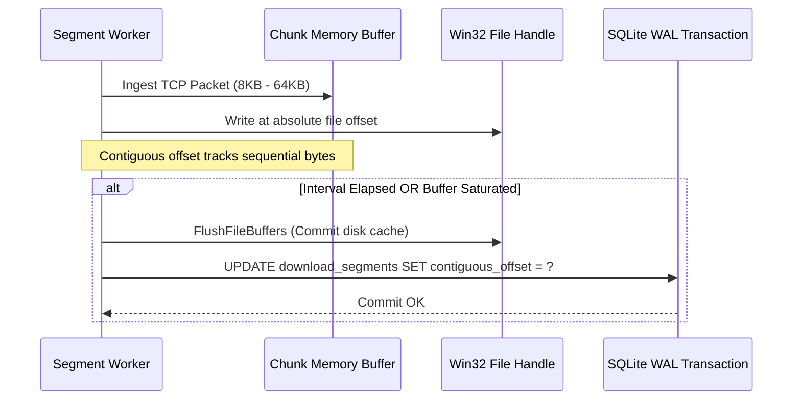
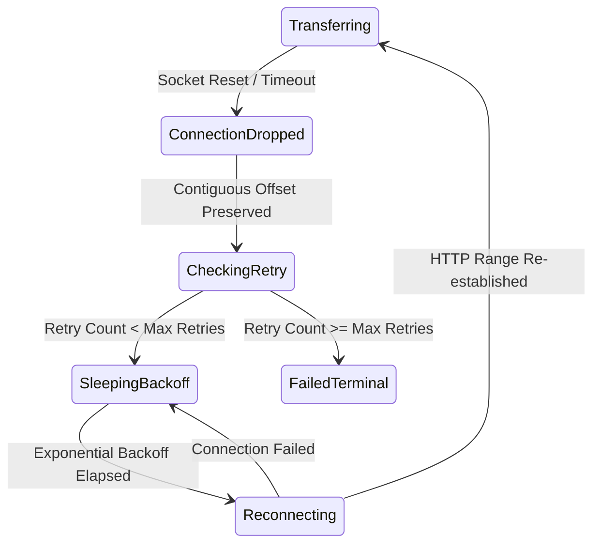

# Mesin Unduh Bersegmen: UnduhKilat

## 1. Scope and Boundary

This document defines the technical architecture, algorithms, and execution semantics for the multi-connection segmented download engine of UnduhKilat on Windows 10 and Windows 11 x64 systems (DEC-005). It specifies dynamic byte-range partitioning, HTTP/HTTPS and FTP connection lifecycles, real-time bandwidth throttling, crash-durable state checkpointing, and non-destructive resume capabilities.

This specification deliberately delegates the following operational aspects to other system documents:
- Relational schema definitions, SQLite pragmas, and migration scripts are governed by `DATABASE.md`.
- Browser native messaging wire protocols, extension payloads, and IPC schemas are governed by `API.md`.
- UI presentation, egui/wgpu rendering loops, and user interaction dialogues are governed by `ARCHITECTURE.md`.
- Global queue dispatch, priority ordering, and calendar scheduler rules are governed by `FEATURES.md`.

---

## 2. Architectural Principles & Technology Foundation

The download engine is built on standard Rust (MSVC toolchain) leveraging an asynchronous, non-blocking I/O paradigm executed on a Tokio multi-threaded runtime. 



### 2.1 Core Subsystems
- **Async Runtime:** Tokio multi-thread runtime coordinates connection workers and disk I/O tasks. Each segment worker runs inside its own green thread (`tokio::task::JoinHandle`).
- **HTTP/HTTPS Transport:** Implemented with `reqwest` backed by `rustls` to remove external OpenSSL dependencies under Windows x64 environments. It strictly handles range negotiation, HTTP redirects, custom headers (`User-Agent`, `Referer`, `Cookie`), and proxy topologies.
- **FTP Transport:** Implemented via asynchronous stream sockets handling RFC 959 control commands and RFC 3659 restart markers (`REST 100`) for segmented or resumable transfers.
- **File System Assembly:** Pre-allocates target disk space to prevent fragmentation and file corruption. Concurrent writes occur directly to targeted byte offsets using position-based writes without global sequential locking.
- **User Bounds Invariant:** In accordance with DEC-001, the engine does not enforce any hardcoded ceiling on the concurrent connections per download or total active downloads; the values are strictly dictated by user configuration.

---

## 3. Dynamic Segmentation & Connection Lifecycle

When a download task is initiated, the engine inspects server capabilities and partitions the payload into independent byte ranges.

### 3.1 Initial Byte-Range Allocation

Given a total resource size $S$ bytes and a user-configured connection count $C$ ($C \ge 1$, DEC-001), the behavior for $S = 0$ and for $C > S$ is [placeholder]. The owner-supplied allocation rule must guarantee $\text{start\_offset}_i \le \text{end\_offset}_i$ for every segment; because DEC-001 allows any $C \ge 1$, the engine must not assume $C \le S$.

1. For the nominal case where the allocation rule yields $S > 0$ and a non-empty range for every one of the $C$ segments, the engine calculates baseline segment size $B = \lfloor S / C \rfloor$ and remainder $R = S \bmod C$.
2. For each segment index $i$ in the range defined by the allocation rule (nominally $[0, C-1]$ in the case above):
   - $\text{start\_offset}_i = i \times B + \min(i, R)$
   - $\text{end\_offset}_i = \text{start\_offset}_i + B + (1 \text{ if } i < R \text{ else } 0) - 1$
   - The initial durable watermark convention and value are [placeholder]. The owner must decide whether the stored value is the next byte to fetch or whether "no byte yet" is represented separately; the initial value must be representable without underflow.
3. If $S$ is unknown (e.g., chunked transfer encoding) or the server rejects ranges, the engine falls back to a single segment ($C=1$) from byte 0 to an open-ended upper bound (FR-005).



### 3.2 Dynamic Re-Splitting Algorithm (FR-004)

During transfer, connection throughput can fluctuate. The dynamic segmentation supervisor periodically audits active workers to reallocate idle connections or split lagging segments.



#### Split Parameters

| Parameter | Type | Constraint | Description |
|---|---|---|---|
| `split_threshold_bytes` | `u64` | `[placeholder]` | Minimum remaining byte volume in a segment before splitting is allowed. |
| `min_segment_size` | `u64` | `[placeholder]` | Absolute lower bound size below which a segment cannot be sub-divided. |
| `audit_interval_ms` | `u32` | `[placeholder]` | Evaluation cycle frequency for segment audit supervisor. |
| `max_connections_per_task` | `u32` | $\ge 1$ (DEC-001) | User-defined upper limit of concurrent TCP streams for the item. |

Dynamic re-splitting is blocked on owner decisions for `split_threshold_bytes`, `min_segment_size`, and `audit_interval_ms`; until these values are supplied, the split behavior in this section is not implementable or testable (FR-004).

---

## 4. Protocol Handshake, Range Negotiation & Fallback

The engine negotiates transport capabilities prior to initiating data transfer.



**Fallback routing decision:** The routing of a `200 OK` response carrying `Accept-Ranges: bytes` is [placeholder]. The owner must decide whether it proceeds with range partitioning as in the Section 4.1 matrix or takes the single-connection fallback shown in the diagram. Until that is decided, the matrix action for that row and the diagram transition are not normative on this point.

### 4.1 Handshake Matrix

| Origin Response Code | Header Condition | Range Support Classification | Action Taken |
|---|---|---|---|
| `206 Partial Content` | `Content-Range: bytes 0-0/S` | `RangeSupport::Supported` | Pre-allocate $S$ bytes on disk. Partition into $C$ connections. (FR-003) |
| `200 OK` | `Accept-Ranges: bytes` | `RangeSupport::Supported` | [placeholder: proceed with range partitioning or fall back to single connection; see fallback routing decision] |
| `200 OK` | No `Accept-Ranges` or `Accept-Ranges: none` | `RangeSupport::Unsupported` | Fallback to single connection ($C=1$). Stream until EOF. UI flag set. (FR-005) |
| `416 Range Not Satisfiable` | Any | `RangeSupport::Rejected` | Abort segmented attempt. Fallback to single connection without ranges. |
| `301`, `302`, `307`, `308` | `Location: <new_url>` | `RangeSupport::Unknown` | Follow redirect. Record `effective_url`, preserve `Referer`. (FR-013) |
| `401 Unauthorized` | `WWW-Authenticate` | N/A | Match host with credentials store. Retry handshake with auth. (FR-014) |
| `407 Proxy Authentication` | `Proxy-Authenticate` | N/A | Apply proxy credentials. Retry handshake. (FR-015) |

### 4.2 FTP Protocol Handshake (FR-012)
1. Establish control connection via TCP to port 21 (or configured proxy).
2. Authenticate using `USER` and `PASS` commands (anonymous or saved host credentials).
3. Send `TYPE I` to force 8-bit binary transfer mode.
4. Issue `SIZE <filename>` to ascertain total payload byte count.
5. If segmented:
   - For each connection worker, issue `PASV` (Passive Mode) to acquire data socket address.
   - Issue `REST <start_offset>` to position read head.
   - Issue `RETR <filename>` and read data from stream.
6. If `REST` returns error code `501`, `502`, or `504`, abort segmentation and fall back to single-connection FTP stream starting at byte 0.

---

## 5. State Persistence, Checkpointing & Crash Durability

To ensure durability against unexpected process termination and, subject to the SQLite synchronous mode decision in Section 5.2, power loss or OS crashes (FR-010, FR-058), segment progress is tracked via transactional watermarks in a single SQLite database file. The exact power-loss guarantee is [placeholder] until that mode is fixed.

### 5.1 The Contiguous Watermark Invariant

A segment worker downloads byte chunks of size $K$. Even if chunks arrive out-of-order over TCP:
- The byte buffer is immediately written to target file offset $\text{start\_offset} + \Delta$.
- The `contiguous_offset` watermark advances **only** up to the contiguous, unbroken sequence of bytes safely flushed to the physical file system.
- Bytes downloaded beyond a gap are written to disk but are not acknowledged in `contiguous_offset` until the gap is filled.
- The durable SQLite checkpoint updates only commit the `contiguous_offset`.
- Whether non-contiguous received ranges are also checkpointed, or bytes beyond the gap are re-fetched after resume, is [placeholder]. This durability-versus-duplicate policy determines whether the zero-duplicate guarantee in Section 6.2 applies (FR-007, KPI-006).

```
Disk Offsets:       [00] [01] [02] [03] [04] [05] [06] [07] [08] [09]
Flushed to File:     X    X    X    X    .    X    X    .    .    .
Contiguous Offset:                  ^ (Offset 03)
Non-contiguous:                      ^^^^ [placeholder: checkpointed or re-fetched on resume]
```

### 5.2 Checkpoint Flush Strategy



- **Checkpoint Trigger Policy:**
  - Dynamic time-interval: `TBD` ms (periodic checkpoint tick).
  - Byte-volume threshold: `TBD` KB accumulated contiguous data.
  - Mandatory synchronous flush upon pause, manual stop, or clean exit (FR-006, FR-053).
- **SQLite Write Mode:** SQLite database runs in `WAL` (Write-Ahead Logging) mode, ensuring minimal write contention across Tokio threads. The `PRAGMA synchronous` mode is [placeholder]: `FULL` is required if power-loss durability is claimed, while `NORMAL` is only consistent with a process-crash-only durability claim. The selected mode and the corresponding durability wording in Section 5 are [placeholder] (FR-010, FR-058).

---

## 6. Pause, Resume, Restart & Recovery Workflows

### 6.1 Pause Workflow (FR-006)
1. Task coordinator sends a cancellation signal to all active segment workers via `tokio_util::sync::CancellationToken`.
2. Segment workers complete their immediate active disk write block and flush the OS file buffers using `tokio::fs::File::sync_all`.
3. Workers calculate the exact `contiguous_offset` and persist it to SQLite within an exclusive transaction.
4. TCP connections are dropped gracefully.
5. Task status transitions to `DownloadStatus::Paused`.

### 6.2 Resume Workflow (FR-007)
1. Task is dispatched from `Queued` or manually resumed.
2. Segment metadata is loaded from the SQLite database.
3. The resume arithmetic depends on the watermark convention chosen in Section 3.1, which is [placeholder].
   - For each incomplete segment, the condition for completion and the value of `fetch_start` are [placeholder].
   - The HTTP Range header is constructed from `fetch_start` to `end_offset`: `Range: bytes={fetch_start}-{end_offset}`.
   - The behavior when the segment has no remaining bytes is [placeholder].
4. Connection workers are spawned up to the target connection count (DEC-001).
5. Received bytes are appended starting at the owner-defined `fetch_start`. Whether bytes beyond a gap are re-fetched or resumed from checkpointed non-contiguous ranges is [placeholder]; therefore the zero-duplicate guarantee (FR-007, KPI-006) applies only if the non-contiguous checkpoint policy in Section 5.1 is chosen.

### 6.3 Crash Recovery on Startup (FR-010)
On application launch following an abnormal termination (`TerminateProcess`, power failure):
1. Engine initiates startup audit before spawning network listeners.
2. Queries SQLite for downloads flagged with `DownloadStatus::Running`.
3. Evaluates segment table for each orphaned running download.
4. Sets item state to `DownloadStatus::Paused` with intact persisted `contiguous_offset` boundaries.
5. Emits `DownloadStatus::Paused` event to the desktop interface, ready for one-click manual or scheduled queue resumption.

### 6.4 Restart from Zero (FR-009)
1. Active transfers for the item are canceled and aborted.
2. Target file on disk is truncated to 0 bytes via `SetEndOfFile` / `tokio::fs::File::set_len(0)`.
3. Database segment boundaries are wiped, and segment count resets to the default configuration.
4. Download initiates identical to a new item.

---

## 7. Bandwidth Control & Rate Limiting Engine

Throughput throttling is enforced using a token-bucket rate-limiting architecture supporting both individual download limits and an aggregate global limit (FR-025, FR-026, FR-027).

```mermaid
flowchart TD
    GlobalBucket[Global Token Bucket: global_speed_limit KB/s] -->|Refills Tokens Periodically| GlobalTokens((Global Tokens))
    ItemBucket[Item Token Bucket: per_download_limit KB/s] -->|Refills Tokens Periodically| ItemTokens((Item Tokens))
    
    GlobalTokens --> Evaluator{Min Token Evaluator}
    ItemTokens --> Evaluator
    
    Evaluator -->|Granted Permit: min(Global, Item)| WorkerPool[Active Segment Workers]
    WorkerPool -->|Consume N Bytes| NetworkStream[Read Network Sockets]
```

### 7.1 Limiter Algorithm & Token Allocation
1. **Token Refresh:** A Tokio timer ticks at a constant interval of $\Delta t$ ([placeholder] ms; whether 50 ms is a defined default or only an example is [placeholder]). The interval is converted to seconds for token accounting: $\Delta t_s = \Delta t / 1000$.
2. **Token Units:** All token pools and permits are denominated in bytes. The configured limits are converted from KB/s to bytes/s using $F_{KB\to bytes}$, where $F_{KB\to bytes}$ is [placeholder] and must be the same factor used by the settings UI.
3. **Global Cap:** Injects $\text{Tokens}_{global} = \text{Limit}_{global}(\text{bytes/s}) \times \Delta t_s$ bytes into the global pool, where $\text{Limit}_{global}(\text{bytes/s}) = \text{Limit}_{global}(\text{KB/s}) \times F_{KB\to bytes}$.
4. **Item Cap:** Injects $\text{Tokens}_{item} = \text{Limit}_{item}(\text{bytes/s}) \times \Delta t_s$ bytes into the item pool, where $\text{Limit}_{item}(\text{bytes/s}) = \text{Limit}_{item}(\text{KB/s}) \times F_{KB\to bytes}$.
5. **Worker Grant:** Before a segment worker invokes `read()` on its underlying socket:
   - Calculates chunk request size $L$ in bytes (for example, 16KB converted with $F_{KB\to bytes}$).
   - If both limits apply, requested permit $P = \min(L, \text{Tokens}_{global}, \text{Tokens}_{item})$ in bytes (FR-027).
   - If either token pool is empty, the worker awaits the next timer tick without blocking Tokio OS threads.
6. **Zero Limit Semantics:** The meaning of a `0` KB/s setting is [placeholder] for each bucket. The owner must decide whether `0` disables only that bucket (leaving the other bucket active) or whether a global `0` overrides all limits. Until decided, no zero-limit behavior is normative (FR-028).
7. **Live Limit Mutation:** When limits are updated via the settings UI, token replenishment variables mutate atomically, taking effect within the next throttle interval without interrupting TCP connections (FR-028).

---

## 8. Data Integrity Verification & File Allocation

### 8.1 File Pre-Allocation and Fragmentation Guard
When resource size $S$ is obtained via `Content-Length` or range probing:
1. Each positional writer's target file handle is opened with write and read permissions using native Windows attributes (`FILE_SHARE_READ`, `FILE_ATTRIBUTE_NORMAL`).
2. Engine utilizes native sparse file flags or pre-allocates contiguous space using `SetFileInformationByHandle` with `FileAllocationInfo` to allocate disk sectors immediately. This prevents file system fragmentation and ensures disk space availability upfront.

### 8.2 File Conflict Resolution (FR-016)
If a file with the target name already exists in the resolved category directory:
- The conflict policy (`TBD`: auto-rename with incremental suffix `(1)`, `(2)` vs. user prompt) determines the target path.
- In both cases, the final resolved path is committed to `download_items.destination_path` before any byte is written to disk.

### 8.3 Completion and Size Verification (FR-011)
Upon completion of all segments:
1. File writer issues synchronous flush: `FlushFileBuffers(handle)`.
2. Engine checks disk file size:
   $$\text{PhysicalSize} = \text{std::fs::metadata}(\text{destination\_path}).\text{len}()$$
3. If $\text{PhysicalSize} \ne \text{total\_size}$:
   - File is NOT marked completed.
   - Status transitions to `DownloadStatus::Failed`.
   - Error recorded: `FailureReason::SizeMismatch { expected: total_size, actual: PhysicalSize }`.
4. If valid, task transitions to `DownloadStatus::Completed`. A completion toast notification is dispatched if enabled (DEC-004, FR-054).

---

## 9. Error Handling, Network Faults & Retry Policies

Segment workers must survive transient networking disruptions, connection resets (`WSAECONNRESET`), and server-side socket drops without failing the entire download task (FR-008).



### 9.1 Network Fault Handling Policy

| Error Type | Detection Event | Engine Reaction |
|---|---|---|
| `Socket Timeout` | No bytes read within timeout threshold (`TBD` sec) | Drop socket. Preserve `contiguous_offset`. Initiate retry loop. |
| `Connection Reset` | `WSAECONNRESET` / TCP RST | Mark segment `Connecting`. Execute backoff schedule. (FR-008) |
| `HTTP 429 / 503` | Server throttling or transient overload | Temporarily suspend worker. Back off without dropping other connections. |
| `HTTP 416` | Range Not Satisfiable | Verify if segment is already complete. If mismatch, trigger state audit. |
| `DNS Resolution Loss` | Socket address lookup fails | Pause retry loop; attempt re-resolution every `TBD` seconds. |
| `Disk Write Error` | `ERROR_DISK_FULL` (0x70) | Halt entire download task immediately. Transition to `Failed` (Disk Full). |

### 9.2 Auto-Retry and Backoff Schedule (FR-008)

The retry parameters govern automatic reconnection without user intervention:

| Parameter | Type | Default Value | Description |
|---|---|---|---|
| `max_retries_per_segment` | `u32` | `[placeholder]` | Maximum reconnection attempts before declaring segment failure. |
| `initial_backoff_ms` | `u64` | `[placeholder]` | Base backoff interval before first retry attempt. |
| `backoff_multiplier` | `f32` | `[placeholder]` | Multiplier for exponential backoff calculations. |
| `max_backoff_ms` | `u64` | `[placeholder]` | Upper ceiling for exponential backoff duration. |

Automatic reconnection behavior is blocked on owner-supplied values for all four parameters; until they are defined, the retry state machine in Section 9 cannot be implemented or tested (FR-008).

---

## 10. Concrete Technical Interfaces & Tokio Task Topology

### 10.1 Tokio Task Topology

```
DownloadManager (Tokio Main Task)
 │
 ├── DownloadTaskCoordinator (per running download item)
 │    ├── CancellationToken
 │    ├── BandwidthMeter (per-item throughput calculation)
 │    │
 │    ├── SegmentWorker-0 (Tokio task)
 │    │    ├── reqwest::Response / AsyncRead
 │    │    ├── Token Bucket permit acquisition
 │    │    └── Positioned File Write
 │    │
 │    ├── SegmentWorker-1 (Tokio task)
 │    ├── SegmentWorker-N (Tokio task)
 │    │
 │    └── DynamicSplitSupervisor (Tokio timer loop)
 │         └── Checks remaining byte deltas, spawns additional workers
 │
 └── GlobalThroughputGovernor (Tokio timer loop)
      └── Injects tokens into global token bucket
```

### 10.2 Rust Data Structures (Download Engine Core)

```rust
use std::path::PathBuf;
use std::sync::atomic::{AtomicU64, Ordering};
use std::sync::Arc;
use tokio_util::sync::CancellationToken;

#[derive(Debug, Clone, Copy, PartialEq, Eq)]
pub enum RangeSupport {
    Unknown,
    Supported,
    Unsupported,
    Rejected,
}

#[derive(Debug, Clone, Copy, PartialEq, Eq)]
pub enum SegmentStatus {
    Idle,
    Connecting,
    Transferring,
    Paused,
    Completed,
    Failed,
}

#[derive(Debug)]
pub struct DownloadSegmentState {
    pub id: i64,
    pub download_id: String,
    pub segment_index: u32,
    pub start_offset: u64,
    pub end_offset: u64,
    /// [placeholder] Semantics depend on the owner-selected watermark convention.
    pub contiguous_offset: Arc<AtomicU64>,
    pub status: SegmentStatus,
}

impl DownloadSegmentState {
    // [placeholder] These methods illustrate the highest-received-byte convention.
    // If the owner chooses the next-byte-to-fetch convention, completion and
    // remaining-byte calculations must be adjusted.
    pub fn is_complete(&self) -> bool {
        self.contiguous_offset.load(Ordering::Acquire) >= self.end_offset
    }

    pub fn remaining_bytes(&self) -> u64 {
        let current = self.contiguous_offset.load(Ordering::Acquire);
        if current >= self.end_offset {
            0
        } else {
            self.end_offset - current
        }
    }
}

pub struct SegmentWorkerConfig {
    pub download_id: String,
    pub segment_id: i64,
    pub target_url: reqwest::Url,
    pub headers: reqwest::header::HeaderMap,
    pub destination_path: PathBuf,
    pub start_byte: u64,
    pub end_byte: u64,
    /// [placeholder] Initial watermark value; the convention and initial value are undecided.
    pub initial_contiguous_byte: u64,
    pub cancellation_token: CancellationToken,
}
```

### 10.3 Direct Positional File Writer Interface

To execute concurrent asynchronous writes without cross-thread lock contention, each segment worker leverages native Windows offset writes:

```rust
#[cfg(windows)]
pub mod sys {
    use std::fs::File;
    use std::os::windows::fs::{FileExt, OpenOptionsExt};
    use std::io::Result;
    use std::path::Path;

    const FILE_SHARE_READ: u32 = 0x0000_0001;
    const FILE_ATTRIBUTE_NORMAL: u32 = 0x0000_0080;

    pub struct PositionalFileWriter {
        file: File,
    }

    impl PositionalFileWriter {
        pub fn open(path: &Path) -> Result<Self> {
            use std::fs::OpenOptions;
            let file = OpenOptions::new()
                .read(true)
                .write(true)
                .create(true)
                .share_mode(FILE_SHARE_READ)
                .attributes(FILE_ATTRIBUTE_NORMAL)
                .open(path)?;
            Ok(Self { file })
        }

        /// Writes a byte slice directly at an absolute file offset
        /// using Windows Seek/Write primitives without mutating a shared file pointer.
        pub fn write_at(&self, buf: &[u8], offset: u64) -> Result<usize> {
            self.file.seek_write(buf, offset)
        }

        pub fn sync(&self) -> Result<()> {
            self.file.sync_all()
        }
    }
}
```

---

## 11. Consistency Notes

### 11.1 Mapping to User Decisions
- **DEC-001 (Unbounded Concurrency & Connections):** Formally codified in Section 2.1, Section 3.1, and Section 3.2. Connection worker spawning allows any user-specified integer $C \ge 1$ with no engine-enforced upper limit.
- **DEC-002 (Priority-then-FIFO Queue Dispatch):** Respected across task coordination. The engine accepts execution triggers directly from the queue manager and releases execution slots upon pause/completion.
- **DEC-003 (Hybrid Media Capture):** Dynamic media payloads intercepted via sniffing or extension hooks are accepted by the engine through standard URL proposal confirmation.
- **DEC-004 (Tray Minimization & Toasts):** Section 8.3 integrates completion toast delivery on download finish. The engine runs independently of window visibility state inside the background Tokio runtime.
- **DEC-005 (Windows 10/11 x64 Target):** Section 2.1 and Section 10.3 leverage the native Windows MSVC platform APIs (`seek_write`, Win32 file flags, rustls TLS).
- **DEC-006 (Chromium Extension Reach):** Intercepted cookies, user-agent, and referer headers are routed through the request builder as specified in Section 4.1.
- **DEC-007 (Portable ZIP Operation):** The download engine maintains all checkpoints within a local, portable-compatible SQLite database file without requiring administrative services or registry dependencies.

### 11.2 Related Specification Documents
- **`DATABASE.md`**: Defines schema for `download_items` and `download_segments` tables matching `DownloadSegmentState` fields.
- **`API.md`**: Outlines the IPC messaging protocols sending capture payloads into the engine.
- **`ARCHITECTURE.md`**: Defines how egui/eframe consumes real-time progress events emitted by the engine's coordinator tasks.
- **`FEATURES.md`**: Governs category destination folders, speed limiter configurations, and scheduling triggers.