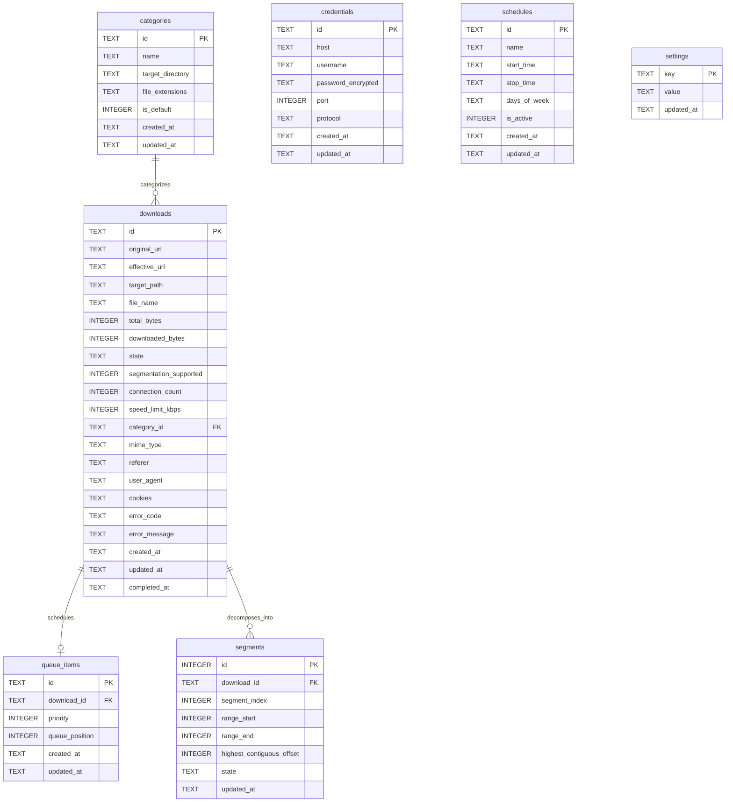

# DATABASE.md: UnduhKilat

## 1. Persistence Overview / Gambaran Persistensi

### 1.1 Scope of the Document / Ruang Lingkup Dokumen
This document defines the physical and logical database architecture for **UnduhKilat**, a crash-durable, high-throughput desktop download manager for Windows built with Rust (stable, MSVC toolchain), egui/eframe on the wgpu renderer, and Tokio multi-thread async runtime (DEC-005). 

The state storage subsystem is responsible for persisting:
- Master download task states, network attributes, request headers, and authentication references.
- Dynamic byte-range segment partitions and transactional byte-offset checkpoints for multi-connection downloads.
- Queue sequencing, per-item manual priority assignments, and dispatch bookkeeping.
- File categories, pattern matching rules, and directory target assignments.
- Reusable host credentials protected at rest.
- Time-based scheduling windows for automated queue execution.
- Application-wide user preferences, speed limits, and concurrency settings.

### 1.2 Storage Engine & File System Location
- **Engine**: Embedded SQLite (via `rusqlite` / `sqlx-sqlite` with bundled SQLite 3.40+). SQLite provides a zero-configuration, transactional, ACID-compliant local relational store with zero network overhead.
- **Physical Location**: Stored as a single database file `unduhkilat.db` located within the local application data directory:
  - Standard installation/user path: `%LOCALAPPDATA%\UnduhKilat\state\unduhkilat.db`
  - Portable override (DEC-007): If an `unduhkilat-portable.marker` file exists in the executable root folder, the database resides at `.\data\state\unduhkilat.db` relative to `UnduhKilat.exe`.
- **Ancillary Database Files**: SQLite Write-Ahead Logging generates `unduhkilat.db-wal` and shared-memory index `unduhkilat.db-shm` within the same directory.
- **File System Permissions**: Constrained to the local Windows user profile (NTFS user-level ACLs). The application operates without elevation (DEC-007), writing only within its portable or AppData tree.

### 1.3 Concurrency Mode & WAL Configuration
Because Tokio drives parallel tasks executing dozens of segmented HTTP connections simultaneously, the database must support fast, lock-free concurrent reads while isolating frequent offset updates:
- **Write-Ahead Logging (WAL)**: Initialized immediately on connection via `PRAGMA journal_mode = WAL;`. WAL allows concurrent readers (egui UI frame renders, diagnostic monitors) to query the database without blocking or being blocked by the download engine writer.
- **Busy Timeout**: Configured via `PRAGMA busy_timeout = 5000;` (5,000 milliseconds) to prevent immediate `SQLITE_BUSY` errors during concurrent checkpointing or transaction bursts.
- **Synchronous Mode**: Configured to `PRAGMA synchronous = NORMAL;`. In WAL mode, `NORMAL` ensures total consistency against application crashes and process termination (`TerminateProcess`, Task Manager kill) while drastically reducing I/O disk flushes compared to `FULL` (FR-010, FR-058).
- **Foreign Key Enforcement**: Enforced globally on every connection via `PRAGMA foreign_keys = ON;`.
- **Single-Writer Thread Concurrency Pattern**: In accordance with SQLite's single-writer architecture, transactional writes (segment progress checkpointing, state transitions) are funneled through a dedicated async Tokio channel to a serialized persistence actor (single writer connection), whereas UI read views utilize a read-only connection pool.

### 1.4 Tenancy & Isolation Strategy
- **Single-User Local Tenancy**: UnduhKilat is an interactive personal desktop client. Tenancy is strictly isolated to the operating system's active Windows interactive user session (DEC-005).
- **No Remote Telemetry or Shared Cloud State**: State is 100% self-contained on the host machine (FR-057). No multi-user tenancy or distributed synchronization mechanisms exist.

### 1.5 Naming, Identifiers & Timestamp Conventions
- **Table & Column Naming**: Strict lower `snake_case` naming across all tables, columns, indexes, and constraints (e.g., `highest_contiguous_offset`, `queue_position`).
- **Primary Keys & Identifiers**:
  - Entity-level primary keys for `downloads`, `categories`, `credentials`, `schedules`, and `queue_items` use canonical UUIDv4 strings (`TEXT` representation of 36 lowercase characters with hyphens, e.g., `550e8400-e29b-41d4-a716-446655440000`).
  - Child range records in `segments` use an auto-incrementing 64-bit integer (`INTEGER PRIMARY KEY AUTOINCREMENT`) paired with a natural composite unique constraint (`download_id`, `segment_index`).
  - Configuration entries in `settings` use a string-based natural key `key` (`TEXT PRIMARY KEY`).
- **Timestamps**: All timestamps (`created_at`, `updated_at`, `completed_at`) are stored as ISO-8601 UTC strings formatted as `YYYY-MM-DDTHH:MM:SS.SSSZ` (e.g., `2026-03-30T14:22:10.123Z`), generated via `strftime('%Y-%m-%dT%H:%M:%fZ', 'now')`.
- **Byte Counts & Offsets**: All file offsets, ranges, and sizes are stored as signed 64-bit integers (`INTEGER` / Rust `i64`), supporting files up to $2^{63}-1$ bytes (exceeding exabyte limits).
- **Secrets at Rest**: Sensitive fields (e.g., HTTP/FTP host authentication passwords in `credentials.password_encrypted`) are encrypted using the Windows Data Protection API (DPAPI via `CryptProtectData`), stored as base64-encoded `TEXT` or raw `BLOB`.

### 1.6 Traceability to Product Decisions (DEC-XXX)
- **DEC-001 (Unbounded Concurrency & Connections)**: Database schema uses unbounded 32/64-bit integers (`connection_count`, `concurrency_limit`, `default_connections_per_download`) without table-level `CHECK` limits that enforce artificial ceilings (FR-001, FR-002).
- **DEC-002 (Manual Priority then FIFO Dispatch)**: The `queue_items` table stores both `priority` (`INTEGER`) and `queue_position` (`INTEGER`), enabling deterministic SQL ordering: `ORDER BY priority DESC, queue_position ASC` (FR-018, FR-021).
- **DEC-003 (Hybrid Media Capture)**: Ingested media links from browser sniffing and DOM hooks flow into standard `downloads` records once confirmed, maintaining identical schema attributes (FR-041, FR-042).
- **DEC-004 (Close to Tray & Notifications)**: Background state persists continuously via transactional checkpointing so the engine operates independently of UI window state (FR-052, FR-054).
- **DEC-005 (Windows 10/11 x64 Exclusive)**: Platform-specific paths, registry integration mappings, and DPAPI-encrypted credential storage reflect Windows Win32 APIs.
- **DEC-007 (Portable ZIP Distribution)**: Single-file SQLite database design enables zero-installation operation and zero-dependency database relocations (FR-059).

---

## 2. ERD (Entity Relationship Diagram)



## 3. Table Definitions / Definisi Tabel

### 3.1 downloads
The primary entity of UnduhKilat representing an individual file transfer task, whether added manually, captured from the Chromium browser extension, detected by the media sniffer, or enqueued via batch/site grabber operations (FR-001–FR-017, FR-036–FR-047).

#### Columns
| Column | Type | Constraint | Notes |
|---|---|---|---|
| `id` | `TEXT` | `PRIMARY KEY NOT NULL` | UUIDv4 (36-character canonical lowercase string). |
| `original_url` | `TEXT` | `NOT NULL` | The initial URL provided or intercepted (`http://`, `https://`, or `ftp://`). |
| `effective_url` | `TEXT` | `NOT NULL` | Final URL after following HTTP redirects (FR-013). Initialized to `original_url`. |
| `target_path` | `TEXT` | `NOT NULL` | Absolute Windows file system path where the payload is assembled and stored (FR-016). |
| `file_name` | `TEXT` | `NOT NULL` | Destination file name derived from URL path, `Content-Disposition`, or user override. |
| `total_bytes` | `INTEGER` | `NOT NULL DEFAULT -1` | Total file size in bytes (-1 indicates unknown size or chunked transfer). Signed 64-bit integer. |
| `downloaded_bytes` | `INTEGER` | `NOT NULL DEFAULT 0` | Checkpointed aggregate bytes written to disk across all segments. Signed 64-bit integer. |
| `state` | `TEXT` | `NOT NULL DEFAULT 'queued'` | Operational state: `'queued'`, `'running'`, `'paused'`, `'completed'`, `'failed'`, `'cancelled'`. |
| `segmentation_supported`| `INTEGER` | `NOT NULL DEFAULT 1` | Boolean flag (0 = false, 1 = true). Indicates whether the server supports HTTP `Range: bytes` (FR-003, FR-005). |
| `connection_count` | `INTEGER` | `NOT NULL DEFAULT 8` | Number of parallel connections allocated for this download. Unbounded positive integer (DEC-001, FR-002). |
| `speed_limit_kbps` | `INTEGER` | `NOT NULL DEFAULT 0` | Per-download speed limit in KB/s. `0` indicates unlimited throughput (FR-026, FR-028). |
| `category_id` | `TEXT` | `NULL REFERENCES categories(id) ON DELETE SET NULL` | Foreign key referencing the assigned file category (FR-029, FR-032). |
| `mime_type` | `TEXT` | `NULL` | MIME content type reported by server (e.g., `video/mp4`, `application/zip`). |
| `referer` | `TEXT` | `NULL` | HTTP `Referer` header captured from browser context or user entry (FR-013, FR-017). |
| `user_agent` | `TEXT` | `NULL` | HTTP `User-Agent` captured from browser context or system default (FR-017). |
| `cookies` | `TEXT` | `NULL` | Serialized HTTP cookie jar or raw `Cookie` header string for session authentication (FR-017, FR-037). |
| `error_code` | `TEXT` | `NULL` | Canonical error code if `state = 'failed'` (e.g., `ERR_RANGE_NOT_SUPPORTED`, `ERR_STORAGE_FULL`). |
| `error_message` | `TEXT` | `NULL` | Human-readable error description or diagnostic message logged during failure (FR-056). |
| `created_at` | `TEXT` | `NOT NULL` | ISO-8601 UTC timestamp when the record was created. |
| `updated_at` | `TEXT` | `NOT NULL` | ISO-8601 UTC timestamp of last metadata or progress checkpoint. |
| `completed_at` | `TEXT` | `NULL` | ISO-8601 UTC timestamp when verification succeeded and status became `completed` (FR-011). |

#### Indexes
| Index Name | Columns | Purpose |
|---|---|---|
| `idx_downloads_state` | `state` | Fast filtration of active, queued, and completed downloads for the main UI list and scheduler loop (FR-018, FR-048). |
| `idx_downloads_category_id` | `category_id` | Accelerates category-based filtering in the egui download view (FR-048). |
| `idx_downloads_created_at` | `created_at DESC` | Default descending chronological sorting in the desktop view. |

#### Foreign Keys and Cascade Rules
- `category_id` references `categories(id)` with `ON DELETE SET NULL` and `ON UPDATE CASCADE`. Deleting a category does not delete the download; its category field is cleared to null (fallback category logic in application code).

#### State Enumerations
- `queued`: Enqueued in the download scheduler awaiting an available concurrency slot (FR-020).
- `running`: Actively executing multi-connection Tokio async workers (FR-003, FR-004).
- `paused`: Suspended manually by the user, scheduled stop, or recovered from process termination (FR-006, FR-010).
- `completed`: Fully downloaded, assembled, and verified against expected byte length (FR-011).
- `failed`: Aborted due to unrecoverable network, authorization, protocol, or file I/O error.
- `cancelled`: Terminated and discarded by explicit user action prior to completion.

#### Business Invariants in Application Code
1. **Crash Normalization**: On application startup, any download persisting with `state = 'running'` MUST be transactionally converted to `state = 'paused'` before any Tokio worker is spawned (FR-010, USER_FLOW Flow 4).
2. **Unbounded Connection Limits**: In accordance with DEC-001 and FR-002, `connection_count` is validated only to be $\ge 1$; no arbitrary maximum ceiling is imposed by the engine or database constraint.
3. **Byte Length Verification**: An item is never set to `completed` unless `downloaded_bytes == total_bytes` (for known lengths). If lengths differ, application code transitions state to `failed` with `error_code = 'ERR_CHECKSUM_SIZE_MISMATCH'` (FR-011).
4. **Single-Connection Fallback**: If the server rejects byte ranges (`Accept-Ranges` missing or HTTP 416), `segmentation_supported` is set to `0` and `connection_count` operates strictly as `1` (FR-005).

---

### 3.2 segments
Stores the dynamic byte-range partitions and persistent file offsets for multi-connection downloads (FR-003, FR-004, FR-006, FR-058).

#### Columns
| Column | Type | Constraint | Notes |
|---|---|---|---|
| `id` | `INTEGER` | `PRIMARY KEY AUTOINCREMENT` | Auto-incrementing 64-bit integer surrogate identifier. |
| `download_id` | `TEXT` | `NOT NULL REFERENCES downloads(id) ON DELETE CASCADE` | UUIDv4 foreign key linking the segment to its parent download task. |
| `segment_index` | `INTEGER` | `NOT NULL` | Zero-based sequential index of the segment within the download ($0, 1, \dots, N-1$). |
| `range_start` | `INTEGER` | `NOT NULL` | Lower bound byte offset of this segment's allocated byte slice (inclusive). |
| `range_end` | `INTEGER` | `NOT NULL` | Upper bound byte offset of this segment's allocated byte slice (inclusive). |
| `highest_contiguous_offset` | `INTEGER` | `NOT NULL` | Offset of the next byte to fetch; initialized to `range_start` and equal to `range_end + 1` when the segment is complete. Progress checkpoint (FR-006, FR-058). |
| `state` | `TEXT` | `NOT NULL DEFAULT 'pending'` | Segment state: `'pending'`, `'downloading'`, `'completed'`. |
| `updated_at` | `TEXT` | `NOT NULL` | ISO-8601 UTC timestamp of the last offset checkpoint flush. |

#### Indexes
| Index Name | Columns | Purpose |
|---|---|---|
| `idx_segments_download_id` | `download_id` | Rapid lookup of all segments belonging to a given download during UI detail rendering and engine dispatch (FR-055). |
| `uq_segments_download_index` | `download_id, segment_index` | `UNIQUE` constraint ensuring contiguous unique indexing per download. |

#### Foreign Keys and Cascade Rules
- `download_id` references `downloads(id)` with `ON DELETE CASCADE` and `ON UPDATE CASCADE`. Removing a download purge-deletes all associated segment partitions and checkpoints immediately.

#### State Enumerations
- `pending`: Segment range defined but connection task not yet allocated or socket not connected.
- `downloading`: Dedicated Tokio worker task actively receiving chunk streams and updating `highest_contiguous_offset`.
- `completed`: Segment has completely fetched its range (`highest_contiguous_offset == range_end + 1`).

#### Business Invariants in Application Code
1. **Contiguous Range Integrity**: For any initial download segmentation into $N$ segments, segment $0$ has `range_start = 0`, segment $i$ has `range_start = segments[i-1].range_end + 1`, and segment $N-1$ has `range_end = downloads.total_bytes - 1`.
2. **Offset Monotonicity**: `highest_contiguous_offset` must satisfy `range_start <= highest_contiguous_offset <= range_end + 1`. It is strictly monotonically increasing during transfer and never decreases during resume operations (FR-007, KPI-006).
3. **Dynamic Re-splitting**: When an idle connection worker splits an active segment (FR-004), the engine transactionally creates a new row with index $N$, adjusts the target segment's `range_end` down to the split midpoint, sets the new segment's `range_start` to midpoint $+ 1$, and initializes both with their appropriate offsets.
4. **Crash Recovery Non-Duplication**: Upon resuming from a crash or pause, the HTTP `Range` header request issued for each segment MUST specify `bytes={highest_contiguous_offset}-{range_end}`, guaranteeing 0 bytes re-downloaded (FR-007, FR-010).

---

### 3.3 queue_items
Maintains scheduling order, dispatch queue positioning, and per-item manual execution priorities (DEC-002, FR-018–FR-022).

#### Columns
| Column | Type | Constraint | Notes |
|---|---|---|---|
| `id` | `TEXT` | `PRIMARY KEY NOT NULL` | UUIDv4 (36-character canonical lowercase string). |
| `download_id` | `TEXT` | `NOT NULL UNIQUE REFERENCES downloads(id) ON DELETE CASCADE` | 1-to-1 foreign key referencing the associated download task. |
| `priority` | `INTEGER` | `NOT NULL DEFAULT 0` | Manual user priority level (higher values run before lower values) (DEC-002, FR-019). |
| `queue_position` | `INTEGER` | `NOT NULL` | Sequential position within the queue for FIFO resolution among items with equal priority (DEC-002, FR-018). |
| `created_at` | `TEXT` | `NOT NULL` | ISO-8601 UTC timestamp of queue insertion. |
| `updated_at` | `TEXT` | `NOT NULL` | ISO-8601 UTC timestamp of last priority or position adjustment. |

#### Indexes
| Index Name | Columns | Purpose |
|---|---|---|
| `idx_queue_dispatch` | `priority DESC, queue_position ASC` | Authoritative composite dispatch index enforcing DEC-002: manual priority first, remainder FIFO. |
| `uq_queue_download_id` | `download_id` | `UNIQUE` constraint ensuring a download task appears in the dispatch queue at most once. |

#### Foreign Keys and Cascade Rules
- `download_id` references `downloads(id)` with `ON DELETE CASCADE` and `ON UPDATE CASCADE`. When a download record is deleted, its queue item is automatically removed.

#### State Enumerations
This table does not define independent status strings; lifecycle state is mirrored from the referenced `downloads.state` record (`queued`, `running`, `paused`, etc.).

#### Business Invariants in Application Code
1. **Deterministic Dispatch Rule (DEC-002, FR-018)**: When concurrency slots become available, the scheduler selects candidates using `SELECT download_id FROM queue_items JOIN downloads ON queue_items.download_id = downloads.id WHERE downloads.state = 'queued' ORDER BY queue_items.priority DESC, queue_items.queue_position ASC LIMIT ?`.
2. **Dense FIFO Re-indexing**: When an item is reordered in the UI (FR-021), the application updates `queue_position` values using a transactional batch re-index to preserve strict sequence.
3. **Dynamic Priority Elevation**: Modifying an item's priority via UI takes immediate effect on the next dispatch cycle without stopping running downloads (FR-019).

---

### 3.4 categories
Stores file category classifications, target folder paths on the local Windows filesystem, and file extension mapping rules (FR-029–FR-032).

#### Columns
| Column | Type | Constraint | Notes |
|---|---|---|---|
| `id` | `TEXT` | `PRIMARY KEY NOT NULL` | UUIDv4 (36-character canonical lowercase string). |
| `name` | `TEXT` | `NOT NULL UNIQUE` | Unique category name (e.g., `'Compressed'`, `'Documents'`, `'Music'`, `'Programs'`, `'Video'`). |
| `target_directory` | `TEXT` | `NOT NULL` | Absolute Windows directory path where files in this category are saved (FR-029). |
| `file_extensions` | `TEXT` | `NOT NULL` | Comma-separated or JSON list of lowercase extensions (e.g., `'zip,rar,7z,tar,gz'`) (FR-029). |
| `is_default` | `INTEGER` | `NOT NULL DEFAULT 0` | Boolean flag (0 = false, 1 = true). Marks the fallback category for unknown extensions (FR-030). |
| `created_at` | `TEXT` | `NOT NULL` | ISO-8601 UTC timestamp of category creation. |
| `updated_at` | `TEXT` | `NOT NULL` | ISO-8601 UTC timestamp of category modification. |

#### Indexes
| Index Name | Columns | Purpose |
|---|---|---|
| `uq_categories_name` | `name` | `UNIQUE` constraint preventing duplicate category names. |
| `idx_categories_is_default` | `is_default` | Rapid identification of the designated fallback category. |

#### Foreign Keys and Cascade Rules
- Referenced by `downloads.category_id`. The deletion policy on `downloads` is `ON DELETE SET NULL`, ensuring download history is preserved if a category is removed.

#### State Enumerations
This table contains no state columns; records represent static configuration entities.

#### Business Invariants in Application Code
1. **Single Fallback Invariant**: Exactly one category must have `is_default = 1`. If the user marks another category as default, the application resets the previous default within a single transaction (FR-030).
2. **Case-Insensitive Extension Matching**: Application routing normalizes intercepted file extensions to lowercase before matching against the tokens in `file_extensions`.
3. **Path Validation**: Target directory strings must represent valid Windows absolute paths (e.g., `C:\Downloads\Video`) or environment-variable resolvable paths (USER_FLOW Flow 5). Directories are created on demand if they do not exist.
4. **Historical Isolation**: Modifying a category's `target_directory` or extension mappings applies strictly to subsequent downloads; existing download records retain their existing `target_path` (FR-031).

### 3.5 credentials
Stores host-level and proxy authentication credentials reusable across multiple download sessions (FR-014, FR-015).

#### Columns
| Column | Type | Constraint | Notes |
|---|---|---|---|
| `id` | `TEXT` | `PRIMARY KEY NOT NULL` | UUIDv4 (36-character canonical lowercase string). |
| `host` | `TEXT` | `NOT NULL` | Target domain name, IP address, or proxy server address (e.g., `files.example.com`). |
| `username` | `TEXT` | `NOT NULL` | Account or HTTP basic/digest username. |
| `password_encrypted` | `TEXT` | `NOT NULL` | Authentication secret encrypted at rest using Windows DPAPI (`CryptProtectData`) and base64 encoded (FR-058, DEC-005). |
| `port` | `INTEGER` | `NULL` | Explicit network port number (1–65535). `NULL` indicates default port for the protocol (80 for HTTP, 443 for HTTPS, 21 for FTP). |
| `protocol` | `TEXT` | `NOT NULL DEFAULT 'http'` | Protocol type: `'http'`, `'https'`, `'ftp'`, or `'proxy'` (FR-012, FR-015). |
| `created_at` | `TEXT` | `NOT NULL` | ISO-8601 UTC timestamp of record creation. |
| `updated_at` | `TEXT` | `NOT NULL` | ISO-8601 UTC timestamp of last credential update. |

#### Indexes
| Index Name | Columns | Purpose |
|---|---|---|
| `idx_credentials_host_protocol` | `host, protocol` | Fast lookup during HTTP 401/407 challenges or FTP connection initialization (FR-014). |
| `uq_credentials_host_port_user` | `host, port, username, protocol` | `UNIQUE` constraint preventing duplicate credential definitions for the same endpoint identity when an explicit port is stored. |
| `uq_credentials_host_null_port_user` | `host, username, protocol` `WHERE port IS NULL` | Partial `UNIQUE` index preventing duplicate credential definitions for the same endpoint identity when `port` is `NULL` (SQLite treats `NULL` values as distinct in the table-level `UNIQUE` constraint above). |

#### Foreign Keys and Cascade Rules
This table is not bound by foreign key constraints to `downloads`. Credential association is evaluated dynamically at runtime by matching target URI endpoints (`effective_url`) against stored `host`, `port`, and `protocol` definitions.

#### State Enumerations
This entity represents configuration data and does not track operational state machines.

#### Business Invariants in Application Code
1. **Protection at Rest (DEC-005)**: The plaintext password is never committed to SQLite. Before insertion or update, the engine passes the secret to the Win32 `CryptProtectData` API with an optional per-user entropy salt and base64-encodes the resulting ciphertext. During authentication challenges, `CryptUnprotectData` is invoked in-memory, and the plaintext buffer is zeroized (`zeroize` crate) after use.
2. **Endpoint Resolution Priority**: When an HTTP 401 or 407 challenge occurs, the engine queries `credentials` matching both exact host and explicit port first; if no match is found, it queries matching the host with `port IS NULL`.
3. **Protocol Normalization**: The `protocol` column value is stored in strict lowercase (`'http'`, `'https'`, `'ftp'`, `'proxy'`).

---

### 3.6 schedules
Stores automated time windows and daily recurring triggers for starting and stopping the download queue (FR-023, FR-024).

#### Columns
| Column | Type | Constraint | Notes |
|---|---|---|---|
| `id` | `TEXT` | `PRIMARY KEY NOT NULL` | UUIDv4 (36-character canonical lowercase string). |
| `name` | `TEXT` | `NOT NULL` | User-defined label for the schedule entry (e.g., `'Nightly Batch'`). |
| `start_time` | `TEXT` | `NULL` | Local time formatted as `HH:MM:SS` (24-hour clock) to initiate queue execution. `NULL` if only stop time is configured. |
| `stop_time` | `TEXT` | `NULL` | Local time formatted as `HH:MM:SS` (24-hour clock) to pause active queue execution. `NULL` if only start time is configured. |
| `days_of_week` | `TEXT` | `NOT NULL DEFAULT '1,2,3,4,5,6,7'` | Comma-separated list of active ISO weekday numbers (`1` = Monday, `7` = Sunday) on which the schedule executes. |
| `is_active` | `INTEGER` | `NOT NULL DEFAULT 1` | Boolean flag (0 = disabled, 1 = active). |
| `created_at` | `TEXT` | `NOT NULL` | ISO-8601 UTC timestamp of schedule creation. |
| `updated_at` | `TEXT` | `NOT NULL` | ISO-8601 UTC timestamp of last schedule modification. |

#### Indexes
| Index Name | Columns | Purpose |
|---|---|---|
| `idx_schedules_is_active` | `is_active` | Rapid filtering of active schedules for the background scheduler evaluation loop. |

#### Foreign Keys and Cascade Rules
This table maintains no foreign key constraints.

#### State Enumerations
This table tracks no operational lifecycle state enumerations; activation is governed by the boolean `is_active`.

#### Business Invariants in Application Code
1. **Window Definition Invariant**: At least one of `start_time` or `stop_time` must be non-null. Setting both to `NULL` is rejected by application validation.
2. **Background Execution Continuity (DEC-004, FR-024)**: The Tokio scheduler evaluates active schedules on a periodic 60-second timer tick. Scheduled actions fire whether the main window is visible or minimized/hidden to the system tray.
3. **Day Token Validation**: `days_of_week` tokens must strictly consist of integers between 1 and 7 without duplicates.

---

### 3.7 settings
Stores application-wide configuration parameters, concurrency ceilings, speed throttles, and integration flags as key-value pairs (FR-001, FR-002, FR-015, FR-025, FR-050).

#### Columns
| Column | Type | Constraint | Notes |
|---|---|---|---|
| `key` | `TEXT` | `PRIMARY KEY NOT NULL` | Natural string identifier representing the configuration key. |
| `value` | `TEXT` | `NOT NULL` | String-serialized configuration value (integers, strings, booleans, or JSON). |
| `updated_at` | `TEXT` | `NOT NULL` | ISO-8601 UTC timestamp of last setting modification. |

#### Canonical Settings Keys and Specifications
| Setting Key | Type | Default Value | Notes |
|---|---|---|---|
| `concurrency_limit` | Integer String | `[placeholder]` | Maximum simultaneous active transfers. Positive integer with no application upper bound (DEC-001, FR-001). |
| `default_connections_per_download` | Integer String | `8` | Default parallel connection count assigned to newly ingested downloads. Unbounded positive integer (DEC-001, FR-002). |
| `global_speed_limit_kbps` | Integer String | `0` | Aggregate bandwidth throttle in KB/s. `0` represents unlimited (FR-025, FR-028). |
| `clipboard_monitoring_enabled` | Boolean String (`0` or `1`) | `1` | Enables automatic Windows clipboard polling for downloadable URLs (FR-040). |
| `close_to_tray_enabled` | Boolean String (`0` or `1`) | `1` | Closing window hides to tray while downloads continue (DEC-004, FR-052). |
| `completion_toast_enabled` | Boolean String (`0` or `1`) | `1` | Emits Windows toast notification on transfer completion (DEC-004, FR-054). |
| `proxy_mode` | String (`'direct'`, `'system'`, `'manual'`) | `'system'` | Proxy routing strategy (FR-015). |
| `proxy_host` | String | `NULL` | Manual proxy hostname or IP address (FR-015). |
| `proxy_port` | Integer String | `NULL` | Manual proxy port (FR-015). |
| `proxy_username` | String | `NULL` | Manual proxy authentication username (FR-015). |
| `proxy_password_encrypted` | String | `NULL` | DPAPI-encrypted proxy password (FR-015, DEC-005). |
| `log_level` | String (`'trace'`, `'debug'`, `'info'`, `'warn'`, `'error'`) | `'info'` | Threshold level for rotating disk log files (FR-050, FR-057). |
| `dynamic_split_min_segment_bytes` | Integer String | `[placeholder]` | Minimum remaining segment byte size permitted to be dynamically re-split (FR-004). |
| `checkpoint_interval_ms` | Integer String | `[placeholder]` | Timer interval for committing segment offsets to SQLite (FR-058, NFR-004). |
| `retry_count_limit` | Integer String | `[placeholder]` | Maximum reconnection attempts on dropped socket before marking item failed (FR-008). |
| `retry_backoff_ms` | Integer String | `[placeholder]` | Base backoff interval in milliseconds for socket reconnects (FR-008). |
| `site_grabber_max_depth` | Integer String | `[placeholder]` | Maximum traversal depth for batch site walker (FR-046). |

#### Indexes
| Index Name | Columns | Purpose |
|---|---|---|
| Primary Key | `key` | Implicit unique B-tree index on natural key. |

#### Foreign Keys and Cascade Rules
This table maintains no foreign keys.

#### State Enumerations
This table tracks no operational lifecycle states.

#### Business Invariants in Application Code
1. **Unbounded Concurrency Settings (DEC-001)**: Invariants strictly prohibit artificial upper limit clamps on `concurrency_limit` and `default_connections_per_download`. Any positive integer ($\ge 1$) provided by the user must be committed and applied directly.
2. **Immediate Live Application**: Bandwidth limits (`global_speed_limit_kbps`) take effect across active Tokio sockets within the next rate-limiter interval without restarting or pausing active transfers (FR-028).
3. **DPAPI Security Boundary (DEC-005)**: `proxy_password_encrypted` must be processed exclusively via DPAPI `CryptProtectData` and never stored in plaintext.

---

## 4. ORM Schema / Skema ORM

The following physical migration DDL defines the authoritative SQLite schema for UnduhKilat, executable via SQLx migrations (`sqlx migrate`) or directly via `rusqlite` embedded bootstrap scripts on first run.

```sql
-- ============================================================================
-- UnduhKilat Database Migration: 0001_initial_schema.sql
-- Storage Engine: SQLite 3.40+ (WAL Mode)
-- Platform: Windows 10/11 x64 (MSVC)
-- ============================================================================

-- Ensure foreign key enforcement is active
PRAGMA foreign_keys = ON;

-- ----------------------------------------------------------------------------
-- 1. Table: categories
-- ----------------------------------------------------------------------------
CREATE TABLE IF NOT EXISTS categories (
    id TEXT PRIMARY KEY NOT NULL,
    name TEXT NOT NULL UNIQUE,
    target_directory TEXT NOT NULL,
    file_extensions TEXT NOT NULL,
    is_default INTEGER NOT NULL DEFAULT 0 CHECK (is_default IN (0, 1)),
    created_at TEXT NOT NULL,
    updated_at TEXT NOT NULL
);

CREATE UNIQUE INDEX IF NOT EXISTS uq_categories_name 
    ON categories (name);

CREATE INDEX IF NOT EXISTS idx_categories_is_default 
    ON categories (is_default);

-- ----------------------------------------------------------------------------
-- 2. Table: downloads
-- ----------------------------------------------------------------------------
CREATE TABLE IF NOT EXISTS downloads (
    id TEXT PRIMARY KEY NOT NULL,
    original_url TEXT NOT NULL,
    effective_url TEXT NOT NULL,
    target_path TEXT NOT NULL,
    file_name TEXT NOT NULL,
    total_bytes INTEGER NOT NULL DEFAULT -1,
    downloaded_bytes INTEGER NOT NULL DEFAULT 0,
    state TEXT NOT NULL DEFAULT 'queued' 
        CHECK (state IN ('queued', 'running', 'paused', 'completed', 'failed', 'cancelled')),
    segmentation_supported INTEGER NOT NULL DEFAULT 1 
        CHECK (segmentation_supported IN (0, 1)),
    connection_count INTEGER NOT NULL DEFAULT 8 
        CHECK (connection_count >= 1),
    speed_limit_kbps INTEGER NOT NULL DEFAULT 0 
        CHECK (speed_limit_kbps >= 0),
    category_id TEXT NULL,
    mime_type TEXT NULL,
    referer TEXT NULL,
    user_agent TEXT NULL,
    cookies TEXT NULL,
    error_code TEXT NULL,
    error_message TEXT NULL,
    created_at TEXT NOT NULL,
    updated_at TEXT NOT NULL,
    completed_at TEXT NULL,
    FOREIGN KEY (category_id) REFERENCES categories (id) 
        ON DELETE SET NULL 
        ON UPDATE CASCADE
);

CREATE INDEX IF NOT EXISTS idx_downloads_state 
    ON downloads (state);

CREATE INDEX IF NOT EXISTS idx_downloads_category_id 
    ON downloads (category_id);

CREATE INDEX IF NOT EXISTS idx_downloads_created_at 
    ON downloads (created_at DESC);

-- ----------------------------------------------------------------------------
-- 3. Table: segments
-- ----------------------------------------------------------------------------
CREATE TABLE IF NOT EXISTS segments (
    id INTEGER PRIMARY KEY AUTOINCREMENT,
    download_id TEXT NOT NULL,
    segment_index INTEGER NOT NULL CHECK (segment_index >= 0),
    range_start INTEGER NOT NULL CHECK (range_start >= 0),
    range_end INTEGER NOT NULL CHECK (range_end >= range_start),
    highest_contiguous_offset INTEGER NOT NULL CHECK (highest_contiguous_offset >= range_start),
    state TEXT NOT NULL DEFAULT 'pending' 
        CHECK (state IN ('pending', 'downloading', 'completed')),
    updated_at TEXT NOT NULL,
    FOREIGN KEY (download_id) REFERENCES downloads (id) 
        ON DELETE CASCADE 
        ON UPDATE CASCADE,
    CONSTRAINT uq_segments_download_index UNIQUE (download_id, segment_index)
);

CREATE INDEX IF NOT EXISTS idx_segments_download_id 
    ON segments (download_id);

-- ----------------------------------------------------------------------------
-- 4. Table: queue_items
-- ----------------------------------------------------------------------------
CREATE TABLE IF NOT EXISTS queue_items (
    id TEXT PRIMARY KEY NOT NULL,
    download_id TEXT NOT NULL UNIQUE,
    priority INTEGER NOT NULL DEFAULT 0,
    queue_position INTEGER NOT NULL CHECK (queue_position >= 0),
    created_at TEXT NOT NULL,
    updated_at TEXT NOT NULL,
    FOREIGN KEY (download_id) REFERENCES downloads (id) 
        ON DELETE CASCADE 
        ON UPDATE CASCADE
);

CREATE INDEX IF NOT EXISTS idx_queue_dispatch 
    ON queue_items (priority DESC, queue_position ASC);

CREATE UNIQUE INDEX IF NOT EXISTS uq_queue_download_id 
    ON queue_items (download_id);

-- ----------------------------------------------------------------------------
-- 5. Table: credentials
-- ----------------------------------------------------------------------------
CREATE TABLE IF NOT EXISTS credentials (
    id TEXT PRIMARY KEY NOT NULL,
    host TEXT NOT NULL,
    username TEXT NOT NULL,
    password_encrypted TEXT NOT NULL,
    port INTEGER NULL CHECK (port IS NULL OR (port >= 1 AND port <= 65535)),
    protocol TEXT NOT NULL DEFAULT 'http' 
        CHECK (protocol IN ('http', 'https', 'ftp', 'proxy')),
    created_at TEXT NOT NULL,
    updated_at TEXT NOT NULL,
    CONSTRAINT uq_credentials_host_port_user UNIQUE (host, port, username, protocol)
);

CREATE INDEX IF NOT EXISTS idx_credentials_host_protocol 
    ON credentials (host, protocol);

CREATE UNIQUE INDEX IF NOT EXISTS uq_credentials_host_null_port_user 
    ON credentials (host, username, protocol) WHERE port IS NULL;

-- ----------------------------------------------------------------------------
-- 6. Table: schedules
-- ----------------------------------------------------------------------------
CREATE TABLE IF NOT EXISTS schedules (
    id TEXT PRIMARY KEY NOT NULL,
    name TEXT NOT NULL,
    start_time TEXT NULL,
    stop_time TEXT NULL,
    days_of_week TEXT NOT NULL DEFAULT '1,2,3,4,5,6,7',
    is_active INTEGER NOT NULL DEFAULT 1 CHECK (is_active IN (0, 1)),
    created_at TEXT NOT NULL,
    updated_at TEXT NOT NULL
);

CREATE INDEX IF NOT EXISTS idx_schedules_is_active 
    ON schedules (is_active);

-- ----------------------------------------------------------------------------
-- 7. Table: settings
-- ----------------------------------------------------------------------------
CREATE TABLE IF NOT EXISTS settings (
    key TEXT PRIMARY KEY NOT NULL,
    value TEXT NOT NULL,
    updated_at TEXT NOT NULL
);
```

### 4.1 Rust Domain Model Entity Structs (SQLx / Rusqlite Mapping)

Below are the strongly-typed domain model representations implemented in Rust matching the SQLite table definitions:

```rust
// Domain models mapped to SQLite entities (in src/domain/models.rs)

use chrono::{DateTime, Utc};
use serde::{Deserialize, Serialize};

#[derive(Debug, Clone, PartialEq, Eq, Serialize, Deserialize)]
pub enum DownloadState {
    Queued,
    Running,
    Paused,
    Completed,
    Failed,
    Cancelled,
}

impl DownloadState {
    pub fn as_str(&self) -> &'static str {
        match self {
            Self::Queued => "queued",
            Self::Running => "running",
            Self::Paused => "paused",
            Self::Completed => "completed",
            Self::Failed => "failed",
            Self::Cancelled => "cancelled",
        }
    }
}

#[derive(Debug, Clone, PartialEq, Eq, Serialize, Deserialize)]
pub enum SegmentState {
    Pending,
    Downloading,
    Completed,
}

impl SegmentState {
    pub fn as_str(&self) -> &'static str {
        match self {
            Self::Pending => "pending",
            Self::Downloading => "downloading",
            Self::Completed => "completed",
        }
    }
}

#[derive(Debug, Clone, Serialize, Deserialize)]
pub struct Category {
    pub id: String,
    pub name: String,
    pub target_directory: String,
    pub file_extensions: String,
    pub is_default: bool,
    pub created_at: String,
    pub updated_at: String,
}

#[derive(Debug, Clone, Serialize, Deserialize)]
pub struct Download {
    pub id: String,
    pub original_url: String,
    pub effective_url: String,
    pub target_path: String,
    pub file_name: String,
    pub total_bytes: i64,
    pub downloaded_bytes: i64,
    pub state: DownloadState,
    pub segmentation_supported: bool,
    pub connection_count: u32,
    pub speed_limit_kbps: u32,
    pub category_id: Option<String>,
    pub mime_type: Option<String>,
    pub referer: Option<String>,
    pub user_agent: Option<String>,
    pub cookies: Option<String>,
    pub error_code: Option<String>,
    pub error_message: Option<String>,
    pub created_at: String,
    pub updated_at: String,
    pub completed_at: Option<String>,
}

#[derive(Debug, Clone, Serialize, Deserialize)]
pub struct Segment {
    pub id: i64,
    pub download_id: String,
    pub segment_index: u32,
    pub range_start: i64,
    pub range_end: i64,
    pub highest_contiguous_offset: i64,
    pub state: SegmentState,
    pub updated_at: String,
}

#[derive(Debug, Clone, Serialize, Deserialize)]
pub struct QueueItem {
    pub id: String,
    pub download_id: String,
    pub priority: i32,
    pub queue_position: u32,
    pub created_at: String,
    pub updated_at: String,
}

#[derive(Debug, Clone, Serialize, Deserialize)]
pub struct Credential {
    pub id: String,
    pub host: String,
    pub username: String,
    pub password_encrypted: String,
    pub port: Option<u16>,
    pub protocol: String,
    pub created_at: String,
    pub updated_at: String,
}

#[derive(Debug, Clone, Serialize, Deserialize)]
pub struct Schedule {
    pub id: String,
    pub name: String,
    pub start_time: Option<String>,
    pub stop_time: Option<String>,
    pub days_of_week: String,
    pub is_active: bool,
    pub created_at: String,
    pub updated_at: String,
}

#[derive(Debug, Clone, Serialize, Deserialize)]
pub struct Setting {
    pub key: String,
    pub value: String,
    pub updated_at: String,
}
```

---

## 5. Consistency Notes / Catatan Konsistensi

### 5.1 Verification Against Technical Constraints & Decisions
- **DEC-001 (Unbounded Concurrency & Connections)**: Neither `downloads.connection_count`, `settings.concurrency_limit`, nor `settings.default_connections_per_download` enforce an artificial upper bound limit in check constraints. The database layer only enforces structural positivity (`connection_count >= 1`), leaving user controls entirely unconstrained.
- **DEC-002 (Priority-then-FIFO Dispatch)**: The composite index `idx_queue_dispatch` on `queue_items (priority DESC, queue_position ASC)` precisely supports the query structure mandated by FR-018: highest manual priority items are selected first, with ties broken by strict FIFO sequence.
- **DEC-004 & FR-058 (Crash Durability & Background Continuity)**: Through SQLite Write-Ahead Logging (`WAL`) combined with `PRAGMA synchronous = NORMAL`, all periodic offset flushes to `segments` and status transitions in `downloads` are crash-resilient without risking file corruption if the process is terminated abruptly via Task Manager (`TerminateProcess`) or an application crash. Power loss does not corrupt the database file, but [placeholder: whether the most recent checkpoint transactions may be lost after power loss under `PRAGMA synchronous = NORMAL`, or whether the durability setting is raised to `PRAGMA synchronous = FULL` so no checkpoint loss is required — the durability choice is the owner's].
- **DEC-005 (Windows 10/11 x64 Exclusive Security)**: DPAPI encryption (`CryptProtectData`) protects sensitive secrets in `credentials.password_encrypted` and `settings.proxy_password_encrypted`, ensuring secrets are tied to the local Windows user profile and never readable in plaintext by external processes inspecting the SQLite database file.
- **DEC-007 (Portable ZIP Support)**: All physical constraints and foreign keys reside in a single self-contained database file `unduhkilat.db`, ensuring that extracting the portable ZIP to any writable folder or external storage drive requires zero external service dependencies or registry-bound database drivers.
- **FR-010 Normalization Guarantee**: The database schema and index definitions directly facilitate the startup normalization query:
  ```sql
  UPDATE downloads 
  SET state = 'paused', updated_at = strftime('%Y-%m-%dT%H:%M:%fZ', 'now') 
  WHERE state = 'running';
  ```
  This guarantees that interrupted downloads transition to a clean, resumable state before the scheduler begins dispatching new connections.