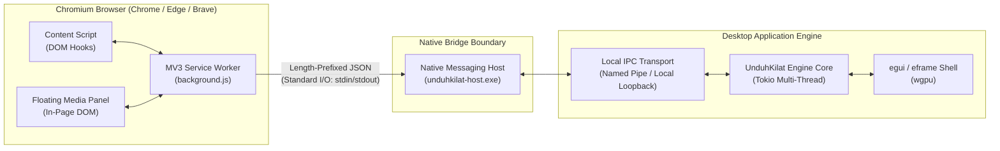
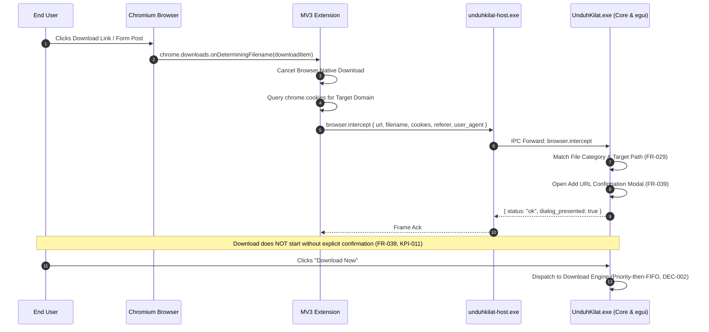
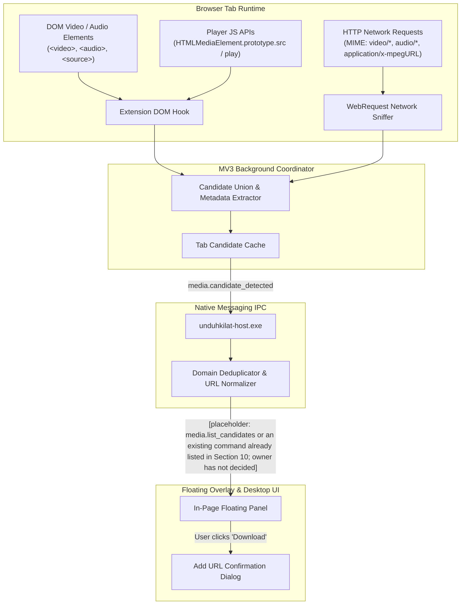
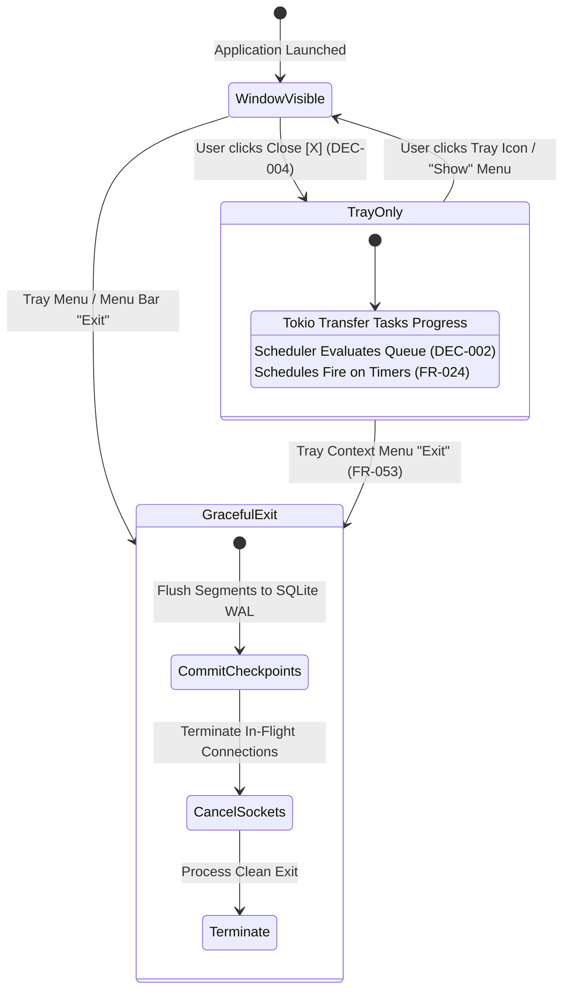

# Integrasi Browser dan Sistem: UnduhKilat

## 1. Scope & System Boundaries

This document defines the technical integration contracts, wire protocols, operating system hooks, and browser extension mechanics connecting UnduhKilat with the Windows desktop environment and Chromium-based web browsers. Its scope covers the Chromium Manifest V3 browser extension architecture, the length-prefixed standard I/O Native Messaging Host protocol, dynamic Windows Registry registration under portable execution constraints, the hybrid media sniffer pipeline, clipboard URL monitoring, system tray lifecycle handling, and Windows native toast notifications.

Detailed data persistence schemas and transactional invariants are defined in `DATABASE.md`. Command envelopes, payload schemas, and IPC signatures are defined in `API.md`. Internal async engine coordination, Tokio runtime thread management, and segmentation pipelines are governed by `ARCHITECTURE.md`. End-user workflows, edge-case interaction sequences, and failure recovery trees are specified in `USER_FLOW.md`. High-level system requirements and KPIs are cataloged in `REQUIREMENTS.md`.

---

## 2. Native Messaging Host Architecture & Protocol

### 2.1 Process Separation & Communication Topology
UnduhKilat establishes browser integration across an explicit security and process boundary via a dedicated native messaging host executable, `unduhkilat-host.exe`, decoupled from the primary GUI application `UnduhKilat.exe`. When a supported Chromium browser initiates communication, the browser spawns `unduhkilat-host.exe` as a child process under the current user's token.



### 2.2 Wire Framing & Serialization Contract
The Native Messaging Host implements the Chromium native messaging wire specification:
1. **Header**: Exactly 32 bits (4 bytes) unsigned integer in native byte order (Little-Endian on Windows x64; DEC-005) specifying the length of the following JSON payload.
2. **Payload**: UTF-8 encoded JSON string matching the length specified in the 4-byte header.
3. **Framing Limits**: Maximum payload size supported by the Chromium native messaging standard is $1\text{ MB}$ ($1,048,576\text{ bytes}$). Messages exceeding this boundary are rejected with `ERR_PAYLOAD_CORRUPT`.

```
0                   1                   2                   3
0 1 2 3 4 5 6 7 8 9 0 1 2 3 4 5 6 7 8 9 0 1 2 3 4 5 6 7 8 9 0 1
+-+-+-+-+-+-+-+-+-+-+-+-+-+-+-+-+-+-+-+-+-+-+-+-+-+-+-+-+-+-+-+-+
|               Message Length N (Little-Endian uint32)         |
+-+-+-+-+-+-+-+-+-+-+-+-+-+-+-+-+-+-+-+-+-+-+-+-+-+-+-+-+-+-+-+-+
|                                                               |
|                   UTF-8 JSON Payload (N bytes)                |
|                                                               |
+-+-+-+-+-+-+-+-+-+-+-+-+-+-+-+-+-+-+-+-+-+-+-+-+-+-+-+-+-+-+-+-+
```

### 2.3 Handshake & Lifecycle Management
- **Startup & Ping**: Upon extension initialization, the background service worker opens a native port via `chrome.runtime.connectNative("com.unduhkilat.host")` and sends a `browser.ping` frame. The host validates its internal IPC connection to the desktop engine and replies with application metadata (`app_name`, `version`, `protocol_version`, `app_running`).
- **Engine Bridge**: If the desktop application `UnduhKilat.exe` is not active when `unduhkilat-host.exe` receives an interception command (`browser.intercept` or `media.send_to_app`), `unduhkilat-host.exe` launches `UnduhKilat.exe` passing the portable directory context.
- **Shutdown & Disconnection**: If the browser terminates or the extension disconnects the port, `unduhkilat-host.exe` receives `EOF` on `stdin` ($0\text{ bytes}$ read) and terminates immediately within $500\text{ ms}$, releasing all resources.

---

## 3. Windows Registry Registration & Portable Path Management

### 3.1 Chromium Browser Scope
Link capture and native integration target Chromium-class browsers only (DEC-006):
1. **Google Chrome**: Primary target.
2. **Microsoft Edge**: Chromium engine.
3. **Brave Browser**: Chromium engine.

Firefox and Safari are non-Chromium and out of scope; Opera and Vivaldi are Chromium-based but excluded from the supported target list (DEC-006).

### 3.2 Registry Manifest Definition
The native messaging manifest file, `com.unduhkilat.host.json`, defines allowed origins and the host binary path:

```json
{
  "name": "com.unduhkilat.host",
  "description": "UnduhKilat Download Manager Native Messaging Host",
  "path": "unduhkilat-host.exe",
  "type": "stdio",
  "allowed_origins": [
    "chrome-extension://TBD_CHROME_EXTENSION_ID/",
    "chrome-extension://TBD_EDGE_EXTENSION_ID/",
    "chrome-extension://TBD_BRAVE_EXTENSION_ID/"
  ]
}
```

### 3.3 Dynamic Per-User Registry Setup (DEC-007, FR-034)
Because UnduhKilat runs as a portable ZIP without a standard Windows installer (DEC-007), registry registration is handled dynamically at runtime:
1. **First-Launch Hook**: On boot, `UnduhKilat.exe` checks for the presence and correctness of the registry keys under `HKEY_CURRENT_USER` (`HKCU`).
2. **Zero Elevation**: Writing to `HKCU` requires standard Windows user privileges (no UAC elevation prompt).
3. **Dynamic Self-Repair**: If the portable folder is moved to a new drive or directory, `UnduhKilat.exe` compares the current executable directory against the registered manifest `path`. If a discrepancy is detected, the manifest and registry values are rewritten automatically.

#### Target Registry Keys (Per-User: HKCU)
| Browser | Registry Key Path | Value Name | Value Type | Target Content |
|---|---|---|---|---|
| **Google Chrome** | `HKCU\Software\Google\Chrome\NativeMessagingHosts\com.unduhkilat.host` | `(Default)` | `REG_SZ` | Absolute path to `com.unduhkilat.host.json` |
| **Microsoft Edge** | `HKCU\Software\Microsoft\Edge\NativeMessagingHosts\com.unduhkilat.host` | `(Default)` | `REG_SZ` | Absolute path to `com.unduhkilat.host.json` |
| **Brave Browser** | `HKCU\Software\BraveSoftware\Brave-Browser\NativeMessagingHosts\com.unduhkilat.host` | `(Default)` | `REG_SZ` | Absolute path to `com.unduhkilat.host.json` |

### 3.4 Machine-Wide Elevated Registration (FR-035)
For multi-user or enterprise shared machines, an Administrator can invoke elevated registration via the command-line interface:
```cmd
UnduhKilat.exe --admin-register-host
```
This writes the manifest pointer to `HKEY_LOCAL_MACHINE` (`HKLM`), ensuring browser instances across all local Windows accounts can locate the native host:
- `HKLM\Software\Google\Chrome\NativeMessagingHosts\com.unduhkilat.host`
- `HKLM\Software\Microsoft\Edge\NativeMessagingHosts\com.unduhkilat.host`
- `HKLM\Software\BraveSoftware\Brave-Browser\NativeMessagingHosts\com.unduhkilat.host`

If executed without an elevated token (`TOKEN_ELEVATION`), the operation fails with error code `ERR_PERMISSION_DENIED`.

---

## 4. Chromium Browser Extension (Manifest V3) Architecture

### 4.1 Manifest V3 Declaration
The extension operates under Manifest V3 specifications to ensure compatibility with modern Chromium security baselines:

```json
{
  "manifest_version": 3,
  "name": "UnduhKilat Browser Integration",
  "version": "1.0.0",
  "description": "High-performance dynamic link interception and media sniffer for UnduhKilat.",
  "permissions": [
    "nativeMessaging",
    "declarativeNetRequest",
    "webRequest",
    "downloads",
    "cookies",
    "storage",
    "tabs",
    "activeTab"
  ],
  "host_permissions": [
    "http://*/*",
    "https://*/*"
  ],
  "background": {
    "service_worker": "background.js"
  },
  "content_scripts": [
    {
      "matches": ["http://*/*", "https://*/*"],
      "js": ["content_script.js"],
      "run_at": "document_start",
      "all_frames": true
    }
  ],
  "action": {
    "default_title": "UnduhKilat"
  }
}
```

### 4.2 Background Service Worker Lifecycle & Keepalive
Under Manifest V3, background service workers are ephemeral and terminate after approximately 30 seconds of inactivity.
- **Port Keepalive Strategy**: During active operations (such as processing candidate streams or monitoring multi-file transfers), the extension sends heartbeat frames (`browser.ping`) across the native port at an interval of `[placeholder: heartbeat interval, which must be shorter than the approximately 30-second idle limit — the owner has not decided]` to maintain the connection.
- **Dormancy Resilience**: When the service worker awakens due to an intercepted navigation or media hook event, it transparently reconnects to `com.unduhkilat.host` if the port was previously discarded.

### 4.3 Native Host Dispatch & Event Handling
The service worker routes incoming messages from content scripts and network listeners into structured JSON frames matching `API.md`:
- Emits `browser.intercept` when a downloadable resource is detected.
- Emits `media.candidate_detected` when network or DOM media stream candidates surface.
- Receives `browser.push_status` unsolicited push frames from the host to update the extension toolbar badge and popup state.

---

## 5. Download Interception & Context Capture

### 5.1 Interception Mechanics
UnduhKilat captures downloads via two cooperative browser-level mechanisms:
1. **Navigation Interception (`chrome.webRequest` / `chrome.declarativeNetRequest`)**: Inspects HTTP response headers (`Content-Disposition`, `Content-Type`) before the browser renders or streams the payload.
2. **Download API Hook (`chrome.downloads.onDeterminingFilename`)**: Intercepts browser-initiated downloads, halts native browser disk storage (`chrome.downloads.cancel(downloadItem.id)`), extracts download parameters, and redirects the transfer request to UnduhKilat.



### 5.2 Header & Context Extraction
To bypass authentication paywalls, session tokens, and strict hotlink protections, the extension captures and forwards the following execution context (FR-017, FR-036, FR-037):
- **Full Cookie Header**: Retransmitted as standard `Cookie: ...` strings using `chrome.cookies.getAll({ url: targetUrl })`.
- **Referer**: Preserved exactly as the originating page URL.
- **User-Agent**: Exact browser user-agent string to prevent anti-bot mismatch rejection.
- **MIME Type & Suggested Filename**: Inferred from `Content-Disposition` or URL terminal segments.

### 5.3 Confirmation Enforcement Rule (FR-039, KPI-011)
Any download initiated via browser interception, clipboard sniffing, or DOM media capture must **never** begin transferring automatically. The desktop core forces the display of the Add URL confirmation dialog (`ui.dialog_confirm`), permitting the user to modify:
- Target filename and destination path
- File category assignment
- Number of parallel connections (DEC-001)
- Bandwidth throttling cap
- Priority assignment (DEC-002)

---

## 6. Hybrid Media Sniffer & In-Page Floating Panel

### 6.1 Hybrid Detection Strategy (DEC-003, FR-041)
Web video and audio streams often evade standard link interceptors by using JavaScript players, dynamic blob URLs, or partitioned requests. UnduhKilat mandates a hybrid architecture unifying two detection paths:



### 6.2 Stream Parsing & Manifest Support
Candidates are inspected and classified into stream types:

| Stream Type | Detection Signature | Engine Handling Status | Cross-Ref |
|---|---|---|---|
| **Progressive HTTP** | `video/mp4`, `video/webm`, `audio/mp3`, `audio/aac`, direct static URLs | Supported via dynamic segmentation (FR-003). | FR-041 |
| **HLS Manifest** | `application/vnd.apple.mpegurl`, `application/x-mpegURL`, `.m3u8` | Candidate displayed in panel; download handling is `[placeholder: HLS/DASH handling undecided — supported or rejected with ERR_MEDIA_PARSE_FAILED]` (FR-044). | FR-044 |
| **DASH Manifest** | `application/dash+xml`, `.mpd` | Candidate displayed in panel; download handling is `[placeholder: HLS/DASH handling undecided — supported or rejected with ERR_MEDIA_PARSE_FAILED]` (FR-044). | FR-044 |

The download handling for HLS and DASH manifest candidates is `[placeholder: HLS/DASH handling undecided — supported or rejected with ERR_MEDIA_PARSE_FAILED]` (FR-044); this is the same undecided result recorded in the table above and in IT-004.

### 6.3 Deduplication & In-Memory Ingestion (FR-042)
1. **Canonical Keying**: Candidates are normalized by removing transient query-string tracking tokens (`utm_*`, session tokens where safe) while preserving stream authentication signatures.
2. **Union Rule**: If a URL is discovered by both DOM inspection and network sniffing, it is merged into a single entry. The priority between retaining the largest discovered `Content-Length` and retaining the highest video resolution attribute is `[placeholder: largest Content-Length takes priority, highest video resolution takes priority, or each attribute is taken independently — the owner has not decided]`.
3. **Tab Isolation**: Candidates are scoped to their respective Chromium `tab_id`. When a tab navigates to a new origin or is closed, the candidate cache for that tab is purged.

### 6.4 Floating Overlay Injection & UI Mechanics (FR-043)
- **Injection**: The extension injects a lightweight, non-intrusive floating button over the top-right corner of detected media elements on the active webpage.
- **Panel Display**: Clicking the floating button expands an overlay listing available qualities, formats, and discovered file sizes.
- **Action**: Selecting a stream invokes `media.send_to_app`, forwarding candidate metadata to `unduhkilat-host.exe`, which immediately focuses the desktop application window and opens the Add URL confirmation dialog (FR-039).

---

## 7. Windows System Integration: Clipboard, Tray, & Toast Notifications

### 7.1 Clipboard URL Monitoring (FR-040)
UnduhKilat implements an asynchronous Windows clipboard listener decoupled from the UI rendering thread:
- **Win32 Hook**: Registers via `AddClipboardFormatListener(hwnd)` within the win32 event loop of `UnduhKilat.exe`.
- **Validation Pipeline**: Upon receiving `WM_CLIPBOARDUPDATE`, the clipboard string is extracted via `GetClipboardData(CF_UNICODETEXT)`. The text is evaluated against URL scheme regex patterns:
  - Allowed schemes: `http://`, `https://`, `ftp://` (FR-012).
  - Matches are checked against known downloadable file extensions or mime-types.
- **Safety**: Monitoring can be enabled or disabled in application settings. Even when enabled, copying a URL **never** starts a download automatically; it presents the Add URL dialog (`ui.dialog_confirm`) with fields pre-filled (FR-040, KPI-011).

### 7.2 System Tray Controller & Window Lifecycle (DEC-004, FR-051, FR-052)
The application shell implements an explicit background process lifecycle:



#### Tray Lifecycle Rules:
1. **Close-to-Tray**: When the user clicks the title bar close button (`[X]`), the window interceptor suppresses standard `WM_DESTROY`, invokes `egui::ViewportCommand::Visible(false)`, and leaves the process executing in the background (DEC-004, FR-052).
2. **Context Menu Actions**: The tray icon context menu exposes:
   - `Show / Hide Window`: Toggles egui window visibility.
   - `Start Queue`: Invokes `queue.start_all` (FR-022).
   - `Stop Queue`: Invokes `queue.stop_all` (FR-022).
   - `Exit`: Triggers application shutdown.
3. **Explicit Exit (FR-053)**: Terminating the application via the "Exit" action halts active downloads, commits final progress checkpoints to SQLite (`downloads.state = 'paused'`), and cleanly shuts down Tokio worker tasks.

### 7.3 Windows Native Toast Notifications (DEC-004, FR-054)
- **Facility**: Toast notifications are dispatched using the Windows App Notification facility (via WinRT / Win32 `Shell_NotifyIcon` APIs).
- **Completion Events**: When a download completes successfully and passes size verification (`FR-011`), the notification dispatcher raises a toast displaying the filename, size, and destination directory.
- **Background Execution**: Toasts fire reliably while the main window is hidden in the system tray (DEC-004).
- **Action Activation**: Clicking the toast notification opens Windows File Explorer with the completed file highlighted (`explorer.exe /select, <target_path>`).

---

## 8. Security, Permissions, & Threat Model

### 8.1 Boundary Threat Matrix

| Threat Vector | Severity | Attack Scenario | Architectural Mitigation |
|---|:---:|---|---|
| **Unauthorized Native Messaging Origin** | High | A malicious browser extension attempts to connect to `unduhkilat-host.exe` and execute arbitrary downloads or read local paths. | Host validates the calling extension ID against hardcoded `allowed_origins` declared in the native messaging manifest. Frames from unknown IDs are rejected with `ERR_UNAUTHORIZED`. |
| **Credential Exfiltration at Rest** | High | Malicious local process reads `unduhkilat.db` to extract stored HTTP/FTP/Proxy credentials. | Credential passwords are encrypted using Windows Data Protection API (`CryptProtectData`) tied to the local Windows user credentials (DEC-005, FR-014, FR-058). Plaintext secrets are zeroized in memory immediately after socket authorization. |
| **Arbitrary Code Execution via In-Place Update** | Critical | Man-in-the-middle attacker tampers with portable update ZIP packages to deliver malicious binaries. | In-place updates require cryptographic digital signature verification against embedded public keys prior to file extraction (DEC-007, FR-060). Invalid signatures immediately abort the update with `ERR_PACKAGE_SIGNATURE_INVALID`. |
| **Path Traversal / Arbitrary File Overwrite** | High | Malicious website passes `suggested_filename = "../../../Windows/System32/calc.exe"` in interception frame. | Core sanitizes all filenames using Windows Win32 path normalization rules, strips relative directory traversal tokens (`..`, `/`, `\`), and validates destination directories against configured category paths (FR-029). |
| **Unbounded Concurrency Resource Exhaustion** | Medium | User configures thousands of concurrent connections (DEC-001), exhausting Windows socket descriptors (`WSAENOBUFS`) or memory. | Non-blocking async I/O bounded by small reusable chunk buffers ($64\text{ KB}$ ring buffers). Live socket metrics surfaced in the Diagnostics View (FR-056) to maintain user visibility. |

### 8.2 Execution Privilege Boundaries
- **Normal Execution**: Both `UnduhKilat.exe` and `unduhkilat-host.exe` run strictly un-elevated (Medium Mandatory Integrity Level) under standard Windows user accounts, writing data exclusively to the portable folder or the user's `HKCU` registry hive (DEC-007, FR-059).
- **Administrative Maintenance**: Operations modifying system-wide configuration (`HKLM` registry writes via `--admin-register-host` or shared folder replacement) verify the presence of an elevated administrative token (`TOKEN_ELEVATION`), failing with `ERR_PERMISSION_DENIED` if unprivileged (FR-035, FR-061).

---

## 9. Acceptance Criteria & Integration Test Matrix

### 9.1 Verification Test Cases

| Test ID | Domain | Scenario / Preconditions | Step-by-Step Test Procedure | Expected Results & Assertions | Error Code / KPI |
|---|---|---|---|---|---|
| **IT-001** | Native Host Registry | Portable ZIP extracted to `D:\Tools\UnduhKilat`. First application launch. | 1. Run `UnduhKilat.exe`.<br/>2. Inspect Windows Registry under `HKCU\Software\Google\Chrome\NativeMessagingHosts\com.unduhkilat.host`.<br/>3. Relocate folder to `E:\UnduhKilat` and rerun. | Registry key created pointing to `com.unduhkilat.host.json`. After moving, path updates dynamically to drive `E:`. No UAC elevation prompted. | FR-034, FR-059, KPI-017 |
| **IT-002** | Download Interception | Chrome extension installed. User clicks `.zip` link on web page. | 1. Navigate to downloadable URL.<br/>2. Click download button.<br/>3. Verify browser download is cancelled.<br/>4. Check desktop application. | Native browser download cancels. Desktop egui displays Add URL modal containing URL, cookies, referer. Download does not run until confirmed. | FR-036, FR-037, FR-039, KPI-011 |
| **IT-003** | Hybrid Media Sniffing | Edge browser opens streaming page containing HTML5 video element. | 1. Open video streaming URL.<br/>2. Inspect injected DOM floating button.<br/>3. Click floating overlay.<br/>4. Choose stream candidate. | Floating overlay displays union of DOM hook and webRequest candidate streams. Clicking candidate opens Add URL confirmation dialog. | DEC-003, FR-041, FR-043, KPI-012 |
| **IT-004** | Unsupported Stream Handling | User selects HLS manifest (`.m3u8`) in floating media panel. | 1. Identify `.m3u8` candidate in overlay.<br/>2. Send candidate to application.<br/>3. Attempt immediate start. | Candidate is listed with stream type identified. Download handling is `[placeholder: HLS/DASH handling undecided — supported or rejected with ERR_MEDIA_PARSE_FAILED]` (FR-044). | FR-044; `[placeholder: HLS/DASH handling undecided — supported or rejected with ERR_MEDIA_PARSE_FAILED]` |
| **IT-005** | Clipboard Monitoring | Clipboard URL monitoring enabled in settings. Valid URL copied. | 1. Copy `https://example.com/file.iso` to Windows clipboard.<br/>2. Monitor desktop egui shell. | Desktop Add URL modal opens pre-filled with copied URL and target filename. No transfer starts without explicit confirmation. | FR-040, `ui.clipboard_notify`, KPI-011 |
| **IT-006** | Close-to-Tray Continuity | Active segmented download transferring at $10\text{ MB/s}$. | 1. Click main window close button `[X]`.<br/>2. Verify window hides to tray.<br/>3. Observe network adapter throughput.<br/>4. Wait for download completion. | Window hides to system tray. Tokio sockets remain active. Transfer completes successfully. Native Windows completion toast fires. | DEC-004, FR-051, FR-052, FR-054, KPI-013 |
| **IT-007** | Administrative Registration | Unprivileged standard terminal executes machine-wide registration. | 1. Run `UnduhKilat.exe --admin-register-host` without elevation.<br/>2. Observe CLI response. | Command fails with `ERR_PERMISSION_DENIED`. Registry under `HKLM` remains unmodified. | FR-035, `ERR_PERMISSION_DENIED` |

---

## 10. Consistency Notes

This document directly operationalizes and enforces the following authoritative decisions and specification dependencies:

- **DEC-001**: Concurrency and per-download connection counts are unbounded and user-governed. Native interception envelopes permit arbitrary positive integers for `connection_count`.
- **DEC-002**: Dispatch ordering enforces manual priority first, followed by FIFO sequencing for items of equal priority. Add URL confirmation dialogs prefill priority accordingly.
- **DEC-003**: Media capture uses a hybrid model unifyingbrowser network request sniffing with DOM hook signals into a deduplicated candidate stream presented in the in-page floating overlay.
- **DEC-004**: Closing the window hides execution to the system tray while downloads continue uninterrupted; native Windows toast notifications fire upon transfer completion.
- **DEC-005**: Target operating system is Windows 10 and 11 on x64 exclusively; native integrations utilize Win32, WinRT, and Windows DPAPI facilities matching this runtime baseline.
- **DEC-006**: Browser reach is restricted strictly to Chromium engines (Chrome, Edge, Brave); non-Chromium browsers are out of scope.
- **DEC-007**: Distribution operates strictly as a portable ZIP without an installer, mandating dynamic per-user `HKCU` registry self-registration and self-repairing portable path resolution on first boot.

### Document Dependencies
- **`API.md`**: Authoritative specification for command names (`browser.ping`, `browser.intercept`, `browser.push_status`, `media.candidate_detected`, `media.send_to_app`, `ui.clipboard_notify`, `ui.dialog_confirm`), standard JSON response envelopes, and canonical error codes (`ERR_UNAUTHORIZED`, `ERR_PAYLOAD_CORRUPT`, `ERR_PERMISSION_DENIED`, `ERR_NATIVE_HOST_TIMEOUT`, `ERR_MEDIA_PARSE_FAILED`). The `media.list_candidates` command shown in the §6.1 diagram is `[placeholder: added to this authoritative command list, or replaced in the diagram by a command already listed above — the owner has not decided]`.
- **`DATABASE.md`**: Defines target schemas for `downloads`, `categories`, `credentials`, and `settings` referenced during category path resolution and DPAPI credential retrieval.
- **`ARCHITECTURE.md`**: Governs inter-process communication boundaries, actor-based SQLite single-writer patterns, Tokio multi-threaded channel topologies, and memory ring buffers.
- **`USER_FLOW.md`**: Defines step-by-step UI state transitions for browser link interception (Flow 2 Path A), media sniffer overlay interactions (Flow 2 Path B), clipboard notification prompts (Flow 2 Path C), and tray menu operations.
- **`REQUIREMENTS.md`**: Authoritative source for functional requirements FR-017, FR-033 through FR-044, FR-051 through FR-054, and performance benchmarks KPI-010 through KPI-014.