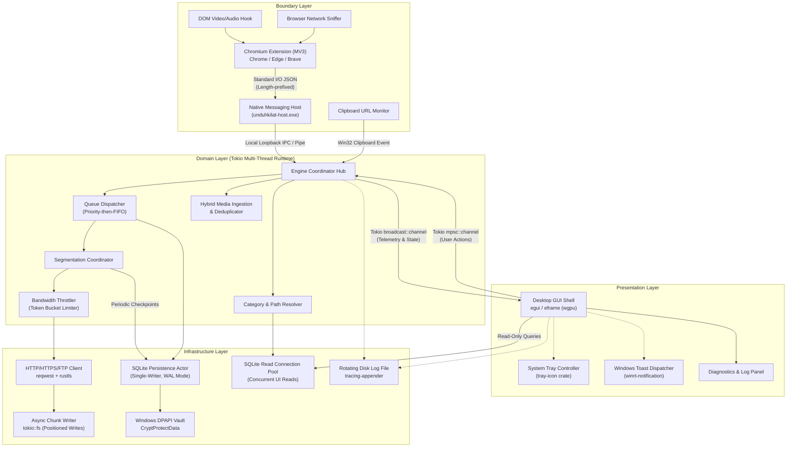
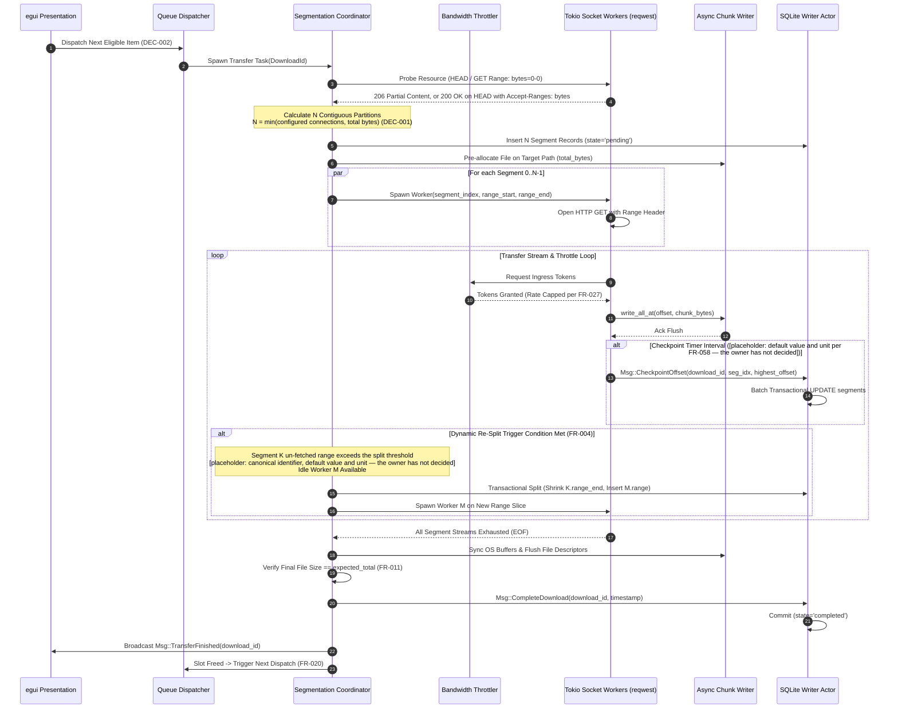
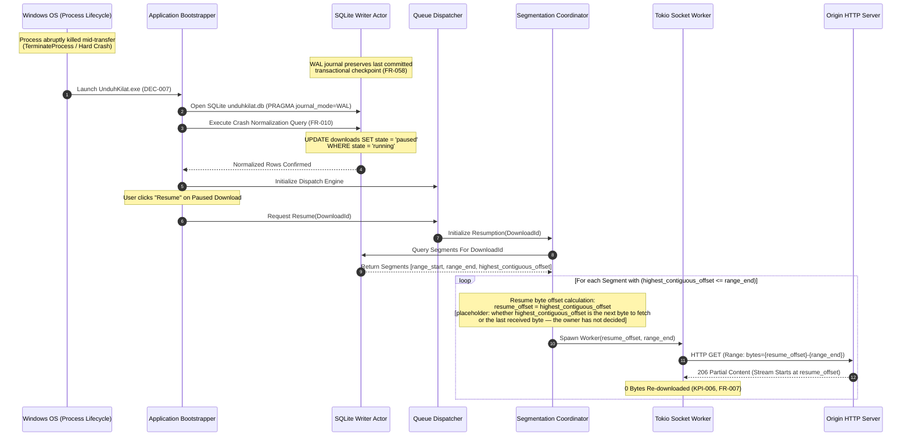

# ARCHITECTURE.md: UnduhKilat

## 1. Document Scope / Ruang Lingkup Dokumen

This document defines the authoritative software architecture for **UnduhKilat**, a crash-durable, high-throughput desktop download manager engineered for Windows 10 and Windows 11 (x64 only) using Rust and egui/eframe on the wgpu renderer (DEC-005). It establishes the structural decomposition, module boundaries, inter-process communication contracts, concurrency patterns, and data flow topologies of the system. 

This document serves as the foundational design reference for engineering teams. It deliberately avoids duplicating data schemas, wire message formats, and low-level protocol definitions, deferring instead to authoritative companion specifications:
- Entity schemas, indexes, and database lifecycle invariants are owned by `DATABASE.md`.
- Wire message schemas, IPC structures, length-prefixed native messaging envelopes, and error codes are owned by `API.md`.
- Operational interaction paths, failure handling matrices, and UX flows are defined in `USER_FLOW.md`.
- Verifiable behavioral requirements and acceptance criteria are cataloged in `REQUIREMENTS.md`.

---

## 2. System Overview

UnduhKilat is organized as a four-tier architecture comprising the **Presentation Layer** (an immediate-mode GUI powered by `egui`/`eframe` backed by `wgpu`, a persistent Windows system tray controller, and native WinRT toast notifications), the **Boundary Layer** (a Chromium Manifest V3 browser extension and a standard I/O length-prefixed native messaging host bridge executing un-elevated user registrations under `HKCU`), the **Domain Layer** (a Tokio-driven dynamic segmentation engine, priority-then-FIFO dispatch scheduler, aggregate and per-download token-bucket bandwidth limiters, hybrid media candidate consolidator, and category routing logic), and the **Infrastructure Layer** (an asynchronous `reqwest`/`rustls` transport client, a dedicated actor-isolated SQLite single-writer persistence connection operating in WAL mode, a DPAPI-backed credential vault, and rotating local file loggers). The dominant architectural pattern is an asynchronous actor-based message-passing design: time-sliced UI rendering loops remain strictly decoupled from the multi-threaded network runtime via bounded crossbeam/Tokio channels for UI signalling and worker telemetry, with the persistence mutation channel's bound set to [placeholder: whether `tx_persist` is bounded or unbounded — the owner has not decided], funneling all database writes and state mutations through serialized transactional checkpoint actors. The system is structurally governed by explicit product decisions: concurrency and per-download parallel connections are completely unbounded and user-governed with zero artificial clamps (DEC-001); queue dispatch evaluates manual per-item priorities first and resolves identical priorities via FIFO sequencing (DEC-002); web media extraction relies on a hybrid topology unifying browser network request sniffing with DOM script hooks into a deduplicated candidate stream (DEC-003); window closure delegates process execution to the background system tray while downloads continue uninterrupted until completion toasts fire (DEC-004); binary artifacts and execution environments target Windows 10 and 11 on x64 exclusively (DEC-005); browser capture reaches Chromium-class browsers only (Chrome, Edge, Brave) via native messaging (DEC-006); and runtime distribution operates strictly as a standalone, portable ZIP folder requiring zero installation wizards or elevated privileges for normal execution (DEC-007).

---

## 3. High-Level Architecture Diagram



---

## 4. Component Breakdown

| Component | Responsibility | Depends on | Layer |
|---|---|---|---|
| **egui Shell View** | Immediate-mode desktop rendering, real-time download progress list, modal dialogs, and manual user controls (FR-048, FR-049). | eframe, wgpu, Domain Telemetry Channels, SQLite Read Connection Pool | Presentation |
| **Tray Manager** | Manages shell tray icon lifecycle, context menu, window minimize/restore toggling, and close-to-tray handling (DEC-004, FR-051, FR-052). | Windows Shell API, tray-icon, Engine Coordinator Hub | Presentation |
| **Notification Dispatcher** | Fires native Windows toast notifications upon file download completion while process is backgrounded (DEC-004, FR-054). | WinRT / Win32 Notification APIs, Engine Coordinator Hub | Presentation |
| **Diagnostics View** | Displays live connection metrics, tail of rotating disk logs, and handles log export flows (FR-056). | Log Rotator, Engine Coordinator Hub | Presentation |
| **Native Messaging Host** | Standalone binary (`unduhkilat-host.exe`) bridging browser extension stdin/stdout length-prefixed frames to local desktop IPC (DEC-006, FR-034). | Windows Registry (`HKCU`/`HKLM`), Windows Named Pipes / Local Sockets | Boundary |
| **Chromium Extension** | Manifest V3 extension capturing downloads, DOM media tags, and web requests in Chrome, Edge, and Brave (DEC-003, DEC-006, FR-033, FR-036). | Chromium Extension APIs (`chrome.nativeMessaging`, `chrome.webRequest`) | Boundary |
| **Clipboard Watcher** | Win32 clipboard notification listener detecting URLs and prompting confirmation dialogs (FR-040). | Win32 API (`AddClipboardFormatListener`), Engine Coordinator Hub | Boundary |
| **Engine Coordinator Hub** | Central message-passing mediator orchestrating commands across UI, boundaries, scheduler, and persistence actors. | Tokio Runtime, Crossbeam Channels | Domain |
| **Queue Dispatcher** | Evaluates queued transfers, strictly enforcing user manual priority first and FIFO secondary dispatch against unbounded concurrency settings (DEC-001, DEC-002, FR-018, FR-020). | SQLite Persistence Actor, Segmentation Coordinator | Domain |
| **Segmentation Coordinator** | Splits files into parallel byte ranges, balances dynamic segment re-splitting, and manages pause/resume/restart lifecycles (DEC-001, FR-003, FR-004, FR-006–FR-009). | Bandwidth Throttler, Http Transport, Async Chunk Writer, Db Actor | Domain |
| **Bandwidth Throttler** | Enforces global aggregate and per-download token-bucket bandwidth limits across active socket streams (FR-025–FR-028). | Tokio Timer Subsystem | Domain |
| **Media Ingestion & Deduplicator** | Combines DOM media hooks and network-sniffed media candidate streams into a deduplicated candidate union (DEC-003, FR-041, FR-042). | Engine Coordinator Hub, URL Normalization Utilities | Domain |
| **Category Router** | Maps file extensions to configured disk directories and resolves file naming collisions (FR-029–FR-032). | SQLite Read Connection Pool, Path Resolver | Domain |
| **Batch & Site Walker** | Executes depth-limited URL pattern scanning and crawls for batch ingestion (FR-045–FR-047). | Http Transport, Engine Coordinator Hub | Domain |
| **HTTP/FTP Transport** | Issues HTTP range requests, manages cookies/headers/proxies, verifies certificates via rustls, and handles FTP REST commands (FR-012, FR-013, FR-015, FR-017). | reqwest, rustls, async-ftp | Infrastructure |
| **Async Chunk Writer** | Performs direct, positioned byte writes to pre-allocated disk files without cross-thread lock contention. | tokio::fs, Windows File I/O APIs | Infrastructure |
| **SQLite Persistence Actor** | Dedicated thread owning the single write connection to `unduhkilat.db`, processing transactional checkpoint queues in WAL mode (FR-058). | SQLite 3 / rusqlite, Windows File System | Infrastructure |
| **SQLite Read Connection Pool**| Read-only database handles serving egui frame rendering and scheduler state queries without blocking the writer thread. | SQLite 3 / rusqlite (WAL mode) | Infrastructure |
| **DPAPI Credential Vault** | Encrypts and decrypts host and proxy passwords at rest using Windows DPAPI (FR-014, FR-058, DEC-005). | Win32 `CryptProtectData` / `CryptUnprotectData` | Infrastructure |
| **Log Rotator** | Manages local diagnostic rotating log files with zero remote network egress (FR-057). | tracing, tracing-appender | Infrastructure |

---

## 5. Critical Flow Sequence Diagram

### 5.1 Multi-Connection Segmented Transfer with Dynamic Re-Splitting and Checkpointing

This sequence illustrates the high-risk, high-throughput asynchronous execution of a multi-connection download obeying DEC-001, dynamic segment re-splitting (FR-004), live bandwidth throttling (FR-027), and periodic transactional checkpointing to SQLite (FR-058).



---

### 5.2 Process Crash, Startup Normalization, and Zero-Duplication Resume

This sequence illustrates crash durability (FR-010, FR-058) following an abrupt process termination (`TerminateProcess` or power cut) and subsequent non-destructive resume verification ensuring zero bytes are re-downloaded (FR-007, KPI-006).



---

## 6. Core Pipeline & Cross-Cutting Concerns

### 6.1 Dynamic Segmented Transfer & Assembly Pipeline

The file acquisition pipeline guarantees continuous saturation of available network bandwidth while preserving strict offset isolation to eliminate byte corruption:

```
[ Ingest URL & Headers ]
           │
           ▼
[ Range Capability Probe ] ──(No Ranges / 416)──► [ Fallback to Single Connection (FR-005) ]
           │ (Range Supported)                                   │
           ▼                                                     │
[ Multi-Segment Partitioning (DEC-001) ]                         │
           │                                                     │
           ▼                                                     ▼
[ Pre-Allocate Target File on Disk ]              [ Sequential Disk File Allocation ]
           │                                                     │
           ├────────────────────────┬────────────────────────────┤
           ▼                        ▼                            ▼
[ Worker 0 (Range 0) ]   [ Worker 1 (Range 1) ]       [ Worker N (Range N) ]
           │                        │                            │
           └────────────────────────┼────────────────────────────┘
                                    ▼
                      [ Token Bucket Throttler (FR-027) ]
                                    │
                                    ▼
                    [ Positioned Disk Writes (pwrite) ]
                                    │
                                    ▼
                [ Checkpoint Actor (WAL Commit FR-058) ]
                                    │
                                    ▼
             [ Size Verification & Final Assembly (FR-011) ]
```

1. **Range Validation Probe**: A lightweight probe issues a `GET` with `Range: bytes=0-0` or `HEAD`. For the `GET` probe, an HTTP 206 response accompanied by `Accept-Ranges: bytes` indicates range support; for the `HEAD` probe, which normally returns HTTP 200 because it carries no body and therefore no 206 status, HTTP 200 accompanied by `Accept-Ranges: bytes` is accepted as range support. If the server answers the `GET` probe with HTTP 200, omits `Accept-Ranges: bytes`, or rejects the range request, `segmentation_supported` is set to `false`, and execution redirects immediately to single-connection streaming (FR-005).
2. **Storage Pre-Allocation**: Target disk files are pre-allocated using Win32 sparse file configurations or `SetFileInformationByHandle` (`FileAllocationInfo`), minimizing on-disk fragmentation during concurrent multi-point writes.
3. **Partition Slicing**: For a file of size $S$ bytes and user-configured connection count $N$ (DEC-001), the effective connection count is capped at the number of bytes available: $N_{\text{eff}} = \min(N, S)$, so no empty or negative slice is ever produced. Contiguous byte slices are then calculated as $\text{chunk} = \lfloor S / N_{\text{eff}} \rfloor$. Each segment $i$ spans $[i \cdot \text{chunk}, (i+1) \cdot \text{chunk} - 1]$ for $i \in [0, N_{\text{eff}} - 1]$, with the final segment terminating at $S - 1$; when $N > S$, the surplus configured connections are allocated no range and are skipped rather than being given an empty segment, preserving the invariant that the union of segments covers $[0, S-1]$.
4. **Dynamic Segment Re-Splitting**: A monitoring thread monitors relative segment progress. When an active segment completes early and remaining active segments contain un-fetched ranges exceeding the dynamic split min-size threshold `[placeholder: canonical identifier, default value and unit — the owner has not decided]` (FR-004), the least-advanced segment is bisected. The original worker's upper bound is reduced to the midpoint, and an idle worker task begins pulling from $\text{midpoint} + 1$. `[placeholder: whether the trigger additionally requires the un-fetched range to be at least twice the min-size threshold, or whether the no-partition-below-threshold invariant is relaxed — the owner has not decided; see 7.1]`
5. **Direct Positioned Writing**: Active worker threads bypass shared global file locks by executing direct positional writes (`tokio::fs::File` with OS-level overlapped/positioned file operations) into non-overlapping file offsets.
6. **Completion Verification**: Upon stream completion, the pipeline syncs OS file buffers to physical media (`FlushFileBuffers`), computes the on-disk file size, and asserts exact byte equivalence against expected `Content-Length`. Any discrepancy aborts finalization, transitions the entity to `failed`, and sets error code `ERR_CHECKSUM_SIZE_MISMATCH` (FR-011).

### 6.2 Crash Durability & Checkpointing Pipeline

Crash resilience is implemented via SQLite Write-Ahead Logging (`WAL`) paired with an in-memory transactional write queue:
- **Periodic WAL Checkpoints**: Segment workers maintain in-memory counters of contiguous received bytes. Every `checkpoint_interval_ms` `[placeholder: default value and unit — the owner has not decided]`, workers dispatch lightweight progress frames to the SQLite writer actor.
- **Single-Writer Serialization**: The single-writer persistence actor wraps incoming progress updates in SQLite transactions (`BEGIN IMMEDIATE ... COMMIT`). With `PRAGMA synchronous = NORMAL`, transactions do not require synchronous disk flushes on every write, maintaining extreme I/O throughput while guaranteeing database integrity against OS crashes.
- **Startup Crash Normalization**: Before rendering the first UI frame or accepting browser commands, the engine issues a normalization update:
  ```sql
  UPDATE downloads 
  SET state = 'paused', updated_at = strftime('%Y-%m-%dT%H:%M:%fZ', 'now') 
  WHERE state = 'running';
  ```
  Any orphaned in-flight segments automatically revert to `pending`, and the item safely awaits explicit user resumption or automated scheduler triggers.

### 6.3 Cross-Cutting Architectural Concerns

#### Bandwidth Throttling (Token Bucket Topology)
Throttling is structured hierarchically. A master global token bucket replenishes tokens at the user-defined `global_speed_limit_kbps` rate. Concurrently, each download task manages an optional local token bucket bounded by `speed_limit_kbps`. Worker sockets must acquire available tokens from both the local and global buckets before issuing `read_exact` calls. A limit value of `0` bypasses token consumption entirely, enabling unbounded line-rate throughput (FR-028).

#### Credential Security at Rest (Windows DPAPI)
In compliance with DEC-005, user credentials (HTTP Basic/Digest, proxy authentications, FTP logins) are never stored in plaintext within SQLite. Strings are encrypted via Win32 `CryptProtectData` utilizing user-bound master keys managed by Windows LSA. The resulting ciphertext is stored in `credentials.password_encrypted`. Decryption via `CryptUnprotectData` occurs exclusively in volatile heap memory upon socket authentication challenges, followed by secure memory zeroization (`zeroize` crate).

#### Single-Writer SQLite Actor Pattern
SQLite WAL mode allows concurrent readers but requires serialized writes. Any concurrency collision results in `SQLITE_BUSY`. To eliminate lock contention:
- All domain modules communicate mutations through a Tokio mpsc channel (`tx_persist`) whose capacity policy is `[placeholder: bounded or unbounded — the owner has not decided]`, and the same policy applies to the channel bound referenced in Section 2.
- A dedicated OS thread runs the `PersistenceActor`, reading messages sequentially from `rx_persist` and executing them within localized transactions.
- egui UI rendering routines maintain an independent read-only SQLite connection pool, enabling fluid 60+ FPS UI redraws without thread blocking.

#### Close-to-Tray and Background Lifecycle
The presentation layer manages window state transitions via `eframe` window event hooks. When the user clicks the window close button (`[X]`), the application intercepts the close event, calls `ctx.send_viewport_cmd(egui::ViewportCommand::Visible(false))`, and delegates process visibility entirely to the tray icon (DEC-004, FR-052). Background Tokio workers continue socket processing without disruption. Process termination occurs strictly upon user selection of "Exit" within the tray context menu, which triggers graceful cancellation tokens, commits active segment state, and closes database handles (FR-053).

---

## 7. Module Specifications

### 7.1 Module `engine::segmentation`

Manages parallel connection slicing, dynamic bisection, and offset synchronization.

#### Public Interface
```rust
pub struct SegmentRange {
    pub segment_index: u32,
    pub range_start: i64,
    pub range_end: i64,
    pub highest_contiguous_offset: i64,
}

pub struct SegmentationConfig {
    pub dynamic_split_min_bytes: i64, // [placeholder: default value and unit; canonical identifier not yet fixed — the owner has not decided]
    pub checkpoint_interval_ms: u64,   // [placeholder: default value and unit — the owner has not decided]
}

pub trait SegmentCoordinator: Send + Sync {
    /// Initializes segment allocations for a new range-capable download.
    /// The effective connection count is min(connection_count, total_bytes), so no empty range is produced.
    fn allocate_segments(
        &self, 
        total_bytes: i64, 
        connection_count: u32
    ) -> Result<Vec<SegmentRange>, SegmentationError>;

    /// Dynamically bisects an active segment to feed a newly available connection worker
    fn bisect_segment(
        &self, 
        target_segment: &mut SegmentRange, 
        new_segment_index: u32
    ) -> Result<SegmentRange, SegmentationError>;

    /// Validates segment contiguous range coverage and file size integrity
    fn verify_assembly(&self, target_path: &std::path::Path, expected_bytes: i64) -> Result<bool, SegmentationError>;
}
```

#### Invariants
- `range_start <= highest_contiguous_offset <= range_end + 1` across all active and persisted segments; `[placeholder: whether `highest_contiguous_offset` is defined as the next byte to fetch or as the last received byte, and whether the resume offset is `highest_contiguous_offset` or `highest_contiguous_offset + 1` — the owner has not decided]`.
- Segments must remain mutually disjoint; $\bigcup_{i=0}^{N-1} [\text{range\_start}_i, \text{range\_end}_i] \equiv [0, \text{total\_bytes} - 1]$, with the effective connection count capped at $\min(N, \text{total\_bytes})$ so that no empty range is allocated.
- Bisect threshold rule: `[placeholder: whether a bisect may never yield a partition shorter than `dynamic_split_min_bytes`, or whether the trigger instead requires the un-fetched range to be at least `2 * dynamic_split_min_bytes` before bisecting — the owner has not decided which rule is authoritative]`.

#### Error Code Mapping
- `SegmentationError::RangeUnsupported` $\to$ Fallback to single connection (FR-005) or `ERR_RANGE_NOT_SUPPORTED`
- `SegmentationError::RangeOutOfOrder` $\to$ `ERR_RANGE_NOT_SATISFIABLE`
- `SegmentationError::SizeMismatch` $\to$ `ERR_CHECKSUM_SIZE_MISMATCH`
- `SegmentationError::DiskIo(e)` $\to$ `ERR_STORAGE_WRITE_FAILED` / `ERR_STORAGE_FULL`

---

### 7.2 Module `engine::scheduler`

Controls queue sequencing, priority evaluation, and concurrency allocations.

#### Public Interface
```rust
pub struct DispatchCandidate {
    pub download_id: String,
    pub priority: i32,
    pub queue_position: u32,
}

pub trait QueueDispatcher: Send + Sync {
    /// Evaluates database queue items and returns the next items eligible for execution
    fn evaluate_next_dispatches(
        &self, 
        running_count: usize, 
        concurrency_limit: usize
    ) -> Result<Vec<DispatchCandidate>, SchedulerError>;

    /// Updates manual priority on a download item
    fn set_item_priority(
        &self, 
        download_id: &str, 
        priority: i32
    ) -> Result<(), SchedulerError>;

    /// Reorders queue positions to maintain dense FIFO indices
    fn reorder_queue(
        &self, 
        ordered_download_ids: &[String]
    ) -> Result<(), SchedulerError>;
}
```

#### Invariants
- Concurrency ceiling enforcement: Total items in `state = running` must not exceed `concurrency_limit` (FR-020).
- Dispatch sorting rule: Items are ordered strictly by `ORDER BY priority DESC, queue_position ASC` (DEC-002, FR-018).
- Concurrency limit and connection count values are bounded only by $\ge 1$; no hard-coded upper ceiling is enforced (DEC-001).

#### Error Code Mapping
- `SchedulerError::QueueEmpty` $\to$ Non-error; dispatcher idles
- `SchedulerError::ItemNotFound` $\to$ `ERR_FILE_NOT_FOUND`
- `SchedulerError::PersistenceFailure` $\to$ `ERR_STORAGE_WRITE_FAILED`

---

### 7.3 Module `boundary::native_host`

Coordinates inter-process communication with the Chromium extension.

#### Public Interface
```rust
#[derive(Serialize, Deserialize, Debug)]
#[serde(tag = "action", content = "payload")]
pub enum NativeHostMessage {
    InterceptDownload {
        url: String,
        mime_type: Option<String>,
        referer: Option<String>,
        user_agent: Option<String>,
        cookies: Option<String>,
    },
    MediaCandidateDetected {
        url: String,
        mime_type: Option<String>,
        stream_type: Option<String>,
        discovered_size: Option<i64>,
    },
    PushStatusUpdate {
        download_id: String,
        state: String,
        downloaded_bytes: i64,
        total_bytes: i64,
        speed_kbps: u64,
    },
    // [placeholder: whether a QueryDownloadState variant is added to this enum for the
    // service-worker re-query mitigation, or the mitigation aligns with an action already
    // defined in API.md — the owner has not decided]
}

pub trait NativeMessagingBridge: Send + Sync {
    /// Listens on stdin for length-prefixed JSON frames and dispatches commands
    fn listen_stdin(&self) -> Result<(), NativeHostError>;

    /// Dispatches length-prefixed JSON response frames to stdout
    fn send_stdout(&self, message: &NativeHostMessage) -> Result<(), NativeHostError>;

    /// Registers the native messaging host manifest in the Windows Registry under HKCU or HKLM
    fn register_host_manifest(&self, machine_wide: bool) -> Result<(), NativeHostError>;
}
```

#### Invariants
- All frames over stdin/stdout must strictly adhere to the Chromium 32-bit little-endian length prefix contract (max message size 1 MB).
- Registry registrations default to `HKCU\Software\Google\Chrome\NativeMessagingHosts` (and equivalent Edge/Brave keys) without elevation requirements (DEC-006, DEC-007, FR-034); the value written under each key is the absolute path of the native messaging host manifest JSON, and that manifest's `path` field points at `unduhkilat-host.exe`.
- Admin machine-wide registration (`HKLM`) requires elevated security tokens (FR-035).

#### Error Code Mapping
- `NativeHostError::InvalidPayload` $\to$ `ERR_PAYLOAD_CORRUPT`
- `NativeHostError::RegistryAccessDenied` $\to$ `ERR_REGISTRY_WRITE_FAILED`
- `NativeHostError::HostTimeout` $\to$ `ERR_NATIVE_HOST_TIMEOUT`
- `NativeHostError::HostNotFound` $\to$ `ERR_NATIVE_HOST_NOT_FOUND`

---

### 7.4 Module `storage::persistence`

Owns transactional database persistence and DPAPI credential protection.

#### Public Interface
```rust
pub enum PersistenceCommand {
    UpdateSegmentOffset {
        download_id: String,
        segment_index: u32,
        offset: i64,
    },
    TransitionDownloadState {
        download_id: String,
        state: String,
        error_code: Option<String>,
        error_message: Option<String>,
    },
    NormalizeStartupStates,
    StoreCredential {
        credential: crate::domain::models::Credential,
    },
}

pub trait PersistenceActorHandle: Send + Sync {
    /// Asynchronously posts a database mutation command to the single-writer queue
    fn send_command(&self, cmd: PersistenceCommand) -> Result<(), PersistenceError>;

    /// Executes an in-memory DPAPI protection on sensitive secrets
    fn protect_secret(&self, plaintext: &[u8]) -> Result<String, PersistenceError>;

    /// Decrypts DPAPI secrets for transient runtime authentication
    fn unprotect_secret(&self, ciphertext_b64: &str) -> Result<Vec<u8>, PersistenceError>;
}
```

#### Invariants
- The database connection pool for write operations has a strict cardinality of 1 (single-writer actor pattern).
- Plaintext secrets must never be committed to disk in SQLite tables; DPAPI transformation is mandatory prior to insert.
- On startup, `NormalizeStartupStates` must commit before any worker socket tasks are scheduled.

#### Error Code Mapping
- `PersistenceError::DatabaseInitFailed` $\to$ `ERR_STORAGE_INIT_FAILED`
- `PersistenceError::DiskFull` $\to$ `ERR_STORAGE_FULL`
- `PersistenceError::IoFailure` $\to$ `ERR_STORAGE_WRITE_FAILED`
- `PersistenceError::DecryptionFailed` $\to$ `ERR_AUTH_CHALLENGE_FAILED`

---

## 8. Cross-Platform Strategy

UnduhKilat targets Windows 10 and 11 on the x64 architecture exclusively (DEC-005). The system architecture segregates universal logic from Windows Win32 subsystems to ensure clean modularity while fully utilizing native platform capabilities:

| Subsystem | Architectural Allocation | Implementation Technology |
|---|---|---|
| **Domain Logic** | Platform-Agnostic | Pure Rust (concurrency arithmetic, queue evaluation, HTTP parsing, dynamic range bisection, tokens). |
| **GUI Framework** | Platform-Agnostic Abstraction | `egui`/`eframe` backed by `wgpu` (DirectX 12 / Vulkan on Windows). |
| **System Tray Integration** | Windows-Specific Implementation | Win32 Shell NotifyIcon API via `tray-icon` crate (DEC-004). |
| **Toast Notifications** | Windows-Specific Implementation | WinRT / Win32 App Notification API via `winrt-notification` crate (DEC-004). |
| **Credential Protection** | Windows-Specific Implementation | Win32 Data Protection API (`CryptProtectData`, `CryptUnprotectData`) via `windows-sys` crate (DEC-005). |
| **Native Host Registry** | Windows-Specific Implementation | Win32 Registry API (`HKCU` and `HKLM` key writes) via `winreg` crate (DEC-006, DEC-007). |
| **Clipboard Hooks** | Windows-Specific Implementation | Win32 Clipboard Format Listener (`AddClipboardFormatListener`). |

### Postponed Targets & Explicit Non-Goals
Per DEC-005, DEC-006, and PRD specifications:
- **macOS / Linux**: Strictly out of scope; no cross-platform abstractions or stub crates are developed.
- **Windows 7 / 8 / 8.1**: Strictly out of scope; runtime dependencies rely on Windows 10+ Win32/WinRT facilities.
- **32-bit x86 & ARM64 Architectures**: Postponed/Out of scope (DEC-005). Compilation artifacts target `x86_64-pc-windows-msvc` exclusively.
- **Non-Chromium Browsers (Firefox, Safari)**: Excluded by DEC-006; native messaging registration and content script manifests target Chromium engines only.

---

## 9. Deployment Strategy

UnduhKilat is distributed strictly as a **Portable ZIP Archive** requiring no Windows installer, elevated MSI setup, or system services (DEC-007).

- **Bundle Artifact Structure**:
  ```text
  UnduhKilat-vX.Y.Z-portable-x64/
  ├── UnduhKilat.exe                # Main desktop application binary
  ├── unduhkilat-host.exe           # Native messaging host bridge binary
  ├── unduhkilat-portable.marker    # Marker file anchoring state directory to local folder
  ├── extension/                    # Manifest V3 extension bundle for manual/unpacked loading
  │   ├── manifest.json
  │   ├── background.js
  │   └── content_script.js
  └── data/                         # Created at runtime if portable marker is present
      ├── state/                    # unduhkilat.db, unduhkilat.db-wal
      └── logs/                     # Rotating diagnostic log files
  ```
- **Registration on First Launch**: When `UnduhKilat.exe` boots, it detects if the Native Messaging Host registry keys exist under `HKCU`. If missing or invalid, it registers the absolute path of the native messaging host manifest JSON under `HKCU\Software\Google\Chrome\NativeMessagingHosts` and the equivalent Edge/Brave keys without requesting administrative UAC elevation (FR-034, FR-059). The registry value points at the manifest JSON, and the manifest's own `path` field points at `unduhkilat-host.exe` inside the bundle; registering the executable path directly under the browser key would leave the extension unable to connect.
- **Signed In-Place Auto-Update**: In-place bundle updates download signed update archives containing replacement binaries. The engine cryptographically verifies the package signature against an embedded public key (FR-060, NFR-013). Once verified, the update process replaces `UnduhKilat.exe` and `unduhkilat-host.exe` in place and relaunches the application without external installer wizards.
- **Administrative Maintenance Operations**: Privileged administrators may optionally execute `UnduhKilat.exe --admin-register-host` to configure `HKLM` keys for multi-user environments (FR-035, FR-061), or launch an administrative state purge to cleanly reset database state files while leaving downloaded target files intact (FR-062).
- Detailed operational runbooks, CI/CD artifact generation, and update signature validation workflows are maintained in `DEPLOYMENT.md`.

---

## 10. Architectural Risks & Mitigation / Risiko Arsitektural & Mitigasi

| Risk | Architectural Mitigation |
|---|---|
| **Resource Exhaustion via Unbounded Settings (DEC-001)**: User configures extreme concurrent downloads (e.g. 500) or connections per download (e.g. 64), exhausting Windows socket descriptors (`WSAENOBUFS`), file handles, or ephemeral memory. | Maintain architectural enforcement of user choices without artificial ceilings (FR-001, FR-002), but implement non-blocking asynchronous socket pooling via Tokio. Display real-time aggregated and per-download connection metrics in the Diagnostics View (FR-056) to grant visibility over resource consumption. Throttle memory consumption using small, reusable I/O ring buffers (e.g. 64 KB chunks). |
| **Database Lock Contention & `SQLITE_BUSY`**: High-frequency checkpoint updates across hundreds of active connections collide during concurrent SQLite write operations. | Implement the Single-Writer Actor pattern. All state mutations and offset flushes are funneled through an asynchronous Tokio mpsc channel to a dedicated persistence thread owning a single write connection in `WAL` mode with `PRAGMA busy_timeout = 5000`. egui rendering views utilize an independent read-only connection pool. |
| **File Offset Overlap & Data Corruption during Dynamic Splits (FR-004)**: Dynamic re-splitting of active segments could cause race conditions where two socket workers write into overlapping file ranges. | Enforce strict transactional range bisection in SQLite before spawning the new connection worker. Target file writes use direct OS positioned writes (`write_all_at`) with non-overlapping range constraints (`range_start` and `range_end`). Validate final assembled file size against source `Content-Length` upon completion (FR-011). |
| **Crash Mid-Transfer Causing Progress Loss (FR-010, FR-058)**: Abrupt OS shutdown or process kill (`TerminateProcess`) occurs while segment buffers are in volatile memory. | Persist progress offsets incrementally via periodic transactional checkpoints to SQLite in WAL mode during transfers rather than solely on pause. Implement mandatory startup crash normalization to convert orphaned `running` states to `paused` before scheduling transfers, bounding progress loss strictly to at most one checkpoint interval ([placeholder: default value and unit — the owner has not decided]). |
| **Native Host Registry Breakage upon Bundle Relocation (DEC-007)**: Because the app is a portable ZIP, the user may move the folder to another directory or drive, breaking the absolute path registered in the Windows Registry. | On every application launch, the desktop engine validates whether the host manifest path recorded in the registry matches the manifest shipped in the current bundle folder and whether that manifest's `path` field resolves to the current `unduhkilat-host.exe`. If a path discrepancy or broken registration is detected, the registry key and manifest are dynamically updated to the current location automatically without elevation (FR-034). |
| **Chromium Manifest V3 Service Worker Dormancy**: The browser extension background worker terminates after 30 seconds of inactivity, breaking pending status pushes or active sniffing hooks. | Treat the native messaging channel as an on-demand, reconnectable stream. When the service worker awakens, it re-queries the desktop host via the download-state query action `[placeholder: whether a QueryDownloadState message is added to NativeHostMessage or the mitigation uses an action already defined in API.md — the owner has not decided]` to refresh UI badge counters, ensuring that desktop transfers remain completely autonomous from browser process lifecycles. |
| **Hybrid Media Detection Duplication (DEC-003)**: Sniffed network requests and DOM hooks emit redundant or slightly varied query string candidate URLs for the same underlying media stream. | Ingest all raw candidate signals into the Domain Layer's `Media Ingestion & Deduplicator`, which applies canonical URL parsing, parameter normalization, and origin matching (FR-042). Display unified entries with discovered MIME types and file sizes in the floating overlay, requiring explicit user confirmation before any download begins (FR-039, FR-043). |
| **Credential Theft at Rest via SQLite File Extraction**: Storing host and proxy authentication credentials in a local SQLite database exposes them to unauthorized local processes. | Integrate Windows Data Protection API (`CryptProtectData`) to encrypt sensitive credential strings at rest (DEC-005, FR-058). Plaintext secrets exist solely in volatile heap memory for the duration of the HTTP/FTP authentication challenge and are wiped via memory zeroization immediately after use. |