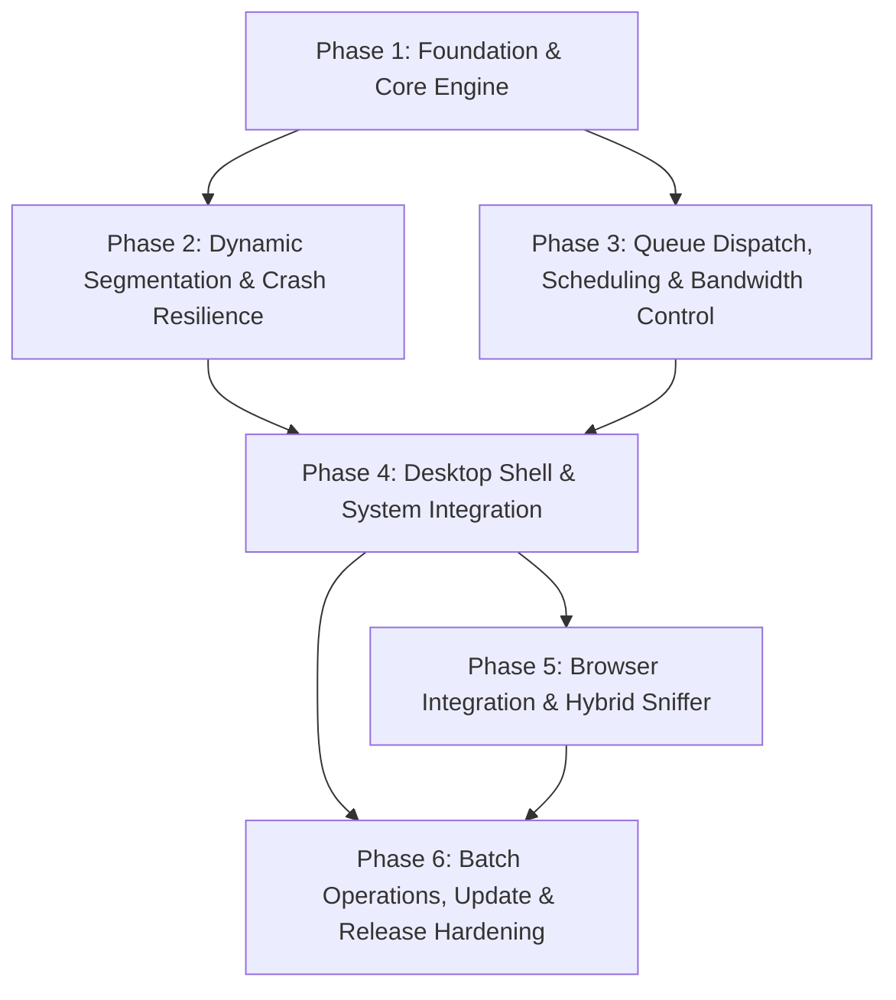

# ROADMAP.md: UnduhKilat

Timeline assumes a team of 3 developers. Adjust proportionally for different team sizes.

---

## 1. Planning Principles / Scope of Document

### 1.1 Scope of the Document
This roadmap outlines the program-level phased delivery plan, feature priorities, major milestones, dependencies, and risk mitigation strategies for **UnduhKilat**, a crash-durable, high-throughput desktop download manager engineered for Windows 10 and Windows 11 (x64 only) using Rust (stable, MSVC toolchain) and egui/eframe on the wgpu renderer (DEC-005). 

Detailed behavioural specifications and RFC 2119 testable acceptance criteria reside in `REQUIREMENTS.md`. Task-level work breakdowns and implementation slices reside in `TASKS.md`. Architectural topologies, database schemas, IPC wire protocols, and operational workflows are governed by `ARCHITECTURE.md`, `DATABASE.md`, `API.md`, and `USER_FLOW.md` respectively.

### 1.2 Core Planning Principles
- **Vertical Slices**: Every phase delivers end-to-end, testable functionality connecting presentation, engine coordination, and persistence. Work is organized so that progress yields demonstrable desktop behavior at every increment.
- **Third-Party Isolation**: Components dependent on third-party integration (such as the Chromium Manifest V3 browser extension and Windows notification APIs) are encapsulated behind clean Rust abstraction traits. An upstream browser change or OS notification failure will never block core Tokio segmentation, queue dispatching, or database checkpoints.
- **Strict Compliance with User Decisions**:
  - **DEC-001**: Concurrency limits and per-download connection counts have no hardcoded ceiling and are completely governed by user configuration.
  - **DEC-002**: Queue dispatch evaluation strictly enforces manual per-item priority first, resolving equal or unset priorities via FIFO sequence.
  - **DEC-003**: Web media capture uses a hybrid model unifying browser network sniffing with DOM extension hooks into a deduplicated candidate stream.
  - **DEC-004**: Window close minimizes to the system tray while downloads continue in the background; completion toasts fire on finish.
  - **DEC-005**: Target platform is strictly Windows 10 and 11, x64 architecture only.
  - **DEC-006**: Browser integration reach is strictly restricted to Chromium engines (Google Chrome, Microsoft Edge, Brave).
  - **DEC-007**: Distribution operates strictly as a portable ZIP archive without an installer; the app self-registers its native messaging host under `HKCU` on first launch without elevation.
- **Handling of Unspecified Parameters**: All numeric thresholds, time intervals, retry schedules, buffer sizes, and dates not explicitly fixed by product decisions or the technology stack are marked strictly as `TBD`.

---

## 2. Phased Delivery Plan

### 2.1 Implementation Phases

| Phase | Duration (weeks) | Goals | Verifiable Deliverable | Req | DEC |
|---|---|---|---|---|---|
| **Phase 1: Foundation & Core Engine** | `TBD` | Establish workspace, SQLite single-writer persistence with WAL mode, Tokio runtime, and single/multi-connection HTTP download engine with range checks and fallback. | Working CLI / minimal GUI executing a 4-connection segmented download of a fixture file with byte-identical file assembly and transactional SQLite checkpoints. | FR-001, FR-002, FR-003, FR-005, FR-011, FR-012, FR-058, FR-059 | DEC-001, DEC-005, DEC-007 |
| **Phase 2: Dynamic Segmentation & Crash Resilience** | `TBD` | Implement dynamic segment bisection, pause/resume, automatic socket retry, restart from zero, and startup crash normalization. [placeholder: add HTTP redirect, FTP with `REST`, proxy routing, and DPAPI credential-encryption goals for FR-013–FR-016 to Phase 2, or move FR-013–FR-016 to the phase that owns the Network Protocols & Credential Vault module — owner decision] | Integration test verifying process kill (`TerminateProcess`) mid-transfer followed by restart, normalization to `paused`, and non-destructive resume with 0 duplicate bytes. [placeholder: verifiable deliverable covering FR-013–FR-016 if they remain in Phase 2, or remove FR-013–FR-016 from this phase’s Req column and assign them to the owning phase — owner decision] | FR-004, FR-006, FR-007, FR-008, FR-009, FR-010, [placeholder: FR-013, FR-014, FR-015, FR-016 remain in Phase 2 or move to the phase that owns Network Protocols & Credential Vault — owner decision] | DEC-001, DEC-005 |
| **Phase 3: Queue Dispatch, Scheduling & Bandwidth Control** | `TBD` | Deliver deterministic priority-then-FIFO dispatching, calendar scheduler, token-bucket speed throttlers (global and per-download), and category destination routing. | Test suite verifying that 10 queued items dispatch in strict manual priority then FIFO order, respecting user concurrency limits and aggregate rate limits live. | FR-018, FR-019, FR-020, FR-021, FR-022, FR-023, FR-024, FR-025, FR-026, FR-027, FR-028, FR-029, FR-030, FR-031, FR-032 | DEC-001, DEC-002, DEC-004 |
| **Phase 4: Desktop Shell & System Integration** | `TBD` | Build full egui/eframe desktop UI, real-time list with 60 FPS metrics, segment inspector, tray controller (close-to-tray), native WinRT toasts, clipboard monitor, and diagnostics panel. | Full desktop application running from portable folder: closing window hides to tray while transfers run; WinRT toast fires on completion; clipboard copy prompts Add URL dialog. | FR-040, FR-048, FR-049, FR-050, FR-051, FR-052, FR-053, FR-054, FR-055, FR-056, FR-057 | DEC-004, DEC-005, DEC-007 |
| **Phase 5: Browser Integration & Hybrid Sniffer** | `TBD` | Develop Chromium Manifest V3 extension, `unduhkilat-host.exe` native messaging host, `HKCU` auto-registration, hybrid video sniffer (DOM hook + webRequest), and floating panel. | End-to-end browser capture in Chrome, Edge, and Brave: clicking download intercepts link and opens confirmation modal; streaming page surfaces floating media panel. | FR-017, FR-033, FR-034, FR-035, FR-036, FR-037, FR-038, FR-039, FR-041, FR-042, FR-043, FR-044 | DEC-003, DEC-006, DEC-007 |
| **Phase 6: Batch Operations, Update & Release Hardening** | `TBD` | Implement Site Grabber with depth-limited crawling, signed in-place portable auto-update, admin maintenance operations, zero-telemetry verification, and release packaging. | Release-ready portable ZIP bundle passing pre-release checklist, signature verification, and automated E2E test suite with zero telemetry egress. | FR-045, FR-046, FR-047, FR-060, FR-061, FR-062 | DEC-005, DEC-007 |

### 2.2 Phase Dependency Graph

---

## 3. MVP Feature List (Priorities)

Features are classified according to program delivery priorities:
- **P0 (Must-Have for MVP)**: Core capabilities essential for functional parity with IDM's primary value proposition (unbounded dynamic multi-connection transfer, crash durability, priority dispatch, portable execution, tray backgrounding, and basic browser capture).
- **P1 (Important / Core Experience)**: Key operational controls enhancing user governance and automation (scheduling windows, category routing, live rate-limiting, hybrid floating media panel, and diagnostics).
- **P2 (Secondary / Maintenance)**: Advanced bulk tooling and administrative capabilities (depth-limited site crawler, machine-wide elevated registration, and signed in-place auto-update).

The following table is [placeholder: exhaustive for every FR listed in Section 2 phases, or non-exhaustive with an explicit priority rule for unlisted FRs — owner decision]. FR-050 (Phase 4) and FR-016 (Phase 2) currently appear in Section 2 but have no assigned priority here; their priority is [placeholder: owner decision] unless the non-exhaustive rule is chosen.

| Priority | Module / Feature Area | Requirements Covered | Description |
|---|---|---|---|
| **P0** | Multi-Connection Segmented Download Engine | FR-001, FR-002, FR-003, FR-005, FR-011, FR-012 | Dynamic multi-connection download with HTTP range support, single-connection fallback, user-set unbounded connections, and final file integrity verification (DEC-001, DEC-005). |
| **P0** | Crash Durability & Resume Pipeline | FR-006, FR-007, FR-008, FR-009, FR-010, FR-058 | Transactional SQLite checkpoints, automatic retry on socket drop, non-destructive resume (0 duplicate bytes), restart from zero, and startup crash normalization. |
| **P0** | Priority-then-FIFO Queue Dispatch | FR-018, FR-019, FR-020, FR-021, FR-022 | Deterministic two-tier scheduler dispatching manual priority items first and FIFO for ties, enforcing user concurrency limits without application ceilings (DEC-001, DEC-002). |
| **P0** | Desktop UI Shell & System Tray Lifecycle | FR-048, FR-049, FR-051, FR-052, FR-053, FR-054 | egui/eframe desktop UI, real-time download list, Add URL dialog, close-to-tray background execution, explicit exit checkpointing, and native Windows completion toasts (DEC-004). |
| **P0** | Portable Execution & Zero-Elevation First Run | FR-059 | Standalone portable ZIP deployment, self-contained data directory, and un-elevated execution (DEC-007). |
| **P0** | Chromium Link Interception & Native Host Bridge | FR-033, FR-034, FR-036, FR-037, FR-038, FR-039 | Manifest V3 extension for Chrome, Edge, and Brave, `unduhkilat-host.exe` bridge, `HKCU` auto-registration, link interception with cookie/context capture, and mandatory confirmation modal (DEC-006, DEC-007). |
| **P1** | Dynamic Segment Re-splitting | FR-004 | Runtime bisection of lagging segments during active transfer to optimize bandwidth saturation. |
| **P1** | Hierarchical Bandwidth Limiter | FR-025, FR-026, FR-027, FR-028 | Live token-bucket rate limiters capping aggregate and per-download throughput with immediate application without task restarts. |
| **P1** | File Categories & Destination Routing | FR-029, FR-030, FR-031, FR-032 | Automatic folder routing based on file extension, configurable fallback category, category CRUD, and per-download path overrides. |
| **P1** | Calendar Scheduler & Timed Execution | FR-023, FR-024 | Daily time triggers and execution windows starting/stopping queue operations while visible or hidden in system tray (DEC-004). |
| **P1** | Hybrid Media Sniffer & Floating Overlay | FR-041, FR-042, FR-043, FR-044 | In-page floating panel rendering the deduplicated union of network request sniffing and DOM hook signals, supporting progressive video and candidate manifest listing (DEC-003). |
| **P1** | Clipboard Monitoring | FR-040 | Win32 clipboard listener prefilling confirmation modal upon copying downloadable URLs. |
| **P1** | Network Protocols & Credential Vault | FR-013, FR-014, FR-015, FR-017 | HTTP redirects, FTP transfers with `REST`, proxy routing, and Windows DPAPI encryption of saved host/proxy credentials at rest (DEC-005). |
| **P1** | Diagnostics Panel & Local Rotating Logs | FR-055, FR-056, FR-057 | In-app diagnostics viewer (live sockets, tail log), per-segment byte range inspector, local rotating logs, log export, and zero remote telemetry egress. |
| **P2** | Site Grabber & Depth-Limited Site Walker | FR-045, FR-046, FR-047 | Wildcard pattern link batch filter and depth-limited webpage crawl with link preview before enqueueing as standard queue items. |
| **P2** [placeholder: FR-060 priority — P2 unchanged or reclassified to P0/P1, owner decision] | Cryptographic In-Place Auto-Update | FR-060 | In-app update runner verifying Ed25519 digital signatures before replacing portable bundle binaries in place (DEC-007). Section 7 item 8 depends on this priority decision. |
| **P2** | Administrative Machine-Wide Operations | FR-035, FR-061, FR-062 | Elevated CLI commands for machine-wide `HKLM` native host registration, shared bundle upgrades, and full application state directory purge. |
| **[placeholder: priority for FR-016 — owner decision]** | File Collision Handling | FR-016 | [placeholder: whether this requirement is assigned a priority in the MVP table or covered by a stated non-exhaustive prioritisation rule — owner decision] |
| **[placeholder: priority for FR-050 — owner decision]** | Settings Screen Coverage | FR-050 | [placeholder: whether this requirement is assigned a priority in the MVP table or covered by a stated non-exhaustive prioritisation rule — owner decision] |

---

## 4. Milestones

### M1: Core Pipeline & Checkpoint Durability
- **Target Phase**: Phase 1 & Phase 2
- **Focus**: Multi-connection dynamic engine, SQLite persistence actor, crash normalization.
- **Exit Criteria**:
  - Headless test successfully downloads a 100 MB fixture over 8 concurrent connections using HTTP `Range: bytes` requests.
  - Final assembled file passes SHA-256 integrity verification against source payload (FR-011).
  - Single-connection fallback completes successfully against servers omitting `Accept-Ranges` (FR-005).
  - Hard kill (`TerminateProcess`) mid-transfer followed by restart normalizes items to `paused`; subsequent resume completes with 0 duplicate bytes fetched (FR-007, FR-010, KPI-005, KPI-006).

### M2: Queue, Throttling & Desktop Presentation
- **Target Phase**: Phase 3 & Phase 4
- **Focus**: Dispatch engine, token-bucket bandwidth limiters, egui GUI shell, system tray lifecycle.
- **Exit Criteria**:
  - Deterministic dispatch test confirms priority-then-FIFO ordering across varied queue configurations (DEC-002, FR-018, KPI-004).
  - Unbounded concurrency test accepts values up to 500 without clamping or engine crashes (DEC-001, NFR-003).
  - Live throughput throttler enforces aggregate limits within tolerance `TBD` without interrupting active sockets (FR-027, FR-028).
  - Main window close button hides execution to system tray; transfers continue running in background and native Windows toast fires on completion (DEC-004, FR-052, FR-054, KPI-013).
  - In-app diagnostics panel correctly displays real-time socket counts and log tail (FR-056).

### M3: Full Browser Integration & Media Sniffer
- **Target Phase**: Phase 5
- **Focus**: Manifest V3 extension, native messaging host, hybrid media detection, floating panel.
- **Exit Criteria**:
  - First-run registration creates `HKCU` keys pointing to `unduhkilat-host.exe` without UAC elevation prompts (DEC-007, FR-034, KPI-017).
  - Clicking downloadable links in Chrome, Edge, and Brave intercepts transfer, extracts cookies/headers, and presents the confirmation dialog (DEC-006, FR-036, FR-039, KPI-010, KPI-011).
  - Hybrid media sniffer surfaces the deduplicated union of DOM hook signals and network sniffed media streams inside the in-page floating overlay (DEC-003, FR-041, FR-042, FR-043, KPI-012).
  - Selecting a media candidate from floating overlay sends item to desktop confirmation modal without starting unconfirmed downloads (FR-039, FR-043).

### M4: Production Release Readiness
- **Target Phase**: Phase 6
- **Focus**: Batch tools, signed in-place update, pre-release checklist, release packaging.
- **Exit Criteria**:
  - Site Grabber successfully crawls a test site up to configured depth limit and enqueues selected links as standard queue items (FR-045, FR-046, FR-047).
  - In-place auto-update rejects unsigned or corrupted packages with `ERR_PACKAGE_SIGNATURE_INVALID` and cleanly applies valid Ed25519-signed updates (FR-060, KPI-018).
  - CI pipeline passes all formatting, clippy, unit, contract, integration, and security test gates on `windows-latest` (MSVC x64) (DEC-005, NFR-001, NFR-002).
  - Network egress inspection across full test execution confirms 0 telemetry transmission off the machine (FR-057, NFR-016).
  - Portable ZIP artifact packaged with `unduhkilat-portable.marker` and tested on clean Windows 10 and Windows 11 machines.

---

## 5. Dependencies

### 5.1 External Dependencies
- **Microsoft Windows Platform**: Windows 10 x64 and Windows 11 x64 OS environments providing Win32 APIs, WinRT App Notification facility, and Windows Data Protection API (DPAPI) (DEC-005).
- **Rust Toolchain**: Stable channel `x86_64-pc-windows-msvc` (pinned compiler 1.84.0).
- **Chromium Browsers**: Google Chrome, Microsoft Edge, and Brave supporting Manifest V3 extension APIs and Native Messaging standard I/O communication (DEC-006).
- **Third-Party Crates (Ecosystem)**:
  - `eframe` / `egui` with `wgpu` backend (GUI shell and rendering loop).
  - `tokio` (multi-threaded async runtime, timers, process coordination).
  - `reqwest` + `rustls` (HTTP/HTTPS transport, Range requests, proxy traversal).
  - `rusqlite` (bundled SQLite 3.40+ in WAL mode).
  - `windows-sys` / `windows` (Win32 WinTrust, DPAPI, Clipboard, and Shell APIs).
  - `tray-icon` (Windows system taskbar tray management).
  - `ed25519-dalek` / `minisign` (update package cryptographic signature verification).

### 5.2 Internal Subsystem Dependencies
- **Domain Engine $\leftrightarrow$ Storage**: The dynamic segmentation engine depends on the SQLite Persistence Actor for committing transactional checkpoints before spawning workers and after completing slices.
- **Scheduler $\leftrightarrow$ Engine**: The Queue Dispatcher depends on the Tokio Task Coordinator to launch and abort segment workers when concurrency slots open or limits are adjusted.
- **Presentation $\leftrightarrow$ Domain**: egui shell views depend on Tokio broadcast channels for live throughput metrics and read-only SQLite connection pools for list rendering.
- **Native Host $\leftrightarrow$ Desktop Engine**: `unduhkilat-host.exe` depends on local loopback IPC (Windows Named Pipes or local sockets) to forward browser capture envelopes to the main desktop application process.

---

## 6. Risks & Mitigation

| Risk Description | Impact | Likelihood | Mitigation Strategy |
|---|:---:|:---:|---|
| **Resource Exhaustion via Unbounded Settings (DEC-001)**: User configures extreme concurrent downloads (e.g. 500) or connections per download (e.g. 64), exhausting Windows socket descriptors (`WSAENOBUFS`), file handles, or ephemeral memory. | High | Medium | Enforce user settings without artificial ceilings as mandated by DEC-001, but utilize non-blocking asynchronous socket pooling via Tokio. Display live active socket counts in the diagnostics panel (FR-056) to ensure transparency. Allocate memory using small, reusable chunk buffers (64 KB). |
| **SQLite Lock Contention & `SQLITE_BUSY`**: High-frequency checkpoint updates across dozens of concurrent segment workers collide during SQLite write transactions. | High | Medium | Implement the single-writer actor pattern. All write operations (segment progress flushes, state transitions) are routed through a serialized Tokio mpsc channel owned by a dedicated persistence thread operating in SQLite `WAL` mode with `PRAGMA busy_timeout = 5000;`. egui UI rendering utilizes an independent read-only connection pool. |
| **Native Host Registry Path Drift upon Bundle Move (DEC-007)**: Because UnduhKilat is distributed as a portable ZIP, moving the folder to another directory breaks the absolute native host manifest path in the Windows Registry. | High | High | On every application boot, `UnduhKilat.exe` detects whether the registered `HKCU` native messaging path matches the current binary directory. If a mismatch is detected, the registry keys are dynamically updated to the current path automatically without requiring user elevation (FR-034). |
| **Chromium Extension Store Policies or MV3 Dormancy**: Manifest V3 service workers terminate after 30 seconds of inactivity, potentially dropping status pushes or sniffing events. | Medium | High | Decouple native messaging from service worker lifecycles. Treat the native pipe as an on-demand, reconnectable channel. When awakened by navigation, the worker reconnects and queries state. Clipboard monitoring and the Add URL dialog remain fully autonomous fallback capture paths (FR-039, FR-040). |
| **Dynamic Segment Offset Collisions during Re-splitting (FR-004)**: Dynamic bisection of active segments causes overlapping byte ranges or race conditions on disk writes. | High | Low | Enforce transactional range mutations in SQLite before spawning new connection workers. Workers execute direct positioned writes (`write_all_at`) into mutually disjoint byte offsets. Completed files must pass full length verification against source `Content-Length` (FR-011). |
| **Credential Theft at Rest via Offline Database Inspection**: Host and proxy credentials stored in SQLite are readable by unauthorized processes or users. | High | Medium | Sensitive passwords in `credentials.password_encrypted` and proxy settings are encrypted using Windows DPAPI (`CryptProtectData`), tying encryption directly to the local Windows user profile (DEC-005, FR-014, FR-058). Plaintext secrets exist only in volatile heap memory and are zeroized immediately after socket authorization. |
| **Hybrid Media Detection Duplication (DEC-003)**: Sniffed network requests and DOM hooks emit duplicate or slightly varied query string candidate URLs for the same underlying media stream. | Medium | High | Candidate streams are funneled into the domain layer's media consolidator, which normalizes URLs and deduplicates entries by canonical path (FR-042). The floating overlay requires explicit user confirmation before any download begins (FR-039, FR-043). |
| **Manifest-Based Adaptive Stream Failure (FR-044)**: Users select HLS (`.m3u8`) or DASH (`.mpd`) streams expecting a single merged media file. | Medium | Medium | Manifest streams are displayed in the floating panel for visibility. Their download behaviour is [placeholder: no raw manifest download, or a user-confirmed experimental raw download with the warning text [placeholder: warning text] — owner decision]. The selected behaviour must define whether any raw manifest download is attempted and the exact warning shown, so the application does not silently produce corrupt partial files. |

---

## 7. Definition of Done (MVP)

An MVP release of UnduhKilat is deemed **Done** and ready for distribution when all the following non-functional and operational targets derived from the PRD and requirements are satisfied. [placeholder: whether Section 7 defines MVP completion only, or MVP plus release readiness, and whether FR-060 is therefore an MVP condition or a release-readiness condition — owner decision]. If FR-060 remains P2 in Section 3, item 8 is [placeholder: MVP condition or release-readiness condition — owner decision].

1. **Target Architecture & Platform (NFR-001, NFR-002, DEC-005)**:
   - Compiles cleanly on stable Rust (MSVC toolchain) targeting `x86_64-pc-windows-msvc`.
   - Verified functional on physical/virtual test machines running Windows 10 x64 and Windows 11 x64.
   - PE binary headers confirm strictly 64-bit machine type; no 32-bit or non-Windows artifacts produced.
2. **Crash Durability & Zero Byte Duplication (NFR-004, NFR-005, KPI-005, KPI-006, KPI-007)**:
   - 100% of in-progress downloads interrupted by abrupt termination (`TerminateProcess`) are restored to `paused` state on the next launch with persisted segment offsets intact.
   - Resuming a paused or recovered download re-fetches 0% of previously checkpointed bytes.
   - 100% of completed downloads pass size and hash verification against the origin resource.
3. **Unbounded User Governance (NFR-003, DEC-001)**:
   - The application imposes zero hardcoded ceilings on concurrent downloads or connections per download; any positive integer set by the user is persisted and enforced.
4. **Deterministic Dispatch (KPI-004, DEC-002, FR-018)**:
   - 100% of automated queue dispatch decisions strictly match the recorded manual priority-then-FIFO sequence.
5. **Portability & Clean First Run (NFR-012, KPI-017, DEC-007, FR-059)**:
   - Runs directly from an extracted portable ZIP archive with zero installation wizards.
   - Normal operation requires zero administrative UAC elevation prompts.
   - First launch automatically registers native messaging keys under `HKCU` pointing to the extracted host binary.
   - State and logs are confined strictly to the portable folder (when marker is present) or the user's local AppData directory.
6. **Browser Reach & Capture Confirmation (NFR-014, KPI-010, KPI-011, DEC-006, FR-039)**:
   - Link interception is 100% functional across Google Chrome, Microsoft Edge, and Brave.
   - 100% of intercepted links, clipboard detections, and floating panel media items require explicit confirmation in the Add URL dialog before any transfer begins.
7. **Tray Continuity & Notifications (KPI-013, KPI-014, DEC-004, FR-052, FR-054)**:
   - Closing the main window hides execution to the system taskbar tray while 100% of active transfers continue progressing.
   - Native Windows completion toast notifications fire when downloads finish while backgrounded.
8. **Update Integrity & Zero Telemetry (NFR-013, NFR-016, KPI-018, FR-057, FR-060)**:
   - 100% of update packages undergo Ed25519 digital signature verification before replacement; invalid or unsigned packages are rejected without file modifications. FR-060 is classified P2 in Section 3; whether this item is an MVP condition or a release-readiness condition is [placeholder: owner decision].
   - Network egress inspection confirms zero telemetry, analytics, or diagnostic packets are transmitted off the machine.
9. **Automated Quality Gates**:
   - `cargo fmt --all -- --check` passes with zero formatting errors.
   - `cargo clippy --all-targets --all-features -- -D warnings` passes with zero warnings.
   - Automated unit, contract, integration, and security test suites pass 100% on Windows CI runners.

---

## 8. Change Control & Schedule Assumptions

### 8.1 Schedule Assumptions
- **Engineering Capacity**: Timeline assumes a team of 3 developers. Adjust proportionally for different team sizes.
- **Platform Access**: Developers and CI runners have continuous access to 64-bit Windows 10 and 11 environments configured with the MSVC C++ build tools and modern Chromium browsers (Chrome, Edge, Brave).
- **Toolchain Stability**: Development relies on the stable Rust release channel without requiring nightly-only features.
- **Unfixed Values**: All specific numeric targets, timeout durations, and thresholds marked as `TBD` in the PRD and requirements (e.g., dynamic split minimum segment bytes, retry backoff intervals, log rotation sizes) will be determined via empirical testing during their respective delivery phases and documented in subsequent specification revisions.

### 8.2 Scope & Change Control Process
1. **Change Ingestion**: Any proposed change to product scope, technology stack, or architectural boundaries must be submitted as a formal Change Proposal referencing affected Functional Requirements (FR-XXX) and Decisions (DEC-XXX).
2. **Impact Analysis**: The delivery lead and engineering team assess the impact on:
   - User Decisions (DEC-001 through DEC-007 cannot be contradicted without executive stakeholder re-interview).
   - Core invariants (unbounded concurrency, priority-then-FIFO dispatch, hybrid sniffing, portable ZIP distribution).
   - Milestone exit criteria and test harnesses.
3. **Specification Synchronization**: If approved:
   - `REQUIREMENTS.md` is updated with revised RFC 2119 obligations and acceptance criteria.
   - Companion documents (`DATABASE.md`, `API.md`, `USER_FLOW.md`, `ARCHITECTURE.md`) are updated simultaneously to preserve contract consistency.
   - Task breakdowns in `TASKS.md` are adjusted, and milestone targets are re-baselined.
4. **Zero-Ad-Hoc Scope Creep**: No developer or coding agent may introduce features outside the PRD or alter architectural boundaries without following this change control procedure.