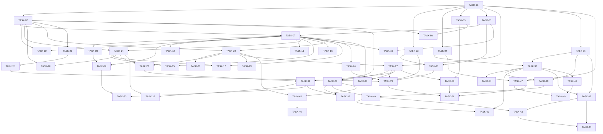

# TASKS.md: UnduhKilat

This backlog specifies the dependency-ordered, verifiable implementation tasks required to build the UnduhKilat desktop download manager for Windows 10 and 11 x64. Every task represents a thin, end-to-end slice derived strictly from the product requirements, architectural models, and user decisions without introducing unverified assumptions.

---

## 1. Legend & Conventions

- **Task ID**: `TASK-NN` is permanent and will never be renumbered or repurposed.
- **Table Schema**:
  - `ID`: Unique task identifier.
  - `Objective`: Concise, technical summary of the deliverable slice.
  - `Req (FR-NNN)`: Functional requirements from `REQUIREMENTS.md` satisfied by this task.
  - `DEC`: Explicit user decision citations from `DECISIONS.md`.
  - `Blocked-by`: Prerequisite tasks that must complete before this task begins. Tasks whose implementation or acceptance criteria depend on an unresolved `TBD` decision are tagged **BLOCKED** and must not start until the corresponding decision is formally recorded in `DECISIONS.md`.
  - `Acceptance`: Concrete, binary verifiable criteria for task completion.
  - `Verification`: Verification method (`unit`, `integration`, `contract`, `e2e`, `manual`, or `CI`).
- **Segment watermark convention**: `[placeholder: whether `highest_contiguous_offset` is the zero-based index of the last written byte or a count of written bytes, and how the empty (nothing written yet) state is represented — owner decision; the resume range formula in TASK-15 and the restart baseline in TASK-17 depend on this convention]`.

---

## 2. Phase 0 — Scaffolding, Data Layer, Response Envelope & Secrets Handling

| ID | Objective | Req (FR-NNN) | DEC | Blocked-by | Acceptance | Verification |
|---|---|---|---|---|---|---|
| TASK-01 | Initialize Cargo workspace for MSVC x64 target, core library crates, desktop GUI crate, and native host binary stub with portable marker support. | FR-059 | DEC-005, DEC-007 | None | Workspace compiles on `x86_64-pc-windows-msvc` toolchain; execution detects `unduhkilat-portable.marker` to select `./data` directory or falls back to `%LOCALAPPDATA%`. | CI / Unit |
| TASK-02 | Implement SQLite database initialization in WAL mode with single-writer actor and initial schema migrations matching all tables in DATABASE.md. | FR-058 | DEC-007 | TASK-01 | `DatabaseStore::open` initializes `unduhkilat.db`, sets `PRAGMA journal_mode = WAL` and `PRAGMA synchronous = NORMAL`, and passes table migration checks for `downloads`, `segments`, `categories`, `queue_items`, `credentials`, `schedules`, and `settings`. | Integration |
| TASK-03 | Implement Windows DPAPI credential vault module to encrypt and decrypt sensitive host and proxy passwords at rest with in-memory zeroization. | FR-014, FR-058 | DEC-005 | TASK-01 | Plaintext password strings passed to `dpapi_encrypt` yield base64 ciphertext using Win32 `CryptProtectData`; `dpapi_decrypt` restores original plaintext; memory is wiped using `zeroize`. | Unit / Integration |
| TASK-04 | Implement standardized JSON IPC command, response, and event serialization envelopes with canonical UPPER_SNAKE error code mappings. | FR-056, FR-058 | None | TASK-01 | All command payloads deserialize to strongly typed Rust structs; error envelopes match `API.md` Section 2.4 specification and serialize canonical error codes (`ERR_RANGE_NOT_SUPPORTED`, `ERR_STORAGE_FULL`, etc.). | Unit / Contract |
| TASK-05 | Implement local rotating file logger with secret redaction pipeline and in-memory ring buffer for live UI diagnostics tail. | FR-056, FR-057 | None | TASK-01 | `tracing-subscriber` writes to rotating `./data/logs/unduhkilat.log*` without logging plaintext passwords or auth headers; tail buffer exposes last 100 log lines to internal channels; zero network egress occurs. | Unit / Integration |

---

## 3. Phase 1 — Foundation & Core Engine

| ID | Objective | Req (FR-NNN) | DEC | Blocked-by | Acceptance | Verification |
|---|---|---|---|---|---|---|
| TASK-06 | Implement HTTP/HTTPS probe client utilizing `reqwest` + `rustls` to inspect `Accept-Ranges`, calculate `Content-Length`, and preserve `Referer` across redirects. | FR-003, FR-005, FR-012, FR-013 | None | TASK-01 | Client probes mock HTTP endpoints; returns `RangeSupport::Supported` when `206 Partial Content` or `Accept-Ranges: bytes` is returned; records `effective_url` and preserves original `Referer` on 302 redirects. | Integration |
| TASK-07 | Implement dynamic multi-connection partitioned download worker with Windows positioned file writes and unbounded user-configured connection counts. | FR-001, FR-002, FR-003 | DEC-001 | TASK-02, TASK-06 | Client partitions resource into $N$ contiguous byte-range segments matching user connection setting without internal ceiling; workers write directly to absolute file offsets using Win32 `seek_write`; completed file is byte-identical to source. | Integration |
| TASK-08 | Implement single-connection streaming fallback pipeline for servers lacking range support or rejecting byte ranges. | FR-005 | None | TASK-07 | When mock server omits `Accept-Ranges` or returns HTTP 200 to range requests, engine completes file download using a single connection worker and flags item with `segmentation_supported = 0`. | Integration |
| TASK-09 | Implement final file size verification on download completion against remote `Content-Length` and range totals. | FR-011 | None | TASK-07, TASK-08 | If on-disk file size differs from expected bytes, task transitions to `state = failed` with error code `ERR_SIZE_MISMATCH`; matching file transitions to `state = completed`. | Unit / Integration |
| TASK-10 | Implement FTP transport client supporting binary transfer (`TYPE I`) and segmented resumption using the FTP restart command (`REST`). | FR-012 | None | TASK-02, TASK-07 | FTP client connects to mock FTP server, issues `REST <offset>` to resume byte streams, and assembles payload byte-identically; falls back to single connection if `REST` is unsupported. | Integration |
| TASK-11 | Implement HTTP/HTTPS/FTP proxy configuration resolver supporting direct connection, Windows system proxy, and manual host/port with DPAPI-encrypted credentials. | FR-015 | DEC-005 | TASK-03, TASK-06 | Engine routes outbound socket connections through mock HTTP proxy using supplied basic credentials; settings persist in `settings` table across application restarts. | Integration |
| TASK-12 | Implement target file conflict detection and resolution policy. | FR-016 | None | TASK-07, **BLOCKED** by TBD-010 (File conflict resolution policy: auto-rename vs prompt) | When target file exists on disk, engine prevents silent overwrite, commits resolved unique path to `downloads.target_path`, and writes exclusively to that resolved destination. | Integration |

---

## 4. Phase 2 — Dynamic Segmentation & Crash Resilience

| ID | Objective | Req (FR-NNN) | DEC | Blocked-by | Acceptance | Verification |
|---|---|---|---|---|---|---|
| TASK-13 | Implement dynamic segment bisection algorithm and lagging worker supervisor to re-split incomplete segments during active transfers. | FR-004 | DEC-001 | TASK-07, **BLOCKED** by TBD-001, TBD-002, TBD-003 (Split thresholds, min segment size, audit interval) | When lagging segment has remaining bytes exceeding threshold, supervisor bisections its range, creates a new segment record in SQLite, and spawns a new Tokio worker on the upper half without restarting existing connections. | Integration |
| TASK-14 | Implement graceful pause workflow flushing segment contiguous offsets and pending chunk buffers to SQLite Write-Ahead Log. | FR-006, FR-058 | None | TASK-02, TASK-07 | Pausing active task aborts in-flight Tokio tasks via `CancellationToken`, flushes contiguous byte offsets to `segments.highest_contiguous_offset`, and commits `state = paused` to `downloads`. | Integration |
| TASK-15 | Implement non-destructive resume pipeline continuing byte-range transfers strictly from persisted contiguous offsets. | FR-007 | None | TASK-07, TASK-14 | Resuming paused download reads `highest_contiguous_offset` from SQLite, issues new HTTP requests with `Range: bytes=[placeholder: resume start offset derived from the watermark convention in Section 1 — owner decision]-{end_offset}`, and fetches zero duplicate bytes. | Integration |
| TASK-16 | Implement automatic socket reconnection and exponential backoff retry loop for dropped TCP connections mid-transfer. | FR-008 | None | TASK-07, **BLOCKED** by TBD-006, TBD-007 (Retry count, backoff schedule, give-up condition) | When TCP socket drops mid-transfer, worker preserves last flushed offset, pauses for backoff interval, and reconnects from last byte; transitions to `state = failed` with `ERR_CONNECTION_DROPPED` only when retry limit is exhausted. | Integration |
| TASK-17 | Implement restart-from-zero workflow discarding persisted segment boundaries and truncating partial files on disk. | FR-009 | None | TASK-07, TASK-14 | Triggering restart resets SQLite segment records, truncates destination file to 0 bytes via `set_len(0)`, resets `downloaded_bytes = 0`, and begins fetching from byte 0. | Integration |
| TASK-18 | Implement startup crash recovery scanner normalizing ungracefully terminated `running` downloads to `paused`. | FR-010, FR-058 | None | TASK-02, TASK-14 | Booting application after simulated `TerminateProcess` executes `UPDATE downloads SET state = 'paused' WHERE state = 'running'`, preserving segment checkpoints and permitting one-click resumption of all items. | Integration / E2E |
| TASK-19 | Implement request header context builder attaching captured cookies, User-Agent, and Referer to outbound transfers. | FR-017 | DEC-006 | TASK-06, TASK-07 | Downloads initialized with cookies, `User-Agent`, or `Referer` strings transmit these headers verbatim in all range requests; session-authenticated fixture completes with status 200/206. | Integration |

---

## 5. Phase 3 — Queue Dispatch, Scheduling & Bandwidth Control

| ID | Objective | Req (FR-NNN) | DEC | Blocked-by | Acceptance | Verification |
|---|---|---|---|---|---|---|
| TASK-20 | Implement deterministic two-tier queue dispatcher enforcing manual priority first, FIFO sequence for ties, and unbounded concurrency limits. | FR-018, FR-020 | DEC-001, DEC-002 | TASK-02, TASK-07 | Dispatcher queries SQLite using `ORDER BY priority DESC, queue_position ASC`; dispatches tasks up to user-configured concurrency limit with no internal ceiling; holds excess tasks in `state = queued`. | Unit / Integration |
| TASK-21 | Implement dynamic queue priority modification and manual FIFO re-indexing without task disruption. | FR-019, FR-021 | DEC-002 | TASK-20 | Elevating or clearing priority on queued item repositions it in subsequent dispatch cycles; batch re-ordering updates `queue_items.queue_position` transactionally without interrupting active transfers. | Integration |
| TASK-22 | Implement bulk queue operations ("Start All" and "Stop All") preserving individual item segment progress. | FR-022 | None | TASK-14, TASK-20 | "Start All" transitions eligible queued items to running up to concurrency limit; "Stop All" halts all active transfers, flushes checkpoints, and transitions items to `state = paused`. | Integration |
| TASK-23 | Implement calendar scheduler engine evaluating daily recurring time windows and triggers while application is visible or hidden in tray. | FR-023, FR-024 | DEC-004 | TASK-20, **BLOCKED** by TBD-018 (Scheduler evaluation rule across clock boundary changes) | Scheduler timer evaluates active schedule entries in SQLite; triggers `queue.start_all` or `queue.stop_all` at designated clock times even when main GUI window is minimized to system tray. | Integration |
| TASK-24 | Implement hierarchical token-bucket bandwidth throttler applying global and per-download speed caps live without socket interruptions. | FR-025, FR-026, FR-027, FR-028 | None | TASK-07 | Workers acquire rate tokens before reading sockets; effective throughput matches $\min(\text{global}, \text{per\_download})$; setting limits to 0 lifts throttling; live limit changes take effect [placeholder: measurable maximum latency bound for applying live limit changes, or the definition and interval of a throttle tick — owner decision]. | Integration |
| TASK-25 | Implement file category extension classifier and automatic destination directory router with fallback category support. | FR-029, FR-030 | None | TASK-02 | Ingested URLs match category extension lists (e.g. `.iso` -> `Images`); files with unmapped extensions route to default fallback category (`is_default = 1`) folder. | Unit / Integration |
| TASK-26 | Implement category CRUD management and single-item category/destination overrides. | FR-031, FR-032 | None | TASK-25 | Creating, editing, or deleting categories in `categories` table affects future downloads without moving existing files; manual path override on single item bypasses category default. | Integration |

---

## 6. Phase 4 — Desktop Shell & System Integration

| ID | Objective | Req (FR-NNN) | DEC | Blocked-by | Acceptance | Verification |
|---|---|---|---|---|---|---|
| TASK-27 | Implement egui/eframe desktop UI shell with real-time download list, live progress metrics, sorting, and filtering by category/status. | FR-048 | DEC-005 | TASK-01, TASK-20 | egui window renders download table showing name, size, status, progress bar, speed, ETA, category, path, and priority; updates live via Tokio telemetry channels; supports sorting and filtering. | Manual / E2E |
| TASK-28 | Implement Add URL modal dialog supporting single and multi-line batch URL input with customizable category, destination, connections, and priority. | FR-049 | DEC-001 | TASK-02, TASK-27 | Dialog parses one or more URLs; allows batch editing of connection count, priority, category, and credentials; creates corresponding `downloads` and `queue_items` rows upon confirmation. | Manual / E2E |
| TASK-29 | Implement settings configuration screen exposing concurrency, connection defaults, bandwidth limits, categories, proxy, credentials, and logs. | FR-050 | DEC-001, DEC-005 | TASK-03, TASK-11, TASK-24, TASK-26, TASK-27 | Settings panel displays all persisted keys from `settings` table; permits unbounded concurrency inputs ($N \ge 1$); changes persist across restarts; broken browser host path surfaces visual warning. | Manual / E2E |
| TASK-30 | Implement per-download segment details view rendering byte ranges, active socket counts, and checkpointed offsets. | FR-055 | None | TASK-07, TASK-27 | Details inspector queries `segments` table and renders visual segment bar displaying contiguous downloaded bytes and active connection count matching engine state. | Manual / E2E |
| TASK-31 | Implement Windows system tray icon controller, context menu, and close-to-tray window lifecycle handling. | FR-051, FR-052 | DEC-004 | TASK-22, TASK-27 | Application instantiates taskbar notification tray icon; closing main window intercepts `WM_CLOSE`, calls `Visible(false)`, and leaves downloads running; tray menu allows restore, queue toggle, and exit. | Integration / Manual |
| TASK-32 | Implement explicit application exit workflow with user confirmation warning and in-progress download checkpointing. | FR-053 | DEC-004 | TASK-14, TASK-31 | Selecting "Exit" from tray or menu prompts user that transfers will halt; on confirmation, commits segment offsets, marks items `state = paused`, and terminates cleanly. | Integration / Manual |
| TASK-33 | Implement Windows native toast notification dispatcher for download completion events. | FR-054 | DEC-004 | TASK-09, TASK-31 | Successful download completion triggers WinRT toast notification displaying filename and target path while app is hidden in tray; toast is suppressed if disabled or if size verification fails. | Integration / Manual |
| TASK-34 | Implement in-application diagnostics panel rendering log tail, live socket counts, failure codes, and log export flow. | FR-056, FR-057 | None | TASK-05, TASK-27 | Diagnostics view displays real-time rolling log lines, open socket metrics, and error codes; "Export Logs" button writes log files into user-selected directory without network transmission. | Integration / Manual |
| TASK-35 | Implement Win32 clipboard URL monitoring format listener with toggle and confirmation prefill. | FR-040 | DEC-006 | TASK-28, TASK-31 | Win32 `AddClipboardFormatListener` detects copied HTTP/HTTPS/FTP URLs when enabled; opens Add URL confirmation dialog prefilled with URL; starts no transfer without explicit confirmation. | Integration / Manual |

---

## 7. Phase 5 — Browser Integration & Hybrid Sniffer

| ID | Objective | Req (FR-NNN) | DEC | Blocked-by | Acceptance | Verification |
|---|---|---|---|---|---|---|
| TASK-36 | Build Manifest V3 browser extension bundle for Chromium browsers (Chrome, Edge, Brave) with service worker and native messaging port. | FR-033 | DEC-006 | TASK-01 | Extension bundle compiles with Manifest V3; loads unpacked into Chrome, Edge, and Brave; background service worker opens native port to `com.unduhkilat.host` with keepalive heartbeat. | Contract / E2E |
| TASK-37 | Implement standalone Native Messaging Host executable (`unduhkilat-host.exe`) communicating via 32-bit length-prefixed standard I/O. | FR-033, FR-034 | DEC-006 | TASK-04, TASK-36 | Host process reads length-prefixed JSON from `stdin`, routes commands to desktop engine via local IPC, and returns length-prefixed JSON responses to `stdout`; validates calling extension ID. | Contract / Integration |
| TASK-38 | Implement dynamic per-user registry self-registration under `HKCU` on first launch with automatic portable path self-repair. | FR-034 | DEC-006, DEC-007 | TASK-37 | Application on boot checks `HKCU\Software\Google\Chrome\NativeMessagingHosts` (and Edge/Brave keys); writes manifest pointer without elevation; rewrites path if portable folder moves. | Integration / E2E |
| TASK-39 | Implement browser link and navigation interception capturing URL, full cookie jar, User-Agent, and Referer headers. | FR-036, FR-037 | DEC-006 | TASK-36, TASK-37 | Clicking downloadable link in Chromium browser intercepts transfer via `chrome.downloads` hook; queries `chrome.cookies`; forwards context to host via `browser.intercept`. | E2E |
| TASK-40 | Implement mandatory download confirmation dialog for all browser, clipboard, and externally proposed downloads. | FR-039 | DEC-006 | TASK-28, TASK-39 | Intercepted browser request brings desktop Add URL modal to foreground; displays URL, filename, size, category, and path; starts 0 network requests until user confirms; canceling sends cancel ack. | E2E |
| TASK-41 | Implement real-time download status push-back from native host to browser extension. | FR-038 | DEC-006 | TASK-37, TASK-40 | Desktop engine emits `browser.push_status` frames across native messaging pipe on state transitions (`queued`, `running`, `paused`, `completed`, `failed`); extension updates badge and popup state. | Contract / E2E |
| TASK-42 | Implement hybrid media sniffer consolidating network request sniffing with DOM media element hooks and canonical URL deduplication. | FR-041, FR-042 | DEC-003, DEC-006 | TASK-36, TASK-37 | WebRequest sniffer captures media MIME requests; content script hooks `<video>`/`<audio>` tags; candidates merge into unified cache deduplicated by normalized URL with discovered size. | Integration / E2E |
| TASK-43 | Implement in-page floating media panel overlay with candidate list and "Download" trigger sending selection to desktop confirmation modal. | FR-043 | DEC-003, DEC-006 | TASK-40, TASK-42 | Extension injects floating overlay over active video player tab; clicking expands list of resolutions/formats; clicking "Download" sends `media.send_to_app`, opening desktop confirmation dialog. | Manual / E2E |
| TASK-44 | Implement detection and listing of manifest-based stream candidates (DASH/HLS) in floating panel. | FR-044 | DEC-003 | TASK-42, TASK-43, **BLOCKED** by TBD-016 (DASH/HLS download execution handling) | Sniffer identifies `.m3u8` (HLS) and `.mpd` (DASH) streams; lists them in floating panel with stream type label; prevents broken segmented downloads while download handling is TBD. | Contract / E2E |

---

## 8. Phase 6 — Batch Operations, Update & Release Hardening

| ID | Objective | Req (FR-NNN) | DEC | Blocked-by | Acceptance | Verification |
|---|---|---|---|---|---|---|
| TASK-45 | Implement wildcard pattern batch link extractor (Site Grabber) with interactive candidate preview and enqueueing. | FR-045, FR-047 | None | TASK-20, TASK-28 | Dialog accepts page URL and wildcard pattern (e.g. `*.pdf`); parses links from page HTML; displays preview checklist; confirmedlinks enqueue as ordinary queue items obeying concurrency limits, priority dispatch, and category rules. | Integration / E2E |
| TASK-46 | Implement depth-limited web crawler (Site Walk) with include/exclude pattern matching, link preview, and batch enqueueing. | FR-046, FR-047 | None | TASK-45, **BLOCKED** by TBD-017 (Default maximum crawl depth for site walk) | Crawler traverses from base URL bounded by max depth; applies inclusion/exclusion filters; surfaces matched links in interactive preview before creating standard queue items. | Integration / E2E |
| TASK-47 | Implement cryptographic Ed25519 digital signature verification and in-place portable bundle update replacement without an installer. | FR-060 | DEC-007 | TASK-01, TASK-04 | In-app updater verifies downloaded update archive against embedded public key; rejects unsigned or corrupted packages with `ERR_PACKAGE_SIGNATURE_INVALID`; replaces portable bundle binaries in place and restarts. | Integration / [placeholder: whether `security` is added to the enumerated Verification values in Section 1 or an existing value is used — owner decision] |
| TASK-48 | Implement elevated administrative command line interface for machine-wide Native Messaging Host registration under `HKLM`. | FR-035 | DEC-006 | TASK-37 | CLI invoked with `--admin-register-host` asserts Windows UAC token elevation (`TOKEN_ELEVATION`); writes host manifest pointer under `HKLM`; non-elevated calls fail with `ERR_PERMISSION_DENIED`. | Integration / [placeholder: whether `security` is added to the enumerated Verification values in Section 1 or an existing value is used — owner decision] |
| TASK-49 | Implement elevated administrative machine-wide portable bundle replacement in shared or system-protected directories. | FR-061 | DEC-006, DEC-007 | TASK-47, TASK-48 | CLI invoked with `--admin-upgrade-bundle` verifies package signature, asserts elevation, and replaces shared bundle files while preserving `HKLM` native host registration paths. | Integration / [placeholder: whether `security` is added to the enumerated Verification values in Section 1 or an existing value is used — owner decision] |
| TASK-50 | Implement elevated administrative application data directory reset clearing SQLite state database and logs after confirmation. | FR-062 | None | TASK-02, TASK-05 | CLI invoked with `--admin-reset-data` and confirmation flag purges `unduhkilat.db`, WAL files, and log directories while leaving downloaded user files completely intact. | Integration / [placeholder: whether `security` is added to the enumerated Verification values in Section 1 or an existing value is used — owner decision] |
| TASK-51 | Implement pre-release verification suite, zero-telemetry egress validation, and automated portable ZIP packaging pipeline. | FR-057, FR-059, FR-060 | DEC-005, DEC-007 | TASK-29, TASK-34, TASK-47 | Automated CI workflow verifies zero network egress during full session; compiles release binaries for `x86_64-pc-windows-msvc`; packages portable ZIP bundle with `unduhkilat-portable.marker`, extension, and manifests. | CI / E2E |

---

## 9. Dependency Summary

### 9.1 Dependency Graph

### 9.2 Metrics & Execution State

- **Total Tasks**: 51
- **Blocked Tasks**: 6
  - `TASK-12`: Blocked by `TBD-010` (File conflict resolution policy: auto-rename vs. prompt).
  - `TASK-13`: Blocked by `TBD-001`, `TBD-002`, `TBD-003` (Split thresholds, minimum segment size, and audit frequency).
  - `TASK-16`: Blocked by `TBD-006`, `TBD-007` (Retry count, backoff schedule, and failure give-up condition).
  - `TASK-23`: Blocked by `TBD-018` (Scheduler evaluation rule across clock boundary changes).
  - `TASK-44`: Blocked by `TBD-016` (Download execution handling for manifest-based DASH/HLS streams).
  - `TASK-46`: Blocked by `TBD-017` (Default maximum crawl depth for site walk).

Implementation status (updated 2026-11-06; `cargo test` = 61 passing):

- **Done & verified (automated tests):** TASK-01 (workspace, portable marker), 02, 03, 04, 05, 06, 07, 08, 09, 14, 15, 17, 18, 19 (Referer kept across redirects), 20, 21, 22, 24, 25, 26 (logic).
- **Done & verified by running the real app (Windows 11, screenshots + DB inspection):** TASK-27 (download table, sort/filter, live speed/ETA/connections), 28 (Add URL dialog incl. multi-URL, category, destination, connections, priority, referer/cookie), 29 (settings: engine, categories, speed limit, window/notification; persisted across restarts), 30 (segment topology strip + per-segment list), 31 (tray icon + menu; close hides to tray; "Tampilkan" restores; verified an 80 MB download finished while hidden), 34 (diagnostics: log tail with level filter, live connection counts, last error per download, log export), single-instance guard.
- **Built but NOT verified end to end:** TASK-32 (explicit exit with confirmation + checkpoint: code path exists, exit dialog not exercised), TASK-33 (WinRT toast on completion: code path exists, toast not observed), "Pengaturan..." / "Mulai Antrian" / "Jeda Antrian" tray items (menu renders; only "Tampilkan" was clicked).
- **Partial:** TASK-12 (never overwrites → `ERR_NAME_COLLISION`; auto-rename/prompt policy still BLOCKED by TBD-010).
- **Browser integration (2026-11-07; Rust 81 tests, extension 17 Node tests):**
  - **Done & verified by automated tests:** TASK-37 (host exe: length-prefixed framing, origin pinning → `ERR_UNAUTHORIZED`, relay to the app over a per-user named pipe with a secret token, `reject_remote_clients`), TASK-38 (HKCU registration for Chrome/Edge/Brave pointing at the manifest JSON, idempotent, detects and repairs a moved folder; tested against a sandbox registry subtree), TASK-40/FR-039 (browser/media requests only become *proposals*; 0 downloads exist until the user confirms), TASK-41 (engine state → `browser.push_status` / `browser.proposal_result` frames, cookies never sent back), the "app not running" path (host answers `ERR_NATIVE_HOST_NOT_FOUND` and never launches the app for a heartbeat).
  - **Done & verified against the real app + real host exe (no browser):** ping, `browser.intercept` → `pending_confirmation`, no download created, self-registration of all three browsers on app start, and clean removal via `UnduhKilat.exe unregister-host`.
  - **Written and logic-tested in a Node `vm` sandbox with a fake `chrome.*`, NOT yet run inside a real browser:** TASK-36 (MV3 manifest, service worker, native port, heartbeat), TASK-39 (download interception: cancels the browser download ONLY after the app accepted; if the host/app is unreachable the browser download continues), TASK-42 (network sniffing + DOM hook union, dedup by resolved URL), TASK-43 (floating panel, popup).
  - **Not visually verified:** the app's confirmation dialog for a browser proposal (badge "Tangkap Otomatis", prefilled fields) and the Settings → "Integrasi Browser" tab — the workstation was locked during the check.
  - **TASK-44 (HLS/DASH):** candidates are *listed* with a warning and cannot be sent (no broken download); download handling stays BLOCKED by TBD-016.
- **FTP + proxy (2026-11-07; Rust 108 tests):**
  - **TASK-10 FTP — done & verified:** own tokio client (login, `TYPE I`, `SIZE`, `EPSV`→`PASV`, `REST`, `RETR`). Segmented download with one control+data connection per segment (user's connection count honoured exactly), resume at the persisted offset via `REST`, fallback to one connection when `REST` is refused, streaming when `SIZE` is unknown, anonymous/URL/vault credentials, `530`→`ERR_HTTP_AUTH_REQUIRED`, `550`→`ERR_FILE_NOT_FOUND`. Security: CR/LF/NUL in URL parts are refused (no command injection), the address in a `PASV` reply is ignored (no bounce/SSRF), passwords never logged. Verified against a mock server AND a real server (`ftp.gnu.org`, 4 connections, SHA-256 identical to curl).
  - **TASK-11 proxy — done & verified:** Direct / System / Manual (`host[:scheme]`, port, optional credentials; `http`, `https`, `socks5`, `socks5h`). Password stored as a DPAPI blob in `proxy_password_encrypted`. Applies to HTTP/HTTPS downloads, probes (including the Add-URL dialog) and, via `CONNECT` tunnels, to every FTP control and data connection. Changing it applies to the next transfer without a restart; invalid settings are rejected and the old ones stay. A SOCKS proxy with FTP is refused with `ERR_INVALID_ARGUMENT` instead of silently going direct.
  - **FR-014 stored credentials:** vault table + `Manager::save_credential` (DPAPI) + Settings → "Jaringan & Proxy". Used for FTP when the URL has no login (integration-tested) and sent as HTTP Basic for the same host (**not** integration-tested: no authenticating HTTP mock yet). Digest auth is not implemented.
  - **Not verified:** the new "Jaringan & Proxy" settings tab was built but not looked at on screen; "System" mode for FTP reads `ProxyServer` from the registry (parsing unit-tested, never run against a real corporate proxy); `ProxyOverride` bypass lists are ignored for FTP.
- **BitTorrent (DEC-008, owner answer "Lengkap"; not in the original PRD): implemented and tested.** `.torrent` files, magnet links (incl. BEP 9 `x.pe` peer hints), trackers, DHT, PEX, seeding with a share-ratio target, per-torrent ratio, live peer/upload info in the details dock, Settings > Torrent tab, CLI support. Built on `librqbit` 9.1 (rustls) behind `engine/torrent.rs`; the session (and any listening port) is created only when the first torrent runs. Policies: existing files are never overwritten (`ERR_NAME_COLLISION`); only SOCKS5 proxies carry torrents (DHT/UPnP/inbound port are switched off when proxied) and an HTTP proxy makes torrents fail with `ERR_INVALID_ARGUMENT` rather than leak the real address; proxy/network changes pause running torrents and rebuild the session. Verified: 10 integration tests against an in-process seeder (content hash, resume, duplicate, collision, proxy refusal, delete only own files, seeding restore) and a real 129,302,391-byte download of the public Sintel torrent over DHT/trackers, byte count identical to the torrent metadata. **PROVISIONAL defaults to confirm:** seeding on, ratio 1.0, DHT on, UPnP off, random port. The two follow-up questions (large dependency allowed? do global limits apply to torrents?) are unanswered; the working assumption is yes/yes. Known gaps: per-torrent speed limit applies at start only; global limit covers download only (not upload); file selection inside a torrent, UDP-tracker use behind a SOCKS proxy, and resume without re-hashing (fastresume) are not done; the Add dialog and Torrent tab have not been looked at on screen.
- **TASK-35 clipboard monitor (FR-040): done & verified.** `AddClipboardFormatListener` message-only window; opt-in (default OFF, Settings > Jendela & Notifikasi); only text that is entirely one http/https/ftp URL is proposed; same link twice = one prompt; opens the Add dialog, starts nothing. Verified against the real Windows clipboard (prose ignored, lone URL proposed, duplicate suppressed, toggle honoured, window woken).
- **TASK-45 Site Grabber, single page (FR-045/047): done & verified (engine); screen built, not looked at on screen.** Page scan, wildcard filter (pattern with `/` matches the full URL, otherwise the file name, per 13_TESTING 3.5), HEAD sizes ("Ukuran: Tidak Diketahui" when absent), preview checklist, "Antrikan File Terpilih" enqueues ordinary items (concurrency, priority, categories, collision refusal all apply). Preview downloads nothing. 5000-link cap with a warning; 5 MB page cap; `ERR_CRAWL_FAILED` on 403/unreachable/oversized. TASK-46 (depth walk) stays BLOCKED by TBD-017.
- **TASK-48 / TASK-50 admin CLI: logic done; the elevated success path is NOT verified.** `--admin-register-host` (HKLM, manifest beside the binaries), `--admin-reset-data --confirm-reset` (db+WAL/SHM+log files only; refuses while the app runs). Verified: unelevated calls exit 5 with `ERR_PERMISSION_DENIED` before touching anything (real exe), reset logic keeps downloads and unrelated state files, registration logic via a throwaway HKCU prefix. Never run elevated here, so HKLM writes and the elevation check returning true are untested. `--admin-upgrade-bundle` exits 3 (needs TASK-47).
- **File search (DEC-009; new request, not in the original PRD): done & verified; screen built, not looked at on screen.** New "Cari" screen (toolbar): sources Internet Archive (JSON, per-item `_archive.torrent`), Academic Torrents (no search API exists, so the official `rss.xml` recent-entries feed is filtered locally), apibay and Nyaa (general indexes, opt-in, owner-approved). Queries leave the machine only on an explicit Search click, to the ticked sources only, through the app's proxy-aware client; results are untrusted (size caps, 40-hex hash validation, control-char stripping, identifier whitelist), merged, de-duplicated by info-hash and ordered by seeders; one failing source never hides the others. Ticked hits queue as ordinary items (magnet or `.torrent` URL); duplicates refused. Verified: 6 parser unit tests, 5 integration tests against a local mock, and a live run against all four real services (IA 50, apibay 37, Nyaa 1, Academic Torrents 11 hits). **PROVISIONAL:** apibay/Nyaa default OFF, legal catalogues default ON. The live test is `#[ignore]` (needs internet). Also added a previously missing test for `.torrent` URL intake.
- **Not started:** TASK-47 (updater: needs the Ed25519 public key, release/update format and where updates are hosted), TASK-49 (depends on 47), TASK-51 (release verification and ZIP packaging; zero-egress validation), 46 (blocked). Scheduler screen (TASK-23 blocked).
- **Still BLOCKED by TBD (not implemented on purpose):** TASK-13, 16, 23, 44, 46.
- **PROVISIONAL values used so the app can run (owner must decide):** `checkpoint_interval` 500 ms, default `concurrency_limit` 3, `read_timeout` 60 s, log retention 7 daily files (`crates/unduhkilat-core/src/config.rs`); table row height 28 px and priority column at the end (DESIGN.md §2/§5 placeholders); priority scale Tinggi=1 / Normal=0 / Rendah=-1 (FR-018 placeholder).
